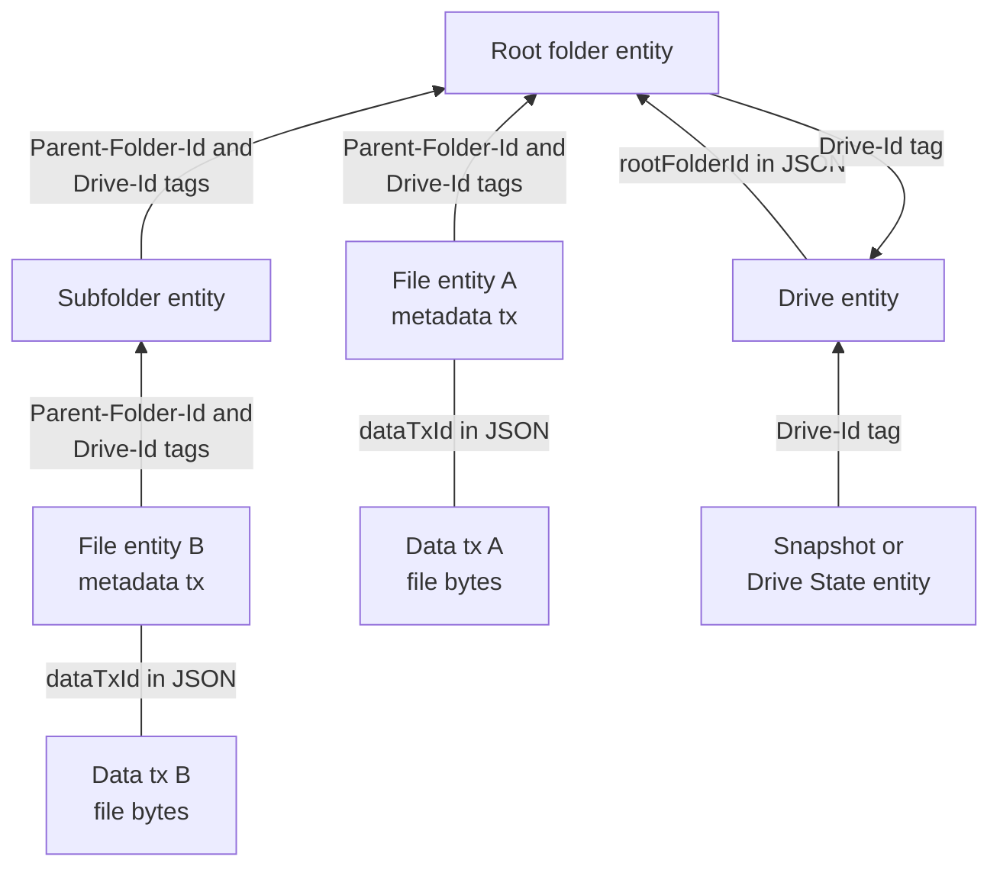

Because of Arweave's permanent and immutable nature, you cannot rename or move a file or folder by changing data already on chain. ArFS instead defines an append-only data model built on the metadata tags in Arweave [Transaction Headers.](https://docs.arweave.org/developers/server/http-api#transaction-format)

References point from the bottom up, which avoids race conditions when two updates land together. Each file and folder names its parent folder and its drive. A top-down model would make each parent, such as a folder, store a list of its children.

From these entities a client builds a drive that looks and works like a file system:

- Drive Entities contain folders and files
- Folder Entities contain other folders or files
- File Entities contain both the file data and metadata
- Snapshot entities contain a rollup of the metadata of a drive's entities over a block range
- Drive State entities contain a drive's whole parsed state, up to a block height, as one SQLite database

## Entity Relationships

The following diagram shows each link between entities and where it is stored. Each entity type's full tag list is in [Entity Types](/build/advanced/arfs/entity-types).



Every folder and file carries a `Drive-Id` tag. Every one except the root folder also carries a `Parent-Folder-Id` tag, which is how a client recognizes the root folder. The drive's metadata JSON names only its root folder (`rootFolderId`), so clients build the rest of the drive from the bottom up. Snapshot and Drive State entities are optional caches of the drive's metadata.

## Metadata Format

Metadata stored in a transaction tag is written like this:

```json
{ "name": "Example-Tag", "value": "example-data" }
```

Metadata stored in the transaction's data is JSON:

```json
{
  "exampleField": "exampleData"
}
```

Fields with a `?` suffix are optional.

```json
{
  "name": "My Project",
  "description": "This is a sample project.",
  "version?": "1.0.0",
  "author?": "John Doe"
}
```

A field that allows only certain values lists them as "value 1 | value 2".

Every entity ID is a UUID, as defined by the [Universally Unique Identifier](https://en.wikipedia.org/wiki/Universally_unique_identifier) standard.

ArFS tags can appear in any order.

## Building a drive's current state

A client rebuilds a drive by reading all its entities, keeping the latest revision of each, and following each `Parent-Folder-Id` to build the folder tree. A [Drive State](/build/advanced/arfs/entity-types#drive-state) entity or [snapshots](/build/advanced/arfs/entity-types#snapshot) let it skip most of that work. [Reading data](/build/advanced/arfs/reading-data#building-a-drives-current-state) has the steps.

## Entity Lifecycle

Each ArFS entity goes through the same lifecycle:

### Creation

1. Generate unique UUID for entity
2. For files: create the data transaction first, because the file's metadata JSON records its ID as `dataTxId`
3. Create the metadata transaction with the required tags
4. Upload to Arweave network

### Updates

1. Create new entity with same ID
2. Update metadata as needed
3. Upload new transaction
4. Client processes both versions and uses latest

### Hiding

1. Mark entity as hidden (`isHidden: true`)
2. Upload new transaction
3. Entity remains in history but hidden from UI

Nothing is deleted, because Arweave transactions cannot change. Every earlier revision stays on Arweave, and the entity reappears if a later revision sets `isHidden: false`.

## Data Integrity

ArFS keeps data intact through:

- **Immutable transactions** - Once uploaded, data cannot be modified
- **Cryptographic signatures** - All transactions are signed by the owner
- **Version tracking** - Multiple versions of entities can exist
- **Conflict resolution** - Clients use block height and timestamps to resolve conflicts

## Next Steps

Now that you understand the ArFS data model, learn how to work with it:

- [Privacy & Encryption](/build/advanced/arfs/privacy) - Secure your data with private drives
- [Creating Drives](/build/advanced/arfs/creating-drives) - Start building with ArFS
- [Reading Data](/build/advanced/arfs/reading-data) - Query and retrieve your data
