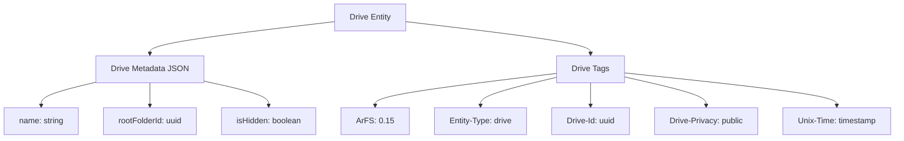
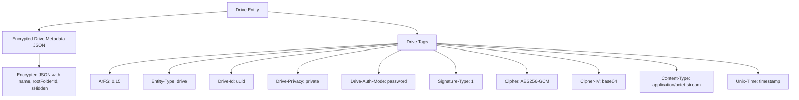

## Overview

Arweave transactions provide for a separation between data and metadata about that data via the use of headers. Key-value tags in the headers provide for expressive description about the data as well as searchability via gateway GraphQL APIs.

ArFS adds an additional layer of separation between data and metadata by using separate transactions for ArFS metadata and, where applicable, ArFS file data. But it also makes use of tags and data separation within an ArFS metadata transaction by including data critical to tracking drive composition in the tags space of ArFS metadata transactions and having most of the other metadata encoded as JSON in the data body of the metadata transaction. In the case of private entities, JSON data and file data payloads are always encrypted according to the protocol processes defined below.

- Drive entities require a single metadata transaction, with standard Drive tags and encoded JSON with secondary metadata.

- Folder entities require a single metadata transaction, with standard Folder tags and an encoded JSON with secondary metadata.

- File entities require a metadata transaction, with standard File tags and an encoded Data JSON with secondary metadata relating to the file.

- File entities also require a second data transaction, which includes a limited set of File tags and the actual file data itself.

- Snapshot entities require a single transaction, which contains a Data JSON with all of the Drive's rolled up ArFS metadata and standard Snapshot GQL tags that identify the Snapshot.

- Drive State entities require a single transaction, which contains a SQLite database of the Drive's parsed state and standard Drive State GQL tags that identify it.

ArFS v0.14 introduces the `isHidden` property. `isHidden` is a boolean (true/false) that tells clients if they should display the file or folder. Hidden files still exist and are included in [snapshots](#snapshot) and [Drive State](#drive-state) entities, but should not be rendered by clients. If `isHidden` is not present, its value should be assumed false.

ArFS v0.15 introduces the `Signature-Type` metadata property on Drive entities, and a new entity type `DriveSignature`.

## Drive

A drive is the highest level logical grouping of folders and files. All folders and files must be part of a drive, and reference the Drive ID of that drive.

When creating a Drive, a corresponding "root" folder must be created as well. This separation of drive and folder entity enables features such as folder view queries, renaming, and linking.

```json
ArFS: "0.15",
Cipher?: "AES256-GCM",
Cipher-IV?: "<12 byte initialization vector as Base64>",
Content-Type: "<application/json | application/octet-stream>",
Drive-Id: "<uuid>",
Drive-Privacy: "<public | private>",
Drive-Auth-Mode?: "password",
Entity-Type: "drive",
Signature-Type?: "1",
Unix-Time: "<seconds since unix epoch>"

Metadata JSON {
    "name": "<user defined drive name>",
    "rootFolderId": "<uuid of the drive root folder>",
    "isHidden": false
}
```

## Drive-Signature

ArFS versions prior to v0.15 applied encryption to drive contents with a signing scheme that, while secure, is now deprecated in modern Arweave software wallets. ArFS v0.15 introduces an updated signing scheme compatible with these wallets and as well as "Drive Signatures", a new entity type to help bridge the signature derivation schemes across ArFS versions.

A drive signature uses the v0.15 encryption scheme to encrypt and store the pre-v0.15 wallet signature for a private drive that is necessary for deriving the "drive key" for that drive. This allows for continued access of historical drive contents into the future.

```json
ArFS: "0.15",
Entity-Type: "drive-signature",
Drive-Id: "<uuid of the drive this signature unlocks>",
Signature-Format: "1",
Cipher: "AES256-GCM",
Cipher-IV: "<12 byte initialization vector as Base64>"
{data: <Encrypted type 1 signature>}
```

The encrypted "type 1" signature for the drive must be provided in the `data` field of the transaction creating the drive-signature entity.

## Folder

A folder is a logical grouping of other folders and files. Folder entity metadata transactions without a parent folder id are considered the Drive Root Folder of their corresponding Drives. All other Folder entities must have a parent folder id. Since folders do not have underlying data, there is no Folder data transaction required.

```json
ArFS: "0.15",
Cipher?: "AES256-GCM",
Cipher-IV?: "<12 byte initialization vector as Base64>",
Content-Type: "<application/json | application/octet-stream>",
Drive-Id: "<drive uuid>",
Entity-Type: "folder",
Folder-Id: "<uuid>",
Parent-Folder-Id?: "<parent folder uuid>",
Unix-Time: "<seconds since unix epoch>"

Metadata JSON {
    "name": "<user defined folder name>",
    "isHidden": false
}
```

## File

A File contains uploaded data, like a photo, document, or movie.

In the Arweave File System, a single file is broken into 2 parts - its metadata and its data.

A File entity metadata transaction does not include the actual File data. Instead, the File data must be uploaded as a separate transaction, called the File Data Transaction. The File JSON metadata transaction contains a reference to the File Data Transaction ID so that it can retrieve the actual data. This separation allows for file metadata to be updated without requiring the file itself to be reuploaded. It also ensures that private files can have their JSON Metadata Transaction encrypted as well, ensuring that no one without authorization can see either the file or its metadata.

```json
ArFS: "0.15",
Cipher?: "AES256-GCM",
Cipher-IV?: "<12 byte initialization vector as Base64>",
Content-Type: "<application/json | application/octet-stream>",
Drive-Id: "<drive uuid>",
Entity-Type: "file",
File-Id: "<uuid>",
Parent-Folder-Id: "<parent folder uuid>",
Unix-Time: "<seconds since unix epoch>"

Metadata JSON {
    "name": "<user defined file name with extension eg. happyBirthday.jpg>",
    "size": <computed file size - int>,
    "lastModifiedDate": <timestamp for OS reported time of file's last modified date represented as milliseconds since unix epoch - int>,
    "dataTxId": "<transaction id of stored data>",
    "dataContentType": "<the mime type of the data associated with this file entity>",
    "isHidden": false,
    "pinnedDataOwner": "<the address of the original owner of the data where the file is pointing to>", # Optional
}
```

### Pinning Files

Since the version v0.13, ArFS supports Pins. Pins are files whose data may be any transaction uploaded to Arweave, that may or may not be owned by the wallet that created the pin.

When a new File Pin is created, the only created transaction is the Metadata Transaction. The `dataTxId` field will point it to any transaction in Arweave, and the optional `pinnedDataOwner` field is gonna hold the address of the wallet that owns the original copy of the data transaction.

### File Data Transaction Example

The File Data Transaction contains limited information about the file, such as the information required to decrypt it, or the Content-Type (mime-type) needed to view in the browser.

```json
Cipher?: "AES256-GCM",
Cipher-IV?: "<12 byte initialization vector as Base64>",
Content-Type: "<file mime-type | application/octet-stream>",
 { File Data - Encrypted if private }
```

### File Metadata Transaction Example

The File Metadata Transaction contains the GQL Tags necessary to identify the file within a drive and folder.

Its data contains the JSON metadata for the file. This includes the file name, size, last modified date, data transaction id, and data content type.

```json
ArFS: "0.15",
Cipher?: "AES256-GCM",
Cipher-IV?: "<12 byte initialization vector as Base64>",
Content-Type: "<application/json | application/octet-stream>",
Drive-Id: "<drive uuid>",
Entity-Type: "file",
File-Id: "<uuid>",
Parent-Folder-Id: "<parent folder uuid>",
Unix-Time: "<seconds since unix epoch>",
 { File JSON Metadata - Encrypted if private }
```

## Snapshot

ArFS applications generate the latest state of a drive by querying for all ArFS transactions made relating to a user's particular `Drive-Id`. This includes both paged queries for indexed ArFS data via GQL, as well as the ArFS JSON metadata entries for each ArFS transaction.

For small drives (less than 1000 files), a few thousand requests for very small volumes of data can be achieved relatively quickly and reliably. For larger drives, however, this results in long sync times to pull every piece of ArFS metadata when the local database cache is empty. This can also potentially trigger rate-limiting related ArWeave Gateway delays.

Once a drive state has been completely, and accurately generated, in can be rolled up into a single snapshot and uploaded as an Arweave transaction. ArFS clients can use GQL to find and retrieve this snapshot in order to rapidly reconstitute the total state of the drive, or a large portion of it. They can then query individual transactions performed after the snapshot.

This optional method offers convenience and resource efficiency when building the drive state, at the cost of paying for uploading the snapshot data. Using this method means a client will only have to iterate through a few snapshots instead of every transaction performed on the drive.

### Snapshot Entity Tags

Snapshot entities require the following tags. These are queried by ArFS clients to find drive snapshots, organize them together with any other transactions not included within them, and build the latest state of the drive.

```json
ArFS: "0.15",
Drive-Id: "<drive uuid that this snapshot is associated with>",
Entity-Type: "snapshot",
Snapshot-Id: "<uuid of this snapshot entity>",
Content-Type: "<application/json>",
Block-Start: "<the minimum block height from which transactions were searched for in this snapshot, eg. 0>",
Block-End: "<the maximum block height from which transactions were searched for in this snapshot, eg 1007568>",
Data-Start: "<the first block in which transaction data was found in this snapshot, eg 854300",
Data-End: "<the last block in which transaction was found in this snapshot, eg 1001671",
Unix-Time: "<seconds since unix epoch>"
```

### Snapshot Entity Data

A JSON data object must also be uploaded with every ArFS Snapshot entity. This data contains all ArFS Drive, Folder, and File metadata changes within the associated drive, as well as any previous Snapshots. The Snapshot Data contains an array `txSnapshots`. Each item includes both the GQL and ArFS metadata details of each transaction made for the associated drive, within the snapshot's start and end period.

Each `txSnapshot` has exactly two fields, `gqlNode` and `jsonMetadata`, as siblings.

`gqlNode` uses the same GQL tags interface returned by the Arweave Gateway. It includes all of the important `block`, `owner`, `tags`, and `bundledIn` information needed by ArFS clients.

`jsonMetadata` is a **string**, not an object: the correlated Data JSON for that ArFS entity, serialized and escaped. It is `null` for an entry recorded for its GQL node alone, with no metadata body — a client must handle that rather than assume a string is always present.

For private drives, `jsonMetadata` contains the JSON-string-escaped encrypted text of the associated file or folder. This encrypted text uses the file's existing `Cipher` and `Cipher-IV`. This ensures clients can decrypt this information quickly using the existing ArFS privacy protocols.

```json
{
  "txSnapshots": [
    {
      "gqlNode": {
        "id": "bWCvIc3cOzwVgquD349HUVsn5Dd1_GIri8Dglok41Vg",
        "owner": {
          "address": "hlWRbyJ6WUoErm3b0wqVgd1l3LTgaQeLBhB36v2HxgY"
        },
        "bundledIn": {
          "id": "39n5evzP1Ip9MhGytuFm7F3TDaozwHuVUbS55My-MBk"
        },
        "block": {
          "height": 1062005,
          "timestamp": 1669053791
        },
        "tags": [
          {
            "name": "Content-Type",
            "value": "application/json"
          },
          {
            "name": "ArFS",
            "value": "0.11"
          },
          {
            "name": "Entity-Type",
            "value": "drive"
          },
          {
            "name": "Drive-Id",
            "value": "f27abc4b-ed6f-4108-a9f5-e545fc4ff55b"
          },
          {
            "name": "Drive-Privacy",
            "value": "public"
          },
          {
            "name": "App-Name",
            "value": "ArDrive-App"
          },
          {
            "name": "App-Platform",
            "value": "Web"
          },
          {
            "name": "App-Version",
            "value": "1.39.0"
          },
          {
            "name": "Unix-Time",
            "value": "1669053323"
          }
        ]
      },
      "jsonMetadata": "{\"name\":\"november\",\"rootFolderId\":\"71dfc1cb-5368-4323-972a-e9dd0b1c63a0\", \"isHidden\":false}"
    }
  ]
}
```

## Drive State

A Drive State entity holds a drive's whole parsed state, up to a block height, in one SQLite database. The drive's owner publishes it. A client that finds one imports the drive in one step and then queries only the blocks after it, instead of fetching and replaying every entity in the drive.

A Drive State entity is a cache. A client that finds none, cannot read one, or refuses one for any reason syncs the drive from snapshots and GQL as it would without it. A Drive State entity that cannot be used must never cause a drive to fail to load.

The following table shows how a Drive State entity differs from a [Snapshot](#snapshot):

| | Snapshot | Drive State |
| --- | --- | --- |
| Data | JSON: each transaction's GQL node and JSON metadata | A SQLite database of the drive's rows |
| Range | Any block range; several snapshots combine | Always from block 0, so each one is a complete copy |
| Private drives | Each entry's metadata is encrypted on its own; the GQL nodes are in the clear | One ciphertext under the drive key |
| Checking against chain | Each entry carries its GQL node | Rows carry no GQL node; trust rests on the owner |

Drive State is its own `Entity-Type` so that clients written before it never query for it. A client that read one as a snapshot would trust its block range and find no transactions in it, so it would skip those blocks for good.

### Drive State Entity Tags

Drive State entities require the following tags. `Cipher` and `Cipher-IV` are present on a private drive's entity only.

```json
ArFS: "0.15",
Drive-Id: "<drive uuid that this drive state belongs to>",
Entity-Type: "drive-state",
Drive-State-Id: "<uuid of this drive state entity>",
State-Version: "<format version as major.minor, eg 0.2>",
Content-Type: "application/octet-stream",
Block-Start: "0",
Block-End: "<the highest block height the producer had synced, eg 2021868>",
Data-Start: "<0, or -1 when the data holds only the drive row>",
Data-End: "<the Block-End value, or -1 when the data holds only the drive row>",
Entity-Count: "<the number of entities in the data, eg 792>",
Unix-Time: "<seconds since unix epoch>",
Cipher: "AES256-GCM",
Cipher-IV: "<12 byte initialization vector as base64url>"
```

A reader checks every tag against the data before trusting it, because a gateway reports tags and the gateway is not trusted:

- **`Cipher` and `Cipher-IV`** are both present on a private drive's entity and both absent on a public drive's. There is no `Cipher: "none"`. An entity with one and not the other is malformed. A reader refuses an entity whose cipher tags contradict the privacy of the drive it names, in either direction. `Cipher-IV` is base64url without padding, and readers also accept standard base64.
- **`Block-Start` and `Block-End`** must equal `blockStart` and `blockEnd` in the data's `meta` table. A `Block-End` higher than the data covers would move a reader's sync position past blocks it never read, and the entities in them would never appear.
- **`Data-Start` and `Data-End`** are `0` and the `Block-End` value when the data holds any folder or file, and `-1` when it holds only the drive row. The rows carry dates rather than block heights, so the claim is the whole range they account for.
- **`Entity-Count`** counts the drive, its folders and its files, not their revisions. It must equal `meta.entityCount` and the rows imported.
- **`State-Version`** must equal `meta.version`. From `1.0`, a reader accepts any minor version of its own major version and refuses any other major version. Below `1.0`, a reader requires an exact match, because a `0.x` format makes no compatibility promise. A version that does not parse as two integers, such as `1` or `1.0.0`, is malformed.
- **Never set `Content-Encoding`** on a Drive State entity. Gateways index that tag and send it on the data response, so an HTTP client decodes the body before the reader can bound it, and a browser fails on the ciphertext of a private drive. Tags cannot be changed, so an entity with the tag stays unreadable through ordinary data requests.

### Drive State Entity Data

The data is a SQLite database file, sealed in this order:

| Drive | Sealing steps |
| --- | --- |
| Public | SQLite file, then gzip (optional) |
| Private | SQLite file, then gzip (optional), then AES256-GCM with the drive key |

For a private drive the key is the drive key itself, as for drive metadata. The data is the ciphertext followed by the 16-byte GCM authentication tag, and the 12-byte nonce is the `Cipher-IV` tag.

A producer chooses whether to gzip each entity, and no tag records the choice. After decrypting, a reader tells the two apart by the first bytes:

- `1f 8b`: a gzip stream, which the reader inflates.
- `SQLite format 3` followed by a zero byte: an uncompressed SQLite file.
- Anything else: refused.

A reader limits the inflated size to 100 MiB (104,857,600 bytes) and stops at the first byte over it, while inflating rather than afterwards. The size recorded in the gzip trailer is chosen by whoever wrote the stream, so it is not the limit. A producer must not publish a database larger than the limit.

**The database.** Its header carries `application_id` `0x41724453` (`ArDS` in ASCII). Apart from SQLite's own `sqlite_` objects, a `State-Version` `0.2` database contains exactly the following nine tables and nothing else: no indexes, views, triggers or virtual tables. A reader compares each table's `sql` value in `sqlite_master` with these strings byte for byte and refuses any difference, so that no SQL written by someone else runs inside the reader:

```sql
CREATE TABLE meta (version TEXT NOT NULL, driveId TEXT NOT NULL, ownerAddress TEXT NOT NULL, privacy TEXT NOT NULL, blockStart INTEGER NOT NULL, blockEnd INTEGER NOT NULL, entityCount INTEGER NOT NULL, producer TEXT NOT NULL)
CREATE TABLE drives (id TEXT NOT NULL, rootFolderId TEXT NOT NULL, ownerAddress TEXT NOT NULL, name TEXT NOT NULL, privacy TEXT NOT NULL, bundledIn TEXT, customJsonMetadata TEXT, customGQLTags TEXT, isHidden INTEGER NOT NULL, signatureType TEXT, dateCreated INTEGER NOT NULL, lastUpdated INTEGER NOT NULL)
CREATE TABLE folder_entries (id TEXT NOT NULL, driveId TEXT NOT NULL, name TEXT NOT NULL, parentFolderId TEXT, dateCreated INTEGER NOT NULL, lastUpdated INTEGER NOT NULL, customJsonMetadata TEXT, customGQLTags TEXT, isHidden INTEGER NOT NULL)
CREATE TABLE file_entries (id TEXT NOT NULL, driveId TEXT NOT NULL, name TEXT NOT NULL, parentFolderId TEXT NOT NULL, size INTEGER NOT NULL, lastModifiedDate INTEGER NOT NULL, dataContentType TEXT, dataTxId TEXT NOT NULL, licenseTxId TEXT, bundledIn TEXT, thumbnail TEXT, pinnedDataOwnerAddress TEXT, customJsonMetadata TEXT, customGQLTags TEXT, isHidden INTEGER NOT NULL, dateCreated INTEGER NOT NULL, lastUpdated INTEGER NOT NULL, assignedNames TEXT, fallbackTxId TEXT, originalOwner TEXT, importSource TEXT)
CREATE TABLE drive_revisions (driveId TEXT NOT NULL, rootFolderId TEXT NOT NULL, ownerAddress TEXT NOT NULL, name TEXT NOT NULL, privacy TEXT NOT NULL, metadataTxId TEXT NOT NULL, dateCreated INTEGER NOT NULL, action TEXT NOT NULL, bundledIn TEXT, customJsonMetadata TEXT, customGQLTags TEXT, isHidden INTEGER NOT NULL)
CREATE TABLE folder_revisions (folderId TEXT NOT NULL, driveId TEXT NOT NULL, name TEXT NOT NULL, parentFolderId TEXT, metadataTxId TEXT NOT NULL, dateCreated INTEGER NOT NULL, action TEXT NOT NULL, customJsonMetadata TEXT, customGQLTags TEXT, isHidden INTEGER NOT NULL)
CREATE TABLE file_revisions (fileId TEXT NOT NULL, driveId TEXT NOT NULL, name TEXT NOT NULL, parentFolderId TEXT NOT NULL, size INTEGER NOT NULL, lastModifiedDate INTEGER NOT NULL, dataContentType TEXT, metadataTxId TEXT NOT NULL, dataTxId TEXT NOT NULL, licenseTxId TEXT, thumbnail TEXT, bundledIn TEXT, dateCreated INTEGER NOT NULL, customJsonMetadata TEXT, customGQLTags TEXT, action TEXT NOT NULL, pinnedDataOwnerAddress TEXT, isHidden INTEGER NOT NULL, assignedNames TEXT, fallbackTxId TEXT, originalOwner TEXT, importSource TEXT)
CREATE TABLE licenses (fileId TEXT NOT NULL, driveId TEXT NOT NULL, dataTxId TEXT NOT NULL, licenseTxType TEXT NOT NULL, licenseTxId TEXT NOT NULL, bundledIn TEXT, dateCreated INTEGER NOT NULL, licenseType TEXT NOT NULL, customGQLTags TEXT)
CREATE TABLE transaction_statuses (id TEXT NOT NULL, status TEXT NOT NULL)
```

Every table must be present. `meta` and `drives` hold exactly one row each, and any other table may be empty. A table that is present and empty says that the drive has no such rows, except `licenses`.

The rows mirror the drive's ArFS metadata:

- Each `*_revisions` row is one metadata transaction of the drive, the folder or the file, and every revision travels, not only the newest. Each `*_entries` row is the latest state of one folder or file.
- `meta` names the format `version`, the `driveId`, the drive's `ownerAddress` and `privacy`, the `blockStart` to `blockEnd` range the rows account for, the `entityCount`, and the `producer` that built the file as `<App-Name>/<App-Version>`. On a private drive the `producer` value is encrypted with everything else, so a reader can trust it more than the `App-Version` tag.
- Dates (`dateCreated`, `lastUpdated`, `lastModifiedDate`) are Unix time in seconds. `isHidden` is `0` or `1`. `privacy` is `public` or `private`.
- `customJsonMetadata` holds the metadata JSON fields an entity carries beyond the ones ArFS defines, as a JSON object, such as `{"department":"finance"}`. `customGQLTags` holds the tags it carries beyond the ones ArFS defines, as a JSON array of `{"name": ..., "value": ...}` objects in the order they appear on the transaction. Either can be `NULL`, `{}` or `[]` when there are none.
- `thumbnail` holds the file's `thumbnail` metadata as JSON, such as `{"variants":[{"name":"thumbnail","txId":"...","size":2048,"width":256,"height":256}]}`, or `NULL`. `assignedNames` holds the file's ArNS names as `{"assignedNames":["name"]}`, or `NULL`.
- A revision's `dateCreated` is its metadata transaction's `Unix-Time`. An entry's `dateCreated` is its oldest revision's, and its `lastUpdated` is its newest revision's.
- `licenses` holds the details of the licences the producer had already read, and can be partial or empty for a drive with licensed files. A file's licence is the `licenseTxId` on its file rows. A reader that has no `licenses` row for that ID reads the licence transaction itself. `licenseTxType` is `composed` when the licence tags are on the file's data transaction, or `assertion` when a separate transaction asserts the licence.
- `action` records what a revision did, such as `create`, `rename`, `move` or `hide`. It is informational.
- `transaction_statuses` lists the transactions the rows reference that the producer had not seen confirmed, with the status it held: `pending` or `failed`. A reader treats every other transaction the rows reference as confirmed. It re-checks a listed file data transaction, and shows any other listed transaction as failed. Any other transaction listed as `pending`, such as a metadata or licence transaction, makes the entity malformed.

A producer follows these rules:

- **Publish only from a complete sync.** If the producer's last sync of the drive skipped any entity, the gap would be published as permanent.
- **Read `Block-End` before reading the rows.** Rows can then only be newer than the claim, never older.
- **Wait while the drive's metadata transactions are unconfirmed**, rather than publishing them as pending.
- **Publish only rows a revision vouches for.** A placeholder a client made for a folder whose metadata it never found must not travel.
- **Build up, never tear down.** Select named columns into an empty database. Copying a database and deleting from it can leave deleted bytes in the file.
- **Never include key material** or the producer's own sync position.

## Schema Diagrams

The following diagrams show complete examples of Drive, Folder, and File entity Schemas.

### Public Drive



### Private Drive



## Next Steps

Now that you understand the different ArFS entity types, explore how they work together:

- [Data Model](/build/advanced/arfs/data-model) - Learn how entities relate to each other
- [Privacy & Encryption](/build/advanced/arfs/privacy) - Understand how private entities work
- [Creating Drives](/build/advanced/arfs/creating-drives) - Start building with ArFS
