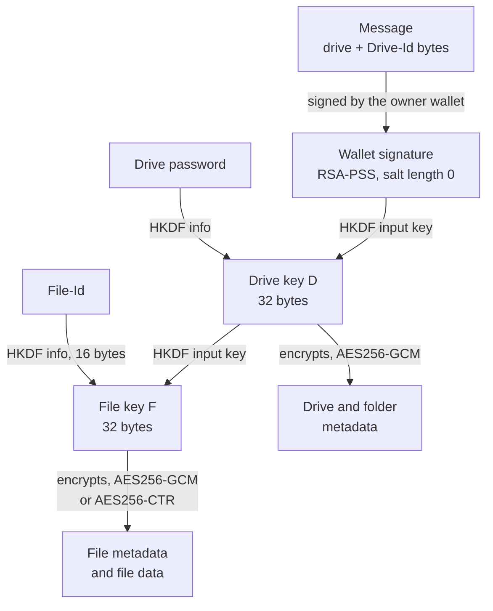
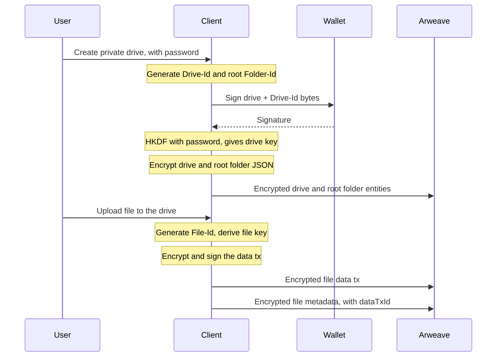

Everything on Arweave is public. Apps that use ArFS, such as ArDrive, encrypt private data on your computer before it is uploaded, with AES-256 (which is [quantum resistant](https://blog.boot.dev/cryptography/is-aes-256-quantum-resistant/#:~:text=Symmetric%20encryption%2C%20or%20more%20specifically,key%20sizes%20are%20large%20enough)). Privacy is set per drive: you choose public or private when you create the drive.

With ArDrive specifically, every file within a Private Drive is symmetrically encrypted using [AES-256-GCM](https://iopscience.iop.org/article/10.1088/1742-6596/1019/1/012008/pdf) (for metadata and for files under 100 MiB) or [AES-256-CTR](https://xilinx.github.io/Vitis_Libraries/security/2020.1/guide_L1/internals/ctr.html) (for files of 100 MiB or more). Every Private drive has a top-level "Drive Key" which uses a combination of the user's Arweave wallet signature, a user defined drive password, and a unique drive identifier ([uuidv4](https://en.wikipedia.org/wiki/Universally_unique_identifier)). Each file has its own "File Key" derived from the "Drive Key". This allows for single files to be shared without exposing access to the other files within the Drive.

Once a file is encrypted and stored on Arweave, it is locked forever and can only be decrypted using its file key.

ArFS does not limit you to AES-256-GCM or AES-256-CTR. A client can use any cipher, as long as the `Cipher` tag names it.

## Deriving Keys

Private drives have a global drive key, `D`, and multiple file keys `F`, for encryption. This enables a drive to have as many uniquely encrypted files as needed. One key is used for all versions of a single file (since new file versions use the same File-Id)

`D` is used for encrypting both Drive and Folder metadata, while `F` is used for encrypting File metadata and the actual stored data. Having these different keys, `D` and `F`, allows a user to share specific files without revealing the contents of their entire drive.

`D` is derived from a wallet signature and the drive password:

- The owner's wallet signs a message made of the UTF-8 bytes of `drive` followed by the 16 bytes of the `Drive-Id` UUID. The signature is RSA-PSS with SHA-256 and a salt length of 0, so the wallet produces the same signature each time it signs for that drive.
- HKDF-SHA256, with no salt, takes that signature as its input key material and the UTF-8 password as its `info`, and outputs the 32-byte drive key.

`F` is derived with HKDF-SHA256 too, taking the drive key as its input key material and the 16 bytes of the `File-Id` UUID as its `info`, and outputs a 32-byte file key.



### Signature types

The `Signature-Type` tag on a private drive says how the wallet produced the signature. Both types sign the same message.

| `Signature-Type` | How the wallet signs | Wallet API |
| --- | --- | --- |
| `1`, or no tag | Signs the message directly | `signature()`, which Wander is deprecating |
| `2` | Signs an ANS-104 data item whose data is the message and whose one tag is `Action: Drive-Signature-V2`, and the client keeps the data item's signature | `signDataItem()` |

New private drives use type `2`. A type `1` drive stays type `1`, because its drive key cannot change. [Upgrading Private Drives](/build/advanced/arfs/upgrading-drives) covers how such a drive stays readable once wallets drop `signature()`.

Browser wallets such as [Wander](https://www.wander.app/), formerly ArConnect, take part in this protocol only by producing the signature. The client runs HKDF itself.

An example implementation, using Dart, is available [here](https://github.com/ardriveapp/ardrive-web/blob/187b3fb30808bda452123c2b18931c898df6a3fb/docs/private_drive_kdf_reference.dart), with a Typescript implementation [here](https://github.com/ardriveapp/ardrive-core-js/blob/master/src/utils/crypto.ts).

## Private Drives

Drives can store either public or private data. This is indicated by the `Drive-Privacy` tag in the Drive entity metadata.

```
Drive-Privacy: "<public | private>"
```

If a Drive entity is private, an additional tag `Drive-Auth-Mode` must also be used to indicate how the Drive Key is derived. ArDrive clients currently use a secure password along with the Arweave Wallet private key signature to derive the global Drive Key.

```
Drive-Auth-Mode?: 'password'
```

Every encrypted drive entity must carry a `Cipher` tag naming the cipher, plus a `Cipher-*` tag for each public parameter needed to decrypt it, such as `Cipher-IV`. A parameter that is bytes is written in the tag as Base64. Drive metadata uses AES256-GCM with an initialization vector (IV) of 12 random bytes:

```
Cipher?: "AES256-GCM"
Cipher-IV?: "<12 byte initialization vector as Base64>"
```

Additionally, all encrypted transactions must have the `Content-Type` tag `application/octet-stream` as opposed to `application/json`

Private Drive Entities and their corresponding Root Folder Entities will both use these keys and ciphers generated to symmetrically encrypt the JSON files that are included in the transaction. This ensures that only the Drive Owner (and whomever the keys have been shared with) can open the drive, discover the root folder, and continue to load the rest of the children in the drive.

## Private Files

When a file is uploaded to a private drive, it by default also becomes private and uses the same drive keys used for its parent drive. Each file in a drive gets its own file key, derived from its `File-Id`.

These file keys can be shared by the drive's owner as needed.

A private file's metadata and data transactions are both encrypted with its file key, and each carries its own `Cipher` and `Cipher-IV` tags. The metadata transaction always uses AES256-GCM; the data transaction uses AES256-CTR when the file is 100 MiB or more:

```
Cipher?: "AES256-GCM | AES256-CTR"
Cipher-IV?: "<12 byte initialization vector as Base64>"
```

Just like drives, private files must have the `Content-Type` tag set as `application/octet-stream` in both its metadata and data transactions:

```
Content-Type: "application/octet-stream"
```

## Encryption Process

The following diagram shows the client creating a private drive and then uploading a file to it:



The client signs the data transaction before it builds the file's metadata, because the metadata JSON records the data transaction's ID as `dataTxId`. Signing fixes that ID, so the client need not wait for the data upload to finish.

## Drive State and Snapshots of Private Drives

A private drive's [Drive State](/build/advanced/arfs/entity-types#drive-state) entity is encrypted as one unit with the drive key, using AES256-GCM. It has no key of its own, so anyone with the drive key can read it, and a shared file key cannot. Its tags show the drive, the block range and the number of entities, and the transaction shows the size of the data. None of them show names or structure.

A public drive's Drive State entity is not encrypted and carries neither `Cipher` nor `Cipher-IV`. A producer must never publish a private drive's state without encryption, and a reader refuses any Drive State entity whose cipher tags contradict the privacy of the drive it names, in either direction.

A [Snapshot](/build/advanced/arfs/entity-types#snapshot) of a private drive works differently. It encrypts each entry's JSON metadata on its own, but carries each entry's GQL node, with all of that entity's tags, in the clear. The same tags are public on the entities themselves; a snapshot gathers all of them in one place.

## Security Best Practices

When working with private drives, follow these security guidelines:

### Password Management

- Use strong, unique passwords for each drive
- Consider using a password manager
- Never share passwords in plain text

### Key Storage

- Never store drive keys in plain text
- Use secure key derivation functions
- Implement proper key rotation if needed

### Access Control

- Share file keys only with authorized users
- Implement proper access logging
- Regularly audit drive access

### Data Handling

- Encrypt data before transmission
- Use secure communication channels
- Implement proper error handling

## Drive Signature (ArFS v0.15)

ArFS v0.15 introduces a new `Drive-Signature` entity type to help bridge signature derivation schemes across ArFS versions. This is particularly important for maintaining access to private drives created with older wallet signing methods.

The drive signature entity stores an encrypted version of the pre-v0.15 wallet signature that's necessary for deriving the drive key. This allows continued access to historical drive contents while using modern wallet signing APIs.

A client writes the entity once, when the owner upgrades the drive:

1. The wallet makes the type `1` signature for the drive, and the client checks that it, with the password, reproduces the drive key the client already holds.
2. The wallet makes the type `2` signature for the same drive, twice, and the client checks that both match. A reader always signs afresh, so a wallet whose type `2` signature varies would write an entity no one can open.
3. The client derives a type `2` drive key from that signature and the same password, and encrypts the type `1` signature with it, using AES256-GCM.
4. The client uploads a `drive-signature` entity carrying the encrypted signature, with `Drive-Id`, `Signature-Format: 1`, `Cipher` and `Cipher-IV` tags.

A client reading a type `1` drive afterwards:

1. Finds the owner's newest `drive-signature` entity for the `Drive-Id`.
2. Derives the type `2` drive key from a fresh type `2` signature and the password, and decrypts the stored type `1` signature with it.
3. Derives the drive key from the stored type `1` signature and the password, as for any type `1` drive.

If no `drive-signature` entity exists, the client falls back to asking the wallet for a type `1` signature.

## Next Steps

Ready to implement privacy in your ArFS applications?

- [Creating Private Drives](/build/advanced/arfs/creating-drives) - Learn how to create secure drives
- [Upgrading Private Drives](/build/advanced/arfs/upgrading-drives) - Update legacy drives to v0.15
- [Reading Data](/build/advanced/arfs/reading-data) - Query and decrypt your private data
