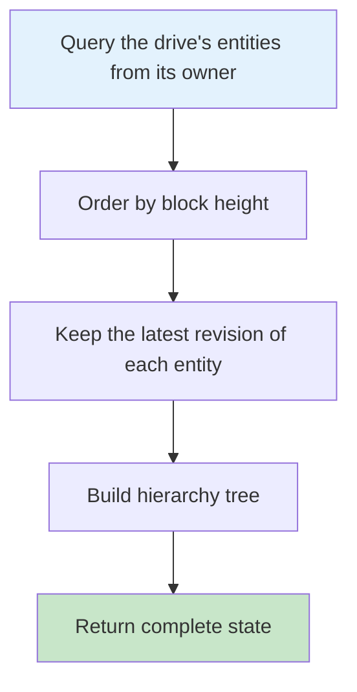
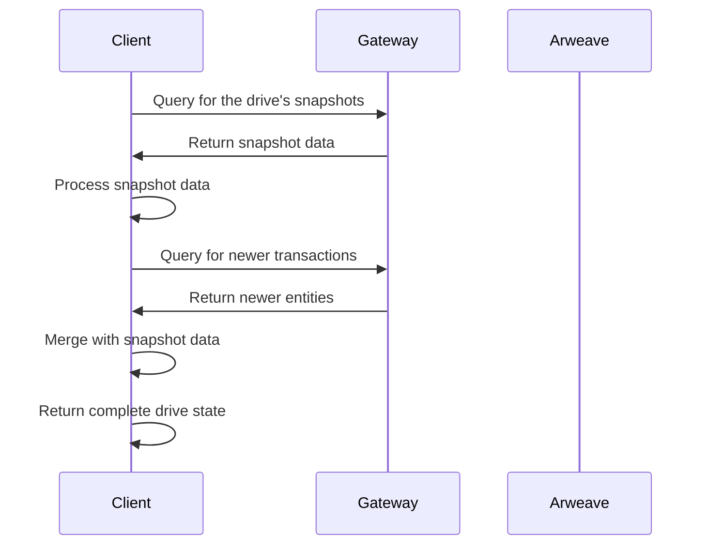

Clients can perform read operations to create a timeline of entity write transactions which can then be replayed to construct the Drive state. This is done by querying an Arweave GraphQL index for the user's respective transactions. [Arweave GraphQL Guide](https://gql-guide.vercel.app/) can provide more information on how to use Arweave GraphQL. If no GraphQL index is available, drive state can only be generated by downloading and inspecting all transactions made by the user's wallet.

This timeline of transactions should be grouped by the block number of each transaction. At every step of the timeline, the client can check if the entity was written by an authorized user. This also conveniently enables the client to surface a trusted entity version history to the user.

To determine the owner of a Drive, clients must check for who created the first Drive Entity transaction using that `Drive-Id`. Until a trusted permissions or ACL system is put in place, any transaction in a drive created by any wallet other than the one who created the first Drive Entity transaction could be considered spam.

The `Unix-Time` defined on each transaction should be reserved for tie-breaking same entity updates in the same block and should not be trusted as the source of truth for entity write ordering. This is unimportant for single owner drives but is crucial for multi-owner drives with updateable permissions (currently undefined in this spec) as a malicious user could fake the `Unix-Time` to modify the drive timeline for other users.

- Drives that have been updated many times can have a long entity timeline which can be a performance bottleneck. To avoid this, clients can cache the drive state locally and sync updates to the file system by only querying for entities in blocks higher than the last time they checked.
- Not checking for Drive Ownership could result in seeing incorrect drive state and GraphQL queries.

## Folder/File Paths

ArweaveFS does not store folder or file paths along with entities as these paths will need to be updated whenever the parent folder name changes which can require many updates for deeply nested file systems. Instead, folder/file paths are left for the client to generate from the folder/file names.

## Folder View Queries

Clients that want to provide users with a quick view of a single folder can simply query for an entity timeline for a particular folder by its id. Clients with multi-owner permissions will additionally have to query for the folder's parent drive entity for permission based filtering of the timeline.

## Basic Query Patterns

Every query names the drive owner's wallet in `owners`, for the reason given earlier: entities from any other wallet are not part of the drive.

Do not filter on the `ArFS` tag. A drive holds entities written at every ArFS version since it was created, from `0.11` to `0.15`, and a query for one version misses the rest.

Gateways return at most 100 results per query. Read every page: while `pageInfo.hasNextPage` is true, query again with `after` set to the `cursor` of the last edge.

### Query a Drive's Entities

```graphql
query ($driveId: String!, $owner: String!, $after: String) {
  transactions(
    owners: [$owner]
    tags: [
      { name: "Drive-Id", values: [$driveId] }
      { name: "Entity-Type", values: ["drive", "folder", "file"] }
    ]
    sort: HEIGHT_ASC
    first: 100
    after: $after
  ) {
    pageInfo {
      hasNextPage
    }
    edges {
      cursor
      node {
        id
        owner {
          address
        }
        bundledIn {
          id
        }
        block {
          height
          timestamp
        }
        tags {
          name
          value
        }
      }
    }
  }
}
```

To read only blocks a client has not seen, add `block: { min: <height> }`.

### Query Folder Contents

```graphql
query ($driveId: String!, $owner: String!, $parentFolderId: String!, $after: String) {
  transactions(
    owners: [$owner]
    tags: [
      { name: "Drive-Id", values: [$driveId] }
      { name: "Parent-Folder-Id", values: [$parentFolderId] }
    ]
    sort: HEIGHT_ASC
    first: 100
    after: $after
  ) {
    pageInfo {
      hasNextPage
    }
    edges {
      cursor
      node {
        id
        block {
          height
          timestamp
        }
        tags {
          name
          value
        }
      }
    }
  }
}
```

A file or folder moved out of this folder still appears here with its old revisions, so keep only entities whose latest revision names this folder as its parent.

### Query a File's Revisions

```graphql
query ($owner: String!, $fileId: String!) {
  transactions(
    owners: [$owner]
    tags: [
      { name: "Entity-Type", values: ["file"] }
      { name: "File-Id", values: [$fileId] }
    ]
    sort: HEIGHT_DESC
    first: 100
  ) {
    edges {
      node {
        id
        block {
          height
          timestamp
        }
        tags {
          name
          value
        }
      }
    }
  }
}
```

The first edge is the latest revision.

## Building a Drive's Current State

The process of building a drive's current state involves several steps:



### Step-by-Step Process

1. **Query for the drive's entities** by `Drive-Id`, from the wallet that owns the drive
2. **Order them by block height**, using `Unix-Time` only to break ties within a block
3. **Keep the latest revision** of each drive, folder and file ID
4. **Build the hierarchy** by following each entity's `Parent-Folder-Id`

### Example Implementation

```javascript
async function buildDriveState(driveId, ownerAddress) {
  // Query every page of the drive's entities, from the drive's owner
  const entities = await queryDriveEntities(driveId, ownerAddress);

  // Order by block height, then Unix-Time within a block, so later
  // revisions replace earlier ones below
  entities.sort(
    (a, b) =>
      a.block.height - b.block.height ||
      Number(getTagValue(a.tags, "Unix-Time")) -
        Number(getTagValue(b.tags, "Unix-Time"))
  );

  // Process entities
  const driveState = {
    drive: null,
    folders: new Map(),
    files: new Map(),
  };

  for (const entity of entities) {
    const entityType = getTagValue(entity.tags, "Entity-Type");

    switch (entityType) {
      case "drive":
        driveState.drive = processDriveEntity(entity);
        break;
      case "folder":
        driveState.folders.set(
          getTagValue(entity.tags, "Folder-Id"),
          processFolderEntity(entity)
        );
        break;
      case "file":
        driveState.files.set(
          getTagValue(entity.tags, "File-Id"),
          processFileEntity(entity)
        );
        break;
    }
  }

  return driveState;
}
```

## Using Drive State

A drive's newest usable [Drive State](/build/advanced/arfs/entity-types#drive-state) entity replaces most of the replay. A client reads a drive from three sources, each covering the blocks the one before it did not:

| Order | Source | Blocks it covers |
| --- | --- | --- |
| 1 | Drive State entity | `0` to its `Block-End` |
| 2 | Snapshots | From a margin below `Block-End` to the newest snapshot |
| 3 | GQL queries | The rest, up to the current block height |

Start the later sources a margin below `Block-End`, not at it. `Block-End` is the producer's block height when it last synced, and an entity mined just below it but indexed after that sync is in no Drive State entity. ArDrive uses a margin of 240 blocks. Re-reading those blocks costs one query, and a client skips revisions it already holds.

If no Drive State entity is found, or every candidate is refused, the client reads the drive from snapshots and GQL alone, exactly as it would without one.

### Drive State Query

Find candidates by the drive's owner and `Drive-Id`. The owner is the wallet that created the drive's first Drive entity, which may differ from the wallet reading it, such as on a drive shared with another user.

```graphql
query ($driveId: String!, $owner: String!) {
  transactions(
    owners: [$owner]
    tags: [
      { name: "Drive-Id", values: [$driveId] }
      { name: "Entity-Type", values: ["drive-state"] }
    ]
    sort: HEIGHT_DESC
    first: 100
  ) {
    edges {
      node {
        id
        owner {
          address
        }
        block {
          height
          timestamp
        }
        tags {
          name
          value
        }
      }
    }
  }
}
```

One page is enough. An entity mined before the newest 100 cannot cover more blocks than they do, because a producer cannot account for blocks that did not exist yet. Try candidates in order of highest `Block-End`, and move to the next one when a candidate is refused.

Keep "no Drive State entity exists" apart from "the query failed". If the gateway does not answer, report that, and do not record the drive as having no Drive State entity.

### Drive State Checks

A client checks a candidate in this order and refuses it at the first failed check. A refusal means skipping that candidate, never failing the drive:

1. **Tags.** The transaction's owner is the drive's owner, `Drive-Id` is the drive's, the cipher tags match the drive's privacy, and the client reads this `State-Version`.
2. **Bytes.** Fetch the data by transaction ID, from an L1 transaction or a bundled data item alike. Decrypt with the drive key if private, detect gzip from the first bytes, and inflate within the 100 MiB limit.
3. **Database.** Open the file under a name of its own and read no rows until `PRAGMA integrity_check` returns `ok`, `application_id` is `0x41724453`, and `sqlite_master` holds exactly the nine tables of the [Drive State Entity Data](/build/advanced/arfs/entity-types#drive-state-entity-data).
4. **Claims.** `meta` agrees with the tags and with the drive the client holds: version, drive, owner, privacy and block range. The number of drive, folder and file rows equals `entityCount`. A `Block-End` above the current block height counts only up to that height.
5. **Rows.** Every value has the column's declared type, no entity is listed twice, and every row belongs to the drive.
6. **Merge.** Copy the rows in one database transaction, and keep any row the client already holds that is newer.

Three more rules:

- **Do not go backwards.** A candidate whose `Block-End` is not above the block height the client has already synced the drive to adds nothing.
- **Do not import the same entity twice.** Record the transaction ID of the entity a drive last imported, and skip it while the drive's synced height is still at or past its `Block-End`. Key the record on the transaction ID, not the range, because a different entity over the same range can repair entities a sync skipped.
- **A full rebuild of a drive ignores Drive State entities.** A request to rebuild from the chain is a request to stop trusting saved state, and a Drive State entity is saved state.

## Using Snapshots

For large drives, snapshots can significantly improve performance. A drive can have several snapshots over different block ranges: read all of them, then query only the blocks none of them covers.



### Snapshot Query

```graphql
query ($driveId: String!, $owner: String!, $after: String) {
  transactions(
    owners: [$owner]
    tags: [
      { name: "Drive-Id", values: [$driveId] }
      { name: "Entity-Type", values: ["snapshot"] }
    ]
    sort: HEIGHT_DESC
    first: 100
    after: $after
  ) {
    pageInfo {
      hasNextPage
    }
    edges {
      cursor
      node {
        id
        bundledIn {
          id
        }
        block {
          height
          timestamp
        }
        tags {
          name
          value
        }
      }
    }
  }
}
```

## Performance Optimization

### Caching Strategies

- **Local caching** - Store frequently accessed data locally
- **Incremental updates** - Only fetch new transactions since last sync
- **Drive State usage** - Import a drive's Drive State entity before reading snapshots
- **Snapshot usage** - Use snapshots for large drives
- **Batch queries** - Combine multiple queries when possible

### Query Optimization

- **Use specific tags** - Narrow down queries with relevant tags
- **Limit results** - Use pagination for large result sets
- **Filter by block height** - Query only blocks a client has not read
- **Index utilization** - Write queries that GraphQL indexes can answer

## Error Handling

### Common Issues

- **Network timeouts** - Implement retry logic
- **Invalid data** - Validate entity structure
- **Missing entities** - Handle incomplete data gracefully
- **Decryption errors** - Proper error handling for private data

### Best Practices

- **Validate ownership** - Check drive ownership before processing
- **Handle conflicts** - Resolve entity version conflicts
- **Graceful degradation** - Provide fallbacks for missing data
- **User feedback** - Inform users of sync status

## Security Considerations

### Data Validation

- **Verify signatures** - Check transaction signatures
- **Validate ownership** - Ensure drive ownership
- **Check timestamps** - Validate entity timestamps
- **Sanitize data** - Clean user-provided data

### Privacy Protection

- **Decrypt carefully** - Handle private data securely
- **Key management** - Protect encryption keys
- **Access control** - Implement proper permissions
- **Audit logging** - Track data access

## Next Steps

Now that you understand how to read ArFS data, explore these related topics:

- [Privacy & Encryption](/build/advanced/arfs/privacy) - Secure your data with private drives
- [Upgrading Private Drives](/build/advanced/arfs/upgrading-drives) - Update legacy drives to v0.15
- [Creating Drives](/build/advanced/arfs/creating-drives) - Start building with ArFS
