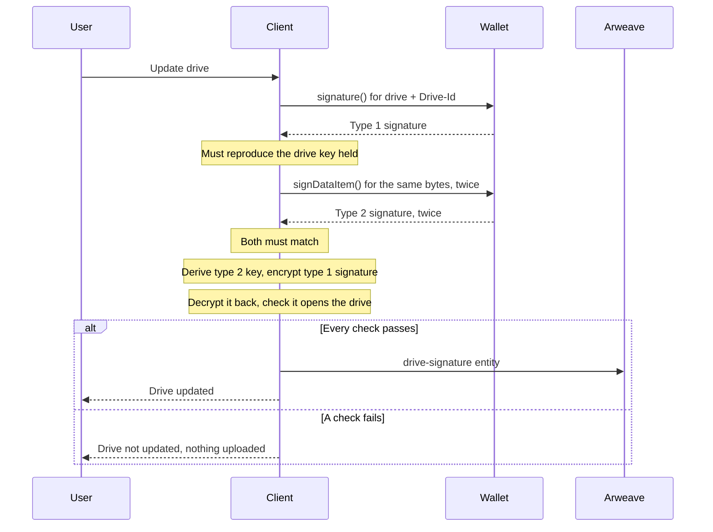

## Overview

Private drives rely on a combination of user-set password and a wallet signature for encryption and decryption. [Wander](https://www.wander.app/), formerly ArConnect, is an Arweave wallet that is deprecating its `signature()` method in favor of `signDataItem()` or `signMessage()`. So that drives whose keys came from `signature()` stay readable, ArFS v0.15 adds a way to derive drive keys with `signDataItem()`, and a bridge from the old keys to the new one.

A private drive's encryption is on chain and cannot change, so a type `1` ("V1") private drive needs an upgrade to stay readable. The upgrade stores the drive's type `1` signature on Arweave, encrypted with a key that only the newer type `2` signature can derive. A client can then fetch and decrypt that signature with `signDataItem()` and use it to open the drive.

<Callout type="warning" title="Deprecation Period">
The below instructions for upgrading a private drive will work during the deprecation period for the `signature()` method from Wander. Once this period is over, and `signature()` loses all support, additional steps will be required to obtain the correct signature format to decrypt V1 private drives in order to upgrade them.

There is, at this time, no set date for when the deprecation period will end.

</Callout>

## The Upgrade Process

The upgrade adds one new `drive-signature` entity holding the drive's type `1` signature, encrypted under the drive's type `2` key. It does not change the drive entity: the drive keeps no `Signature-Type` tag, or `Signature-Type: 1`, and its drive key stays the same.



### Drive-Signature Entity

The `drive-signature` entity stores the encrypted type `1` signature:

```json
ArFS: "0.15",
Entity-Type: "drive-signature",
Drive-Id: "<uuid of the drive this signature unlocks>",
Signature-Format: "1",
Cipher: "AES256-GCM",
Cipher-IV: "<12 byte initialization vector as Base64>"
{data: <Encrypted type 1 signature, followed by the 16-byte GCM tag>}
```

A reader takes only the owner's newest `drive-signature` entity for the drive, so a newer entity encrypted under the wrong key hides any correct older one, and it cannot be deleted. That is why ArDrive refuses to upload an entity it has not read back.

## Using ArDrive

The [ArDrive app](https://app.ardrive.io/) runs the upgrade for you.

### Step 1: Log into ArDrive

If the connected wallet has V1 private drives that need to be updated, a banner will appear at the top of the screen.


### Step 2: Click "Update Now!"

This will open a modal listing the drives that need to be updated, and linking to more information about the upgrade process.


### Step 3: Click "Update"

ArDrive starts the upgrade and asks your wallet to sign for each drive. When it finishes, a new modal lists the drives it updated.


## Manual Upgrade Process

To upgrade drives from your own code:

### 1. Identify V1 Drives

Query the wallet's private drive entities, then keep the drives whose latest drive entity has no `Signature-Type` tag or has `Signature-Type: 1`, and that have no `drive-signature` entity yet. GraphQL cannot query for a missing tag, so this filter runs in the client. Do not filter on the `ArFS` tag: a drive that needs upgrading can carry any version.

```graphql
query ($owner: String!, $after: String) {
  transactions(
    owners: [$owner]
    tags: [
      { name: "Entity-Type", values: ["drive"] }
      { name: "Drive-Privacy", values: ["private"] }
    ]
    sort: HEIGHT_DESC
    first: 100
    after: $after
  ) {
    pageInfo {
      hasNextPage
    }
    edges {
      cursor
      node {
        id
        tags {
          name
          value
        }
      }
    }
  }
}
```

### 2. Create Drive-Signature Entity

```javascript
async function createDriveSignature(driveId, typeOneSignature, typeTwoDriveKey) {
  // Encrypt the type 1 signature under the type 2 drive key, with AES256-GCM
  const { cipherIV, data } = await driveEncrypt(typeTwoDriveKey, typeOneSignature);

  const driveSignature = {
    data,
    tags: [
      { name: "ArFS", value: "0.15" },
      { name: "Entity-Type", value: "drive-signature" },
      { name: "Drive-Id", value: driveId },
      { name: "Signature-Format", value: "1" },
      { name: "Cipher", value: "AES256-GCM" },
      { name: "Cipher-IV", value: cipherIV },
    ],
  };

  // Upload to Arweave
  return await uploadTransaction(driveSignature);
}
```

Before uploading, decrypt the entity's data with a type `2` key made from a fresh signature, derive the drive key from what comes out, and check that it opens the drive. Do not upload a new drive entity: the drive's tags stay as they are.

## Verification

After upgrading, check that it worked:

### Check Drive-Signature Entity

```graphql
query ($owner: String!, $driveId: String!) {
  transactions(
    owners: [$owner]
    tags: [
      { name: "Entity-Type", values: ["drive-signature"] }
      { name: "Drive-Id", values: [$driveId] }
    ]
  ) {
    edges {
      node {
        id
        block {
          height
          timestamp
        }
        tags {
          name
          value
        }
      }
    }
  }
}
```

### Check the Drive Opens

Open the drive in a client that reads `drive-signature` entities, such as ArDrive or ardrive-core-js 3.0.0 or later, with a wallet that offers only `signDataItem()`. The drive's `Signature-Type` tag is unchanged, so do not look for a new drive entity.

## Troubleshooting

### Common Issues

- **Signature not found** - Ensure the wallet supports the required signing methods
- **Encryption errors** - Verify the encryption parameters are correct
- **Upload failures** - Check network connectivity and retry
- **Permission denied** - Ensure you own the drive being upgraded

### Error Handling

```javascript
async function upgradeDrive(driveId) {
  try {
    // Get the type 1 signature and the type 2 drive key
    const typeOneSignature = await getTypeOneSignature(driveId);
    const typeTwoDriveKey = await getTypeTwoDriveKey(driveId);

    // Create drive signature entity
    await createDriveSignature(driveId, typeOneSignature, typeTwoDriveKey);

    console.log("Drive upgraded successfully");
  } catch (error) {
    console.error("Upgrade failed:", error);
    // Handle error appropriately
  }
}
```

## Best Practices

### Before Upgrading

- **Backup your data** - Ensure you have access to your drive contents
- **Test with one drive** - Start with a single drive to verify the process
- **Check wallet compatibility** - Ensure your wallet supports required methods
- **Verify ownership** - Confirm you own the drives being upgraded

### During Upgrading

- **Monitor progress** - Keep track of upgrade status
- **Handle errors gracefully** - Implement proper error handling
- **Batch operations** - Upgrade multiple drives efficiently
- **User feedback** - Provide clear status updates

### After Upgrading

- **Verify functionality** - Test drive access and operations
- **Update clients** - Ensure all clients support v0.15
- **Monitor performance** - Check for any performance issues
- **Document changes** - Keep track of upgraded drives

## Release History

- **2025-05-21**: ArDrive published the upgrade guide in its ArFS specification.
- **2025-05-29**: ArDrive web 2.68.0 shipped ArFS v0.15, including the upgrade banner.
- **2025-06-16**: ardrive-core-js 3.0.0 shipped ArFS v0.15 support. It reads `drive-signature` entities and gives new private drives `Signature-Type: 2`.
- **No date set**: the end of Wander's `signature()` deprecation period.

## Next Steps

After upgrading your drives, explore these related topics:

- [Privacy & Encryption](/build/advanced/arfs/privacy) - Understand the new encryption scheme
- [Reading Data](/build/advanced/arfs/reading-data) - Query your upgraded drives
- [Creating Drives](/build/advanced/arfs/creating-drives) - Create new v0.15 drives
