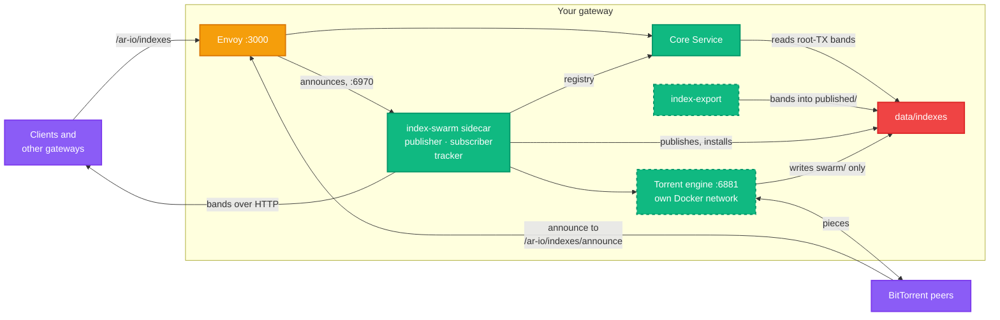
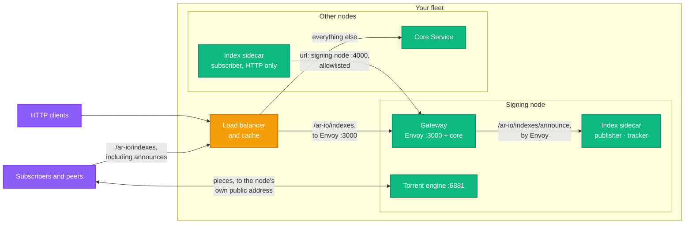

import { Step, Steps } from "fumadocs-ui/components/steps";
import { Callout } from "fumadocs-ui/components/callout";
import { Tabs, Tab } from "fumadocs-ui/components/tabs";
import { Card, Cards } from "fumadocs-ui/components/card";
import { BookOpen, Search, Settings, Zap } from "lucide-react";

To serve a data item, your gateway first has to find which Arweave transaction holds it, and where inside that transaction it sits. [CDB64 indexes](/build/run-a-gateway/manage/cdb64) answer that locally. **Index Sharing** keeps those indexes fresh by letting gateways share them: one gateway publishes its indexes, others subscribe, and every file is signed and checked before it is used. Bands move over HTTP, and, with the optional torrent engine, peer to peer over BitTorrent.

For how it works and why it can be trusted, see [Index Sharing](/learn/gateways/index-sharing) in Learn.

<Callout type="info">
  **Release Requirement**: Index Sharing is available from gateway Release 84.
  Both your gateway and the publisher you subscribe to must be on Release 84
  or later. From Release 85 it is **on by default**: see [On by
  Default](#on-by-default).
</Callout>

Index Sharing runs in a sidecar container, `index-swarm`, beside your gateway; its scripts and settings all use that name. Two scripts in the gateway repository do the work, run from the gateway's directory (where `.env` and `docker-compose.yaml` are). They need only Docker, since they run in the core image:

- `./tools/index-swarm-setup` edits `.env` and, with `--restart`, restarts what the changes need.
- `./tools/index-swarm-status` checks that everything works and says how to fix what doesn't.

## On by Default

<Callout type="info">
  **Release Requirement**: Release 85 or later. On Release 84, Index Sharing
  is off until you set it up with the scripts below.
</Callout>

From Release 85, the sidecar and the torrent engine start with the rest of the gateway on a plain `docker compose up -d`, with no `--profile` flags. With nothing set in `.env`, your gateway:

- **Subscribes to turbo-gateway.com's root transaction index**, by its gateway wallet `34LYvMptiDvBP5sqfh1oAd6Q4qFsy4PWaZ1HTFmML7h5`, and only that index. L1 bands stay opt-in; see [Take L1 Bands](#take-l1-bands-parquet-l1).
- **Downloads the bands**, about 22 GB today, newest heights first, over BitTorrent with the publisher's HTTP routes as the fallback, and checks every file against the signed publication before installing it.
- **Searches the installed bands first** for root transaction and offset lookups, so data items resolve from local disk.
- **Seeds the bands to other gateways**, capped at 10 MB/s (`INDEX_SWARM_UPLOAD_LIMIT_BYTES_PER_SEC`) and 100 GB a UTC day (`INDEX_SWARM_UPLOAD_DAILY_LIMIT_BYTES`).
- **Generates the torrent engine's password** on first start, so there is nothing to set.

{/* TODO(verify): where the generated engine password is stored, and whether an INDEX_SWARM_ENGINE_AUTH already in .env still takes precedence. */}
{/* TODO(verify): the shipped defaults that put installed bands first (ROOT_TX_LOOKUP_ORDER, CDB64_ROOT_TX_INDEX_SOURCES), so the Doing It by Hand and CDB64 pages can quote them. */}

What it costs your gateway, on top of what it already uses:

| Resource | Default |
| --- | --- |
| Disk | About 22 GB of root-TX bands today, growing with the chain. `INDEX_SWARM_MAX_DISK_BYTES` caps it at 64 GiB by default; a band arriving over BitTorrent is on disk twice until it installs. See [Disk](#disk) |
| Memory | About 0.4 GB: the sidecar about 90 MB, the torrent engine about 300 MB, measured on a live gateway. The engine also maps the files it seeds; those pages are reclaimable but count against a container memory limit |
| Download | About 22 GB the first time, then each new band as the publisher releases it |
| Upload | Up to the [upload limits](#bounding-upload): 10 MB/s and 100 GB a day by default |
| Ports | 6881, TCP and UDP, open to the internet is recommended, not required. See [Ports](#ports) |

**To opt out**, set an empty subscription in `.env` and recreate the sidecar:

```bash
INDEX_SWARM_SUBSCRIBE=[]
```

```bash
docker compose up -d --no-deps index-swarm
```

Your gateway then subscribes to nothing and downloads no bands. To remove what it already installed, or to stop the containers too, see [Turning It Off](#turning-it-off).

{/* TODO(verify): with INDEX_SWARM_SUBSCRIBE=[], whether the sidecar removes bands it already installed, and whether the engine keeps running (and publishing 6881/6969) with nothing to seed. Also whether an empty value (INDEX_SWARM_SUBSCRIBE=) falls back to the default subscription, as a compose ${VAR:-default} would. */}

The rest of this page covers changing the defaults: following another publisher, moving bands over HTTP only, taking L1 bands, and publishing your own indexes. On Release 84, it is how you turn Index Sharing on.

## HTTP or BitTorrent?

From Release 85, BitTorrent is the default. On Release 84, decide this first; you can change it later by running the setup script again.

| | HTTP only | With BitTorrent (`--torrent`) |
| --- | --- | --- |
| First download | From the publisher's HTTP routes, through its rate limits and x402. Can take hours | From peers first, unmetered; the publisher's HTTP routes are the fallback |
| Ports to open | None | None required. Opening 6881, TCP and UDP, is recommended: it lets peers connect to you |
| You upload | Nothing | You seed what you install to other gateways, capped at 10 MB/s and 100 GB a day by default |
| Extra memory | About 90 MB (the sidecar) | About 0.4 GB (the sidecar about 90 MB, the torrent engine about 300 MB), plus the files it seeds mapped into memory: the kernel can reclaim those pages, but they count against a container memory limit |

{/* TODO(verify): the sidecar's ~90 MB was measured with the engine running; confirm the HTTP-only figure. Also how to run HTTP only on Release 85, now that the engine starts by default (unset INDEX_SWARM_ENGINE_AUTH? scale the engine to 0?). */}

BitTorrent is the better default: your first pull is faster and free, and each gateway that seeds makes the next one's faster. It works behind NAT or a closed port too, because your gateway connects out to the publisher and to other peers; an open port adds the peers that can only be reached, not reach you. Choose HTTP only if you don't want to upload. [Network and Disk](#network-and-disk) has the details.

What runs on your gateway once it is set up. Dashed boxes are optional: the torrent engine runs by default from Release 85 (on Release 84, only with `--torrent`), and `index-export` (Release 85) only on a publisher that builds its own bands. The tracker answers only when you publish torrents:



## Subscribe to a Publisher

Subscribing is what most operators want: your gateway downloads a publisher's index bands, verifies them, and answers lookups from them. From Release 85, your gateway already subscribes to turbo-gateway.com by default ([On by Default](#on-by-default)); follow these steps to add another publisher, to change how bands move, or to turn it on under Release 84.

### Prerequisites

- A running ar.io gateway on Release 84 or later, with Docker, and a checkout of the gateway repository at that release (the scripts live in `tools/`)
- Free disk on the filesystem that holds `data/indexes`, at least the disk budget: 64 GiB by default from Release 85, and 50 GiB, the budget the setup script sets, on Release 84. The bands turbo-gateway.com publishes take about 22 GB once installed, and grow with the chain; the rest is room for a band to be on disk twice while it arrives and for a new band beside the one it replaces. This is on top of what your gateway already uses. See [Network and Disk](#network-and-disk)

{/* TODO(verify): whether index-swarm-setup --subscribe still writes 50 GiB when INDEX_SWARM_MAX_DISK_BYTES is unset, now that the compose default is 64 GiB. */}
- For BitTorrent: an open peer port is recommended, not required. See [Ports](#ports)

<Steps>
<Step>
### Choose a Publisher

A publisher is identified by its **gateway wallet**, not its URL. Your gateway looks the wallet up in the gateway registry to learn where to fetch from and which key must have signed.

The turbo-gateway.com gateway publishes a root transaction index spanning block 0 to the chain tip, with offsets. It covers the bundles turbo-gateway.com has indexed, so it is densest for recent data:

```text
34LYvMptiDvBP5sqfh1oAd6Q4qFsy4PWaZ1HTFmML7h5
```

To see whether another gateway publishes, check its `/ar-io/info` for an `indexes` entry (`curl -s https://<gateway>/ar-io/info | jq .indexes`), and take its wallet from the registry.

</Step>

<Step>
### Run the Setup Script

See what it would change first, then run it for real:

```bash
./tools/index-swarm-setup --subscribe 34LYvMptiDvBP5sqfh1oAd6Q4qFsy4PWaZ1HTFmML7h5 --torrent --dry-run
./tools/index-swarm-setup --subscribe 34LYvMptiDvBP5sqfh1oAd6Q4qFsy4PWaZ1HTFmML7h5 --torrent --restart
```

This subscribes to the publisher's root transaction index, points your gateway at the installed bands, puts `cdb` right after `db` in the lookup order, generates the torrent engine's password, and restarts only what needs it, by service name. Leave out `--torrent` to move bands over HTTP only. Add `--l1` to take the publisher's L1 bands too and fill your gateway's L1 history from them; see [Take L1 Bands](#take-l1-bands-parquet-l1).

{/* TODO(verify): on Release 85, once --subscribe writes INDEX_SWARM_SUBSCRIBE to .env, that value replaces the compose default. Confirm whether the script keeps the default turbo-gateway.com entry when adding another publisher, and say so here. */}

</Step>

<Step>
### Open the Peer Port

With `--torrent`, open the engine's peer port to the internet if you can, as [Ports](#ports) describes. It isn't required: without it, your gateway still downloads from peers and seeds to the peers it connects to. Behind a home router, forward the port yourself; the engine doesn't use UPnP.

</Step>

<Step>
### Check It

```bash
./tools/index-swarm-status
```

Each line says `ok`, `WARN` or `FAIL`, and every problem comes with the fix. When it says `All good`, your gateway is answering root transaction lookups from the installed bands.

</Step>
</Steps>

Bands arrive newest heights first, because most lookups are for recent data. A first pull of a full index takes minutes to hours. After that, new bands from the publisher install, and replace the ones they supersede, by themselves; the gateway loads each within 30 seconds, without a restart.

### What to Expect

The status script's `CDB64 lookups ... found X of Y` line shows how many root transaction lookups the installed bands answered. Don't expect every lookup to hit. A publisher's index covers the bundles it indexed, densest for recent data, and the tip band is rebuilt periodically, so the newest items aren't in it yet. A miss costs nothing: your gateway falls back to its usual lookup order. Following more than one publisher widens coverage.

<Callout type="warning">
  **The first download can take hours over HTTP.** Publishers meter their
  index files with the same rate limits and
  [x402 payments](/build/run-a-gateway/manage/x402-setup) as any data. With
  BitTorrent, bands come from peers first, and peers are not metered; the
  publisher's HTTP routes are the fallback. Downloads resume where they
  stopped, so nothing is lost if your gateway restarts part way through.
</Callout>

### Take L1 Bands (`parquet-l1`)

<Callout type="info">
  **Release Requirement**: L1 bands require Release 85 or later on your
  gateway and on the publisher.
</Callout>

A publisher can also offer **L1 bands**: the Arweave base layer (blocks, transactions, tags and wallets) in Parquet, one height range per band. Your gateway doesn't serve lookups from them. They are for two jobs:

- Filling your gateway's L1 history while it runs, instead of indexing the chain block by block. See [Bootstrap from L1 Bands](/build/run-a-gateway/manage/index-snapshots#bootstrap-from-l1-bands).
- Analytics: query the installed files with DuckDB or Polars, or read them over HTTP. See [Reading Shared Indexes](/build/advanced/index-publications).

A subscription takes L1 bands only when it names them. Add `--l1` to the setup script:

```bash
./tools/index-swarm-setup --subscribe 34LYvMptiDvBP5sqfh1oAd6Q4qFsy4PWaZ1HTFmML7h5 --l1 --torrent --restart
```

It adds `parquet-l1` to the subscription's `name` list and sets `L1_BAND_IMPORT_ENABLED=true`, so your gateway fills its L1 history from the bands while it runs, and restarts core. The whole chain is 24 L1 bands, about 15 GB more disk. They share `INDEX_SWARM_MAX_DISK_BYTES` with root-TX bands, so the script also sets the budget to 100 GiB if it is unset, and warns if yours is lower.

On a new gateway, run it before the first start, without `--restart` (on a gateway that isn't running, `--restart` would start core and the sidecar alone), then start the gateway as usual, and leave `START_HEIGHT` unset: with an empty `core.db`, the gateway then follows the chain tip from the start, and the history beneath arrives as the bands do. On a gateway that already runs, it fills whatever is missing beneath what the gateway indexed itself.

Taking `parquet-l1` off the subscription retires its bands. History already filled from them stays in `core.db`.

## Publish Your Indexes

Any registered gateway can publish. Other gateways then find it in the registry and subscribe by its wallet.

Publishing is for gateways that unbundle, so their index holds data items to build bands from. The sidecar publishes the bands under `data/indexes/published/`; it doesn't build them. From Release 85 the `index-export` service builds them from your gateway's own index, once a day. On Release 84, you build them [by hand](#by-hand).

### Prerequisites

- A gateway **registered** in the gateway registry, reachable at its registered URL, on Release 84 or later. The routes that serve bands live in the gateway, not the sidecar
- Its registered **observer key**, which signs what it publishes
- For `index-export`: Release 85, and a gateway that unbundles (`ANS104_UNBUNDLE_FILTER`)
- For BitTorrent: the peer port open, and this node's public IP. Peers announce to your tracker through your gateway's HTTPS, which needs the Envoy image from Release 85 or later. See [Ports](#ports)

<Steps>
<Step>
### Set the Signing Key

Set your gateway's wallet:

```bash
AR_IO_WALLET=<your gateway wallet>
```

The sidecar signs with your registered observer key. Set **one** of these, not both:

<Tabs items={["Private key", "Keypair file"]}>
<Tab value="Private key">
```bash
OBSERVER_PRIVATE_KEY=<base58 observer private key>
```
</Tab>
<Tab value="Keypair file">
```bash
# Host path of the observer keypair file; only this file is mounted
INDEX_SWARM_OBSERVER_KEYPAIR_FILE=/path/to/observer-keypair.json
```
</Tab>
</Tabs>

If one Solana keypair does everything ([Pattern 1](/build/run-a-gateway/manage/solana-migration#supported-configurations)), the gateway reads it through `SOLANA_KEYPAIR_PATH` or `OBSERVER_KEYPAIR_PATH`, and the sidecar sees neither. Set `INDEX_SWARM_OBSERVER_KEYPAIR_FILE` to that keypair file's host path.

The setup script refuses to publish, and writes nothing, until the key and `AR_IO_WALLET` are set.

<Callout type="warning">
  Don't use your observer key in a wallet that signs messages for dApps. The
  sidecar's signatures can't be confused with Solana transactions, but a
  wallet asked to sign an arbitrary message could produce one.
</Callout>

</Step>

<Step>
### Run the Setup Script

<Callout type="info">
  **Release Requirement**: `--start-height`, `--header-check-url` and the
  `index-export` service require Release 85 or later. On Release 84, put
  your bands in place [by hand](#by-hand) and run the script without those
  two flags.
</Callout>

See what it would change first, then write it to `.env`, without restarting yet:

```bash
./tools/index-swarm-setup --publish --start-height 1950000 --torrent \
  --public-host <this node's public IP> --dry-run
./tools/index-swarm-setup --publish --start-height 1950000 --torrent \
  --public-host <this node's public IP>
```

- `--start-height` is the lowest height `index-export` builds. Choose the lowest height your index holds data items for.
- `INDEX_EXPORT_HEADER_CHECK_URL` is the gateway `index-export` checks a sample of each band against before publishing. The script sets it to `https://turbo-gateway.com`; pass `--header-check-url http://core:4000` only if your own gateway holds the root transactions' data.
- `--public-host` is where peers reach this node's torrent engine.
- Peers announce to your tracker through the gateway itself, at `<origin>/ar-io/indexes/announce`, where the origin is `--public-url`, else `INDEXES_PUBLIC_URL`, else `https://<ARNS_ROOT_HOST>`.

</Step>

<Step>
### Dry-Run the Export

On Release 85, see what `index-export` would build before it builds anything, with the same `-f` files your gateway was started with:

```bash
docker compose --profile index-export run --rm -T index-export --once --dry-run > plan.json
```

The report lists each band, its rows, the time and disk it needs, and the result of the header check. Nothing is published.

</Step>

<Step>
### Start It

Run the setup script again with `--restart`. It changes nothing more, and restarts what publishing needs by service name: the sidecar, the torrent engine and, on Release 85, `index-export`.

```bash
./tools/index-swarm-setup --publish --torrent --restart
```

The first scan reads and hashes every band once, which takes a few minutes for tens of gigabytes.

</Step>

<Step>
### Open the Peer Port

With `--torrent`, open 6881, TCP and UDP, to the internet. See [Ports](#ports).

The tracker needs no port of its own. Peers announce to it through your gateway, at `https://<your-gateway>/ar-io/indexes/announce`, and Envoy forwards that path to the sidecar's second tracker listener on port 6970, which is never published. The route is Envoy's, so run the Envoy image from Release 85 or later. An older Envoy passes the path to core, which answers `404`, so every announce fails without an error.

If the script has no public URL for your gateway (no `--public-url`, `INDEXES_PUBLIC_URL` or `ARNS_ROOT_HOST`) but has a public host (`--public-host` or `INDEX_SWARM_ENGINE_PUBLIC_HOST`), it writes the tracker's own port instead, `http://<public host>:<INDEX_SWARM_TRACKER_PORT>/announce` (6969 by default), and that port must be open (TCP). With neither, it writes no tracker and warns. An existing `INDEX_SWARM_TRACKERS` is always kept.

</Step>

<Step>
### Check What You Publish

```bash
./tools/index-swarm-status
curl -s https://<your-gateway>/ar-io/indexes | jq '{sequence, publisher, bands: [.indexes[].bands[].id]}'
curl -s https://<your-gateway>/ar-io/info | jq .indexes
```

</Step>
</Steps>

A gateway can do both: pass `--subscribe` and `--publish` together. If you run more than one node behind a load balancer, read [Publishing from a Fleet](#publishing-from-a-fleet) before anyone subscribes.

### Feeds and the WebSeed

<Callout type="info">
  **Release Requirement**: feeds and the served WebSeed require Release 85 or
  later.
</Callout>

With torrents on, your gateway also serves an RSS feed of each index's torrents at `/ar-io/indexes/feed/<index>.xml`, and lists the feeds in `/ar-io/info` under `indexes.feeds`. Anyone can then follow your index in an ordinary BitTorrent client; see [Follow a Publisher with RSS](/build/advanced/bittorrent-indexes#follow-a-publisher-with-rss). Each `.torrent` your gateway serves also names your gateway as a WebSeed, so such a client can finish a band nobody is seeding.

Both need your gateway's public origin, `INDEXES_PUBLIC_URL`, which defaults to `https://<ARNS_ROOT_HOST>`. With neither set, the feeds answer `404` and `.torrent` files are served without a WebSeed.

A stock client pulls a good share of every band from the WebSeed even while seeders could serve it. If your gateway doesn't meter its byte routes, that is your core's egress, read from disk and outside the torrent engine's upload limits. Meter the byte routes to bound it, or set `INDEXES_TORRENT_WEBSEED=false` to serve torrents without the WebSeed. Gateways that subscribe to you drop the WebSeed either way, and add yours only when peers stall.

### What the Daily Run Does

<Callout type="info">
  **Release Requirement**: `index-export` requires Release 85 or later.
</Callout>

`index-export` first runs about five minutes after it starts, then daily at `INDEX_EXPORT_RUN_AT_UTC` (04:00 UTC by default). It reads your ClickHouse if `CLICKHOUSE_URL` is set, otherwise your SQLite (`INDEX_EXPORT_SOURCES` changes this). Each run:

- builds the history bands once, from `--start-height` up, and never again
- rebuilds a daily band from just below the newest history or recent band to the tip, published only when its content changed
- once a week, folds the daily rows into a recent band, which keeps rows your index has since expired
- checks a sample of each band against `INDEX_EXPORT_HEADER_CHECK_URL`, and publishes it only if the check passes

New bands supersede the ones they replace, so subscribers retire the old ones by themselves. A failed run withdraws nothing already published. A rejected band waits for you: `./tools/index-swarm-status` shows it as `FAIL` with the reason. After you fix the cause, run it once by hand:

```bash
docker compose --profile index-export run --rm -T index-export --once
```

If `published/` already holds bands built another way, `index-export` builds nothing until you hand them over with `--adopt`. The [`index-export` reference](https://github.com/ar-io/ar-io-node/blob/develop/docs/index-export.md) covers adoption, disk and memory limits, metrics and troubleshooting.

### Publish L1 Bands

<Callout type="info">
  **Release Requirement**: L1 bands require Release 85 or later.
</Callout>

`index-export` also builds L1 bands from your `core.db`, if it holds every block from height 0. A gateway that started above it (`START_HEIGHT`) can't build them. Add both lines to `.env`:

```bash
INDEX_EXPORT_KINDS=root-tx-index,parquet-l1
INDEX_SWARM_PUBLISH='[{"name":"root-tx-index","kind":"cdb64-root-tx"},{"name":"parquet-l1","kind":"parquet-l1"}]'
```

The sidecar entry is needed too: the sidecar retires each superseded tip band, so without it `published/parquet-l1/` keeps every one. The chain is cut into the same fixed ranges by every publisher: a band per 100,000 heights, a band per 5,000 heights inside the newest range, and a tip band rebuilt each run. Bands are layout `l1-3`, with [lookup files](/build/advanced/index-publications#lookup-files).

The first build of the whole chain takes many hours and reads all of `core.db` once, so start it off-peak. A run starts no new band after `INDEX_EXPORT_L1_RUN_BUDGET_MINUTES` (240 by default), and the next run carries on 15 minutes later. Dry-run it first, capped with `--to`:

```bash
docker compose --profile index-export run --rm -T index-export --once --dry-run --to 600000 > plan.json
```

### By Hand

On Release 84, or to publish bands built some other way, put each band in its own directory under `data/indexes/published/root-tx-index/`, built under a name ending in `.tmp` and renamed into place:

```bash
./tools/export-sqlite-to-cdb64 --partitioned \
  --output-dir data/indexes/published/root-tx-index/band-tip.tmp
mv data/indexes/published/root-tx-index/band-tip.tmp data/indexes/published/root-tx-index/band-tip
```

This tool runs on the host, so it needs Node.js 20 and `yarn install` in the checkout. Give each band a `heightRange` in its manifest's `metadata` so subscribers install the newest heights first, and replace a band by publishing a new one with `"supersedes": "<old band id>"`. See [Partitioned Indexes](/build/run-a-gateway/manage/cdb64#partitioned-indexes).

## The Setup and Status Scripts

### `index-swarm-setup`

The script edits `.env` and nothing else, unless given `--restart`.

| Flag | Effect |
| --- | --- |
| `--subscribe <wallet>` | Adds the publisher to `INDEX_SWARM_SUBSCRIBE`. Repeatable; existing entries are kept. Sets `INDEX_SWARM_MAX_DISK_BYTES` to 50 GiB if unset. Puts `data/indexes/installed/root-tx-index` first in `CDB64_ROOT_TX_INDEX_SOURCES`, keeping what was there (or, if unset, the shipped default), and moves `cdb` right after `db` in `ROOT_TX_LOOKUP_ORDER` (if unset: `db,cdb,gateways,graphql`) |
| `--publish` | Adds `root-tx-index` to `INDEX_SWARM_PUBLISH`. Refuses, writing nothing, without a registered key or `AR_IO_WALLET`. With `--torrent`, sets `INDEX_SWARM_TRACKERS`, if unset, to this node's tracker: from Release 85, through the gateway, `<public URL>/ar-io/indexes/announce`, or with no public URL, `http://<public host>:6969/announce`. An existing tracker list is kept. From Release 85, also sets `INDEX_EXPORT_HEADER_CHECK_URL` (default `https://turbo-gateway.com`) and starts `index-export` |
| `--start-height <n>` | Release 85. With `--publish`: sets `INDEX_EXPORT_START_HEIGHT`, the lowest height `index-export` builds |
| `--header-check-url <url>` | Release 85. With `--publish`: the gateway `index-export` checks sampled headers against |
| `--torrent` | Generates `INDEX_SWARM_ENGINE_AUTH` if unset (`swarm:` and 48 random hex characters; never printed) |
| `--public-host <addr>` | Sets `INDEX_SWARM_ENGINE_PUBLIC_HOST`. From Release 85 it works on its own; on Release 84, pass it with `--torrent` |
| `--engine-port <n>` | Sets `INDEX_SWARM_ENGINE_PORT` (default 6881). From Release 85 it works on its own; on Release 84, pass it with `--torrent` |
| `--public-url <origin>` | Release 85. The gateway's public origin, such as `https://gateway.example`, for the tracker URL. Defaults to `INDEXES_PUBLIC_URL`, then `https://<ARNS_ROOT_HOST>`. To change the feeds' origin too, set `INDEXES_PUBLIC_URL` |
| `--l1` | Release 85. With `--subscribe`: takes the publisher's L1 bands as well (`"name": ["root-tx-index", "parquet-l1"]`) and sets `L1_BAND_IMPORT_ENABLED=true`, so the gateway fills its L1 history from them while it runs; restarts core. Sets the disk budget to 100 GiB if unset, and warns if an existing one is lower |
| `--max-disk-gib <n>` | Sets `INDEX_SWARM_MAX_DISK_BYTES`. Works on its own too, to change an existing subscriber's budget |
| `--no-gateway` | Leaves `CDB64_ROOT_TX_INDEX_SOURCES` and `ROOT_TX_LOOKUP_ORDER` alone |
| `--dry-run` | Shows the changes and writes nothing |
| `--restart` | Then recreates what needs it: the gateway only when those two settings differ from what it runs with, then the sidecar (and the engine, with torrents), by service name, with the compose files the running gateway was started with |
| `--env-file <path>` | A file other than `.env`, relative to the gateway's directory |

It is idempotent: a second run changes only what is missing, so it is also how to add a publisher or turn on torrents later. It never replaces a value it cannot parse or a password it did not write; it stops and says what to fix. Before writing, it copies `.env` to `.env.bak-index-swarm-<time>`, readable only by its owner, since it holds secrets. It warns when an explicit `ROOT_TX_LOOKUP_ORDER` keeps `hyperbeam`, which fails unless you run the `hb` profile, but does not remove it.

On Release 84, `INDEX_SWARM_ENGINE_AUTH` alone turns the torrent engine on: with a password set, `INDEX_SWARM_ENGINE_URL` defaults to the engine in the compose file. From Release 85 the engine runs by default and its password is generated on first start. Set the URL only for an engine you run some other way.

### `index-swarm-status`

The status script is read-only. It runs inside the sidecar, so it sees exactly what the sidecar sees, and checks:

- that the sidecar is up and the gateway's release is new enough
- per publisher: the sequence accepted and its age, any `signature_failed`, `replayed` or `verify_failed`, and failed downloads
- installed bands and their size, and bands skipped or nearly skipped for the disk budget
- that the gateway reads the installed directory, has every installed root-TX band loaded, and sends lookups to them. It compares root-TX bands only, since the gateway doesn't load L1 bands as an index
- publishing: the document served, its expiry, and how many bands seed
- the torrent engine: that it answers, whether any peer has connected in (so a closed port shows), and the day's upload against the budget
- from Release 85, `index-export`: that it answers, when each kind of band last succeeded, retries, and rejected bands, for root-TX and L1 bands

It exits `1` when a check fails, so it can run from cron or a health script.

## Doing It by Hand

What the setup script writes, if you would rather edit `.env` yourself:

```bash
INDEX_SWARM_SUBSCRIBE='[{"publisher":"34LYvMptiDvBP5sqfh1oAd6Q4qFsy4PWaZ1HTFmML7h5","name":"root-tx-index"}]'
INDEX_SWARM_MAX_DISK_BYTES=53687091200   # 50 GiB; about twice what the publisher offers
CDB64_ROOT_TX_INDEX_SOURCES=data/indexes/installed/root-tx-index,resources/cdb64-root-tx-index-non-ao-non-redstone-with-content-type-to-height-1820000,resources/cdb64-root-tx-index-non-ao-non-redstone-without-content-type-to-height-1820000,resources/cdb64-root-tx-index-ao-to-height-1820000
ROOT_TX_LOOKUP_ORDER=db,cdb,gateways,graphql
INDEX_SWARM_ENGINE_AUTH=swarm:<generated>   # only for BitTorrent: at least 16 characters, e.g. openssl rand -hex 24
```

The installed bands go **first** in `CDB64_ROOT_TX_INDEX_SOURCES`, so a fresh band answers before the older shipped indexes. The three `resources/` entries are the shipped default; keep them to go on searching them, or leave them off, since each lookup against them fetches from Arweave and a subscribed set that covers the whole chain makes them redundant.

`ROOT_TX_LOOKUP_ORDER` matters most. By default, `cdb` is asked last, after every network source, so your gateway would barely use the bands it downloaded. Drop `hyperbeam` unless you run the `hb` profile.

With `--l1` (Release 85), the subscription names L1 bands as well, the budget is larger, and core fills its history from them:

```bash
INDEX_SWARM_SUBSCRIBE='[{"publisher":"34LYvMptiDvBP5sqfh1oAd6Q4qFsy4PWaZ1HTFmML7h5","name":["root-tx-index","parquet-l1"]}]'
INDEX_SWARM_MAX_DISK_BYTES=107374182400   # 100 GiB
L1_BAND_IMPORT_ENABLED=true
```

Then restart by service name, with the same `-f` files your gateway was started with:

```bash
docker compose up -d --no-deps core
docker compose up -d --no-deps index-swarm-engine-init index-swarm-engine index-swarm
```

On Release 84, the sidecar and engine sit in compose profiles, so add `--profile index-swarm --profile index-swarm-torrent` to the second command. Without BitTorrent, leave out the `index-swarm-torrent` profile and the two engine services. Name the services as shown: a bare `docker compose up` also starts or recreates every default service, including your observer.

## Network and Disk

### Ports

| Port | Who needs it open | What for |
| --- | --- | --- |
| Your gateway's HTTP port (via Envoy or NGINX) | Publishers | Serving `/ar-io/indexes`, the band files and the `.torrent` files, and, from Release 85, tracker announces at `/ar-io/indexes/announce`. Nothing new: it is the port your gateway already serves on |
| 6881, TCP and UDP (`INDEX_SWARM_ENGINE_PORT`) | Publishers; recommended for subscribers, including every default gateway from Release 85 | Peers connecting to your torrent engine. A publisher needs it, since subscribers must reach its engine. A subscriber works without it, but only peers it connects to can download from it |
| 6969, TCP (`INDEX_SWARM_TRACKER_PORT`) | Only publishers whose peers announce to it directly | The closed tracker's direct port. Peers normally announce through your gateway instead, which needs no port. Published on every node, but only a publisher listens |

From Release 85, Envoy forwards `/ar-io/indexes/announce` to a second tracker listener on the sidecar, `INDEX_SWARM_TRACKER_PROXY_PORT` (6970). That port is never published, so there is nothing to open for it. The route needs the Envoy image from Release 85 or later: an older Envoy passes the path to core, which answers `404`.

Outbound, the sidecar needs HTTPS to each publisher's gateway, and the torrent engine needs to reach peers anywhere on the internet on any port. If your host filters outbound traffic, allow both.

The sidecar publishes the tracker port, 6969, whenever it runs, HTTP only included. The torrent engine publishes 6881 when it runs. From Release 85 both run by default, so check before upgrading that nothing else on the host holds either port. Either container won't start if another program already holds its port. Move them with `--engine-port` and `INDEX_SWARM_TRACKER_PORT`. Keep the engine port below 32768: Linux uses 32768–60999 for outgoing connections, and one of those can hold the port when the engine restarts.

Some hosting providers restrict BitTorrent traffic in their terms of service. Check yours before turning the engine on.

### Disk

- **The budget is a ceiling, not a reservation.** `INDEX_SWARM_MAX_DISK_BYTES` (64 GiB by default from Release 85; unset, with no ceiling, on Release 84 unless the setup script set it) stops the sidecar taking more than that, but nothing sets the space aside, so keep at least the budget free on the filesystem. It counts installed bands, downloads in progress and every torrent download twice (the download and the copy that installs), so with that much free, the budget is reached before the disk fills. A band that would go over is skipped, and `index-swarm-status` says so.
- **One filesystem.** Everything under `data/indexes` must be on one filesystem: an install is a rename and a publisher seeds from hard links. To put it on another disk, move the whole directory and set `INDEX_SWARM_DATA_PATH`; the gateway mounts the same path.
- **SSD or spinning disk.** An installed band answers a lookup in about 2 ms on SSD and tens of milliseconds on a busy spinning disk, still far faster than asking the network. Before installing, the sidecar reads each band once to check it, about a minute for a 7 GB band on a spinning disk. If the same disk also serves your gateway's data, cap the download rate with `INDEX_SWARM_DOWNLOAD_RATE_LIMIT_BYTES_PER_SEC`.

### Bandwidth

A first pull of the index turbo-gateway.com publishes is about 22 GB, and it grows with the chain. From Release 85 every default gateway makes that pull when it first starts. After that, the tip band is rebuilt daily and the next band every few days. Upload is bounded by the [upload limits](#bounding-upload): at the defaults, up to 100 GB a day, about 3 TB a month. On a host that charges for bandwidth, lower them.

## Firewalls and Docker Ports

The torrent engine publishes only its peer port, `INDEX_SWARM_ENGINE_PORT` (6881, TCP and UDP). The sidecar also publishes the tracker port, `INDEX_SWARM_TRACKER_PORT` (6969, TCP), on every node, but only a node that publishes torrents listens on it. A subscriber needn't open it, and a publisher needs it open only if peers announce to it directly rather than through the gateway. The engine's Web API is never published.

The engine is kept away from the rest of the gateway, because the peers and trackers it talks to are chosen by other gateways. It runs on its own Docker network, shared only with the sidecar, so it can't reach the gateway, the observer, ClickHouse or anything else on the node's network. Its IP filter refuses private, loopback, link-local and carrier-grade NAT addresses for peers, trackers and WebSeeds. It can write only its own download and configuration directories; the bands your gateway serves are mounted read-only.

Ports that Docker publishes are forwarded before the host's `INPUT` chain sees them, so a host firewall such as ufw neither blocks nor protects them. Open them wherever traffic reaches the host (a cloud security group or router, for example). To restrict them on the host, filter where Docker forwards. With Docker's default iptables backend, that is the `DOCKER-USER` chain. Its nftables backend has no `DOCKER-USER`, so use a chain of your own table on the `forward` hook, at a priority before Docker's.

## Bounding Upload

Seeding is free to peers but not to you: every byte is your upload, and a peer can fetch the bands again and again. Every node that runs the engine seeds, subscribers included, so two limits apply to every node, with defaults:

| Variable | Default | Effect |
| --- | --- | --- |
| `INDEX_SWARM_UPLOAD_LIMIT_BYTES_PER_SEC` | `10000000` (10 MB/s) | Caps the engine's upload rate. `0` is unlimited |
| `INDEX_SWARM_UPLOAD_DAILY_LIMIT_BYTES` | `100000000000` (100 GB) | Caps upload per UTC day. Once spent, seeding is throttled to 1 KiB/s until the next UTC day. Downloads and the HTTP routes are unaffected. `0` is no budget |

A large publisher should raise both. The engine's memory also grows with the bytes it seeds: it maps the files, and mapped pages count against a container memory limit.

## Tuning the Torrent Engine

The defaults suit most gateways. These are the settings worth changing, all in `.env`, applied by restarting the sidecar and engine:

| Variable | Default | When to change it |
| --- | --- | --- |
| `INDEX_SWARM_ENGINE_PORT` | `6881` | Another program holds the port, or your network throttles it. Also `--engine-port` |
| `INDEX_SWARM_UPLOAD_LIMIT_BYTES_PER_SEC`, `INDEX_SWARM_UPLOAD_DAILY_LIMIT_BYTES` | 10 MB/s, 100 GB | Lower them on metered bandwidth; raise them on a publisher. See [Bounding Upload](#bounding-upload) |
| `INDEX_SWARM_DOWNLOAD_RATE_LIMIT_BYTES_PER_SEC` | no cap | A spinning disk that also serves your gateway |
| `INDEX_SWARM_DOWNLOAD_CONCURRENCY` | `4` | Files fetched at once within one band. Lower it on a slow disk or link |
| `INDEX_SWARM_WEBSEED_AFTER_SECONDS` | `120` | How long a torrent may stall before the publisher's WebSeed is added. The WebSeed is metered like the HTTP routes |
| `INDEX_SWARM_TORRENT_TIMEOUT_SECONDS` | `3600` | How long a torrent may go without progress before the band is fetched over HTTP instead |
| `INDEX_SWARM_MAX_DISK_BYTES` | 64 GiB from Release 85; on Release 84, 50 GiB set by the setup script | Subscribing to more publishers or to larger indexes. Also `--max-disk-gib` |
| `INDEX_SWARM_ENGINE_PUBLIC_HOST` | host of the tracker URL | A publisher whose gateway name doesn't resolve to this node, such as one behind a CDN or a load balancer that doesn't forward the peer port |

### Sharing Between Your Own Gateways

If you run several gateways on one private network, they can seed bands to each other over it instead of each pulling from the internet. By default the engine refuses private addresses, so that other gateways can't use it to reach your network. For a private swarm, set `INDEX_SWARM_ENGINE_BLOCK_PRIVATE=false` on each node and list your own tracker's announce URL in `INDEX_SWARM_ALLOWED_TRACKERS`. Do this only on a network you control.

## Publishing from a Fleet

A large gateway is often several nodes behind an HTTP load balancer, and only one of them holds the observer key and signs.



For BitTorrent:

1. **One node publishes and seeds.** The signing node, the one `/ar-io/indexes` is sent to, runs the engine and the tracker. The other nodes need neither.
2. **The peer port reaches that node directly.** BitTorrent is not HTTP, so the load balancer can't carry it. Publish `INDEX_SWARM_ENGINE_PORT` (TCP and UDP) on the node's own public address, make sure the internet reaches it there (Docker-published ports bypass the host firewall; see [Firewalls and Docker ports](#firewalls-and-docker-ports) to restrict them), and set `INDEX_SWARM_ENGINE_PUBLIC_HOST` (`--public-host`) to that address. Otherwise the tracker lists the engine under the host of its tracker URL, which for a fleet is the load balancer.
3. **The tracker, through the load balancer.** Announce to `https://<gateway>/ar-io/indexes/announce`. The `/ar-io/indexes*` pin sends it to the signing node, whose Envoy forwards it to the tracker, so the pin must reach that node's **Envoy (port 3000)**. Pinned to core (port 4000), announces get `404`. The load balancer and any proxy after it must append `X-Forwarded-For` (`proxy_set_header X-Forwarded-For $proxy_add_x_forwarded_for;`), and any that reach the node from a public address go in `INDEX_SWARM_TRACKER_TRUSTED_PROXIES`. Otherwise every peer appears at the proxy's address and the tracker's per-address limits throttle them together. Publishing `INDEX_SWARM_TRACKER_PORT` on the node's public address and announcing to `http://<that address>:6969/announce` also works.
4. **The `.torrent`, WebSeed, feed and tracker routes** are under `/ar-io/indexes`, so the pin and the [NGINX block](#behind-nginx) for that prefix already cover them.

### Rate Limiting and x402 in a Fleet

Nothing extra to configure. The rate limiter and x402 apply to the byte routes (files by name, by digest, and the WebSeed) the same way they apply to data. The publication, the feeds and the `.torrent` files are free. Peer-to-peer transfer never touches the gateway; the upload budget bounds it instead. A tracker announce is a few hundred bytes through Envoy to the sidecar, never to core. Because `/ar-io/indexes` goes to one node, all metering happens there, so per-address limits stay consistent even if your nodes don't share a rate limiter.

### Advertising From the Other Nodes

<Callout type="info">
  **Release Requirement**: `INDEXES_ADVERTISE_FROM_URL` requires Release 85
  or later.
</Callout>

`/ar-io/info` describes the node that answered, so leave it on every node. A node that doesn't sign has no `indexes` block of its own. Set `INDEXES_ADVERTISE_FROM_URL` on each of those nodes to the signing node's gateway URL. The node then fetches the publication every minute and advertises the same `indexes` block, as long as the signature verifies and the publisher is its own `AR_IO_WALLET`.

It advertises the publication's feeds too, when it has a public origin of its own (`INDEXES_PUBLIC_URL` or `ARNS_ROOT_HOST`). The feeds themselves are served by the signing node that the `/ar-io/indexes*` pin reaches, so give that node a public origin as well.

### Giving the Other Nodes the Index

If your other nodes answer lookups from their own disk, they need the bands installed too. Subscribe each one over HTTP to your own publication, pointed at the publishing node directly:

```bash
INDEX_SWARM_SUBSCRIBE='[{"publisher":"<your gateway wallet>","name":"root-tx-index","url":"http://<publishing node>:4000"}]'
```

`url` only changes where the publication and files are fetched from. The signature is still checked against your registered observer key, so an internal address is safe. Then add those nodes' addresses to `RATE_LIMITER_IPS_AND_CIDRS_ALLOWLIST` on the publishing node, so they aren't rate-limited or asked to pay (the allowlist applies when the rate limiter is on). They don't need a torrent engine: between nodes on one network, HTTP is simpler.

Subscribers behind NAT still work: they reach the publisher's engine, and a reachable subscriber can be reached back.

## Behind NGINX

Give `/ar-io/indexes` its own uncached location, with no trailing slash, that forwards the client IP. A cache breaks range reads and per-subscriber rate limits. The tracker at `/ar-io/indexes/announce` also reads each peer's address from `X-Forwarded-For`, and it is reached only through Envoy, so point the location at Envoy (port 3000), not core (port 4000). [Advanced NGINX Caching](/build/run-a-gateway/manage/nginx-caching#index-sharing) has the location block.

## Monitoring

`./tools/index-swarm-status` covers the day-to-day checks. The sidecar also serves Prometheus metrics on port `9101` inside its container. The ones worth watching:

| Metric | What it tells you |
| --- | --- |
| `index_subscription_manifest_age_seconds` | How old each publisher's latest publication is. **Alarm if it climbs past a day**: the publisher has gone quiet. |
| `index_swarm_installed_bands` | How many bands are live |
| `index_subscription_total{result}` | Outcomes of each poll. `signature_failed` should always be zero. `transport_fallback` means a torrent was not used and the band came over HTTP |
| `index_subscription_bytes_total{transport}` | Bytes fetched over `http` or `torrent`: how much the swarm carries |
| `index_swarm_engine_available` | `1` while the torrent engine answers. Absent when none is configured |
| `index_swarm_upload_today_bytes`, `index_swarm_upload_throttled` | Seeding today against the daily budget; `1` means it is spent and seeding is throttled until the next UTC day |
| `index_publish_total{result}` | On a publisher: `published`, `unchanged` or `failed` |
| `index_publish_seeding_bands` | On a publisher: bands handed to the engine. Below `index_publish_bands` means some are offered over HTTP only |
| `index_swarm_tracker_seeding_hosts`, `index_swarm_tracker_seeders` | On a publisher running the tracker: who shares your index. Seeding hosts are the other hosts seeding at least one of your bands, roughly how many gateways share it; seeders are the peers holding a whole band, per band. Both are as peers report them, and peers found only through DHT or peer exchange aren't counted. From Release 85 |

On the gateway, `indexes_requests_total{route,status}` shows who is downloading from you, by route (`publication`, `file`, `blob`, `torrent`, `webseed`, and from Release 85 `feed`), including `402` and `429` from your rate limits.

<Callout type="info">
  **Release Requirement**: `index-export` and its metrics require Release 85
  or later.
</Callout>

`index-export` serves its own metrics on port `9102` inside its container:

| Metric | What it tells you |
| --- | --- |
| `index_export_runs_total{index,kind,result}` | Band builds by outcome: `published`, `unchanged`, `skipped`, `couldnt_check` (retried by itself) or `rejected` (waits for you). **Alarm on `rejected`** |
| `index_export_last_success_timestamp_seconds{index,kind}` | When a kind of band last published or was found unchanged. **Alarm if the daily band (`kind="d"`) is more than two days old** |

## Troubleshooting

Run `./tools/index-swarm-status` first: it names most problems and their fix.

**Nothing installs, and the logs show `402` or `429`.** The publisher is rate-limiting you. It is expected on a first download over HTTP: each poll picks up where the last stopped. Turn on BitTorrent, ask the publisher to raise your limits, or wait.

**Bands installed, but lookups still go to the network.** Check `ROOT_TX_LOOKUP_ORDER` puts `cdb` right after `db`, and that `CDB64_ROOT_TX_INDEX_SOURCES` starts with `data/indexes/installed/root-tx-index`. Both need a gateway restart; `./tools/index-swarm-setup --restart` does it.

**No peer has connected in.** Port 6881 is closed somewhere between the internet and the engine. Bands still arrive, from peers and over HTTP, and the peers you connect to can download from you, but peers that can't reach you can't. Open or forward the port if you can; for a subscriber it is optional.

**Announces to `/ar-io/indexes/announce` get `404`.** The route is Envoy's. Either Envoy is older than Release 85, so it passes the path to core, which answers `404`, or a proxy or a fleet pin for `/ar-io/indexes` reaches core (port 4000) instead of Envoy (port 3000). Upgrade the Envoy image with core, and point the proxy at Envoy. Every announce fails without an error, so check it the way the setup script does: `curl -s 'https://<your-gateway>/ar-io/indexes/announce?info_hash=x'` should print a bencoded `failure reason` from the tracker. A `404` means the route doesn't reach Envoy's tracker; a `503` means Envoy has the route but nothing answers on the sidecar's port 6970.

**`Bind for 0.0.0.0:6969 failed: port is already allocated`** (or `6881`). Another program on the host holds the port, so the sidecar (6969) or the engine (6881) can't start. Move the engine with `--engine-port`, or the tracker with `INDEX_SWARM_TRACKER_PORT`, and restart.

**The engine refuses the sidecar.** Check `INDEX_SWARM_ENGINE_AUTH`. The sidecar does not retry a failed login, because the engine bans an address after five.

**`Publication was signed by an unregistered key`.** The publication you fetched was not signed by the observer key registered for that wallet. Check the publisher's registry record; if it just changed keys, it can take up to an hour to reach your gateway's registry view.

**`Set OBSERVER_KEYPAIR_PATH or OBSERVER_PRIVATE_KEY, not both`.** On a publisher, `OBSERVER_PRIVATE_KEY` and `INDEX_SWARM_OBSERVER_KEYPAIR_FILE` are both set (inside the sidecar, `INDEX_SWARM_OBSERVER_KEYPAIR_FILE` becomes `OBSERVER_KEYPAIR_PATH`). Keep one.

**`Gateway is too old to load installed index bands`.** Upgrade the gateway to Release 84 or later. The sidecar notices the upgrade by itself.

## Turning It Off

To stop subscribing and keep everything else, set `INDEX_SWARM_SUBSCRIBE=[]` ([On by Default](#on-by-default)). To remove the feature:

Stopping the sidecar changes nothing your gateway serves: installed bands stay loaded, and published bands stay served from the last publication written.

```bash
docker compose --profile index-swarm stop index-swarm
docker compose --profile index-swarm rm -f index-swarm
```

From Release 85 the sidecar and engine start with every `docker compose up -d`, so a stopped container comes back on the next one.

{/* TODO(verify): the supported way on Release 85 to keep the sidecar and engine from starting at all (a COMPOSE_PROFILES setting, an .env switch, or an override file), and replace the note above with it. */}

With the torrent engine, also stop and remove `index-swarm-engine` and `index-swarm-engine-init` (profile `index-swarm-torrent` on Release 84), then delete `data/indexes/swarm/`, `data/indexes/torrents/` and `data/index-swarm-engine/`. Remove `INDEX_SWARM_ENGINE_AUTH` from `.env` too: while it is set, the sidecar expects the engine and warns that it is not answering.

- **On a subscriber**, restore your previous `CDB64_ROOT_TX_INDEX_SOURCES`, remove `L1_BAND_IMPORT_ENABLED` if it was set, and restart the gateway, then delete `data/indexes/installed/`. In that order, so the gateway is no longer holding the files open. L1 history already filled from bands stays in `core.db`.
- **On a publisher**, delete `data/indexes/published/publication.json`. The gateway stops serving the routes on its next request, without a restart. The band directories can then go too. From Release 85, also stop and remove `index-export` (profile `index-export`); it writes its bands as root, so removing them takes `sudo`.

## Related

<Cards>
  <Card
    title="Index Sharing Explained"
    description="How bands move between gateways, and why a subscriber doesn't have to trust the publisher's server or its peers"
    href="/learn/gateways/index-sharing"
    icon={<BookOpen className="w-8 h-8" />}
  />
  <Card
    title="CDB64 Root Transaction Index"
    description="The index format your gateway loads, and building your own bands"
    href="/build/run-a-gateway/manage/cdb64"
    icon={<Search className="w-8 h-8" />}
  />
  <Card
    title="Environment Variables"
    description="Every Index Sharing setting"
    href="/build/run-a-gateway/manage/environment-variables#index-sharing"
    icon={<Settings className="w-8 h-8" />}
  />
  <Card
    title="Reading Shared Indexes"
    description="For client and app developers: verify a publication and look up an ID without a gateway's help"
    href="/build/advanced/index-publications"
    icon={<Zap className="w-8 h-8" />}
  />
</Cards>
