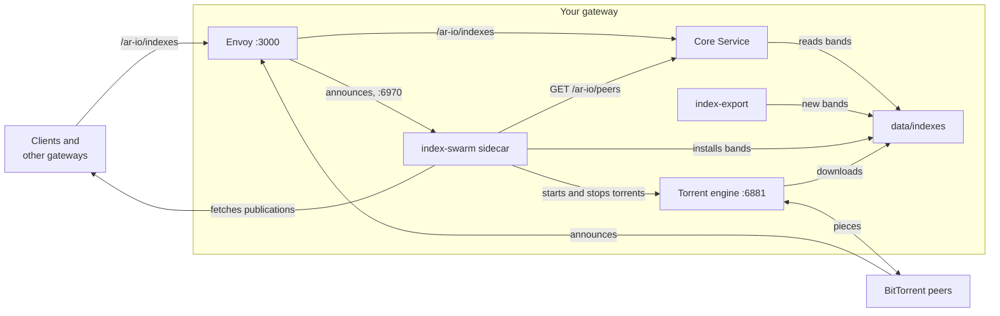
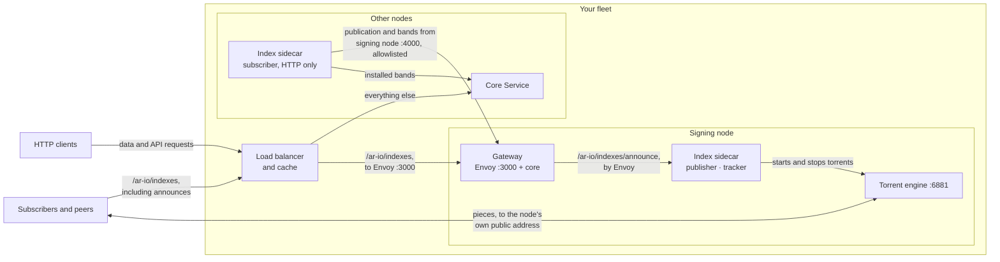

import { Step, Steps } from "fumadocs-ui/components/steps";
import { Callout } from "fumadocs-ui/components/callout";
import { Tabs, Tab } from "fumadocs-ui/components/tabs";
import { Card, Cards } from "fumadocs-ui/components/card";
import { BookOpen, Search, Settings, Zap } from "lucide-react";

Index Sharing lets your gateway find data items on its own disk instead of asking other gateways or GraphQL. To serve a data item, a gateway must know its [root transaction](/glossary#root-transaction): the Arweave transaction the item was bundled into, and where inside it the item sits. A [CDB64 index](/build/run-a-gateway/manage/cdb64) is a file that answers that lookup locally. With Index Sharing, one gateway (the **publisher**) builds these indexes and offers them in [bands](/glossary#index-band), each covering a range of block heights. Other gateways (**subscribers**) download the bands, check every file against the publisher's signature, and answer lookups from them. Bands move over HTTP and, through a torrent engine, peer to peer over BitTorrent.

For how it works and why a subscriber can trust it, see [Index Sharing](/learn/gateways/index-sharing) in Learn.

This page describes Release 88. Index Sharing needs Release 84 or later on your gateway and on the publisher, and is on by default from Release 85. Features added after that name their release where they appear; [Differences on Release 84](#differences-on-release-84) lists what changes on the oldest release.

## On by default

A plain `docker compose up -d` starts two services beside your gateway: the `index-swarm` sidecar, which subscribes, publishes and checks bands, and its torrent engine. With nothing set in `.env`, your gateway:

- **Subscribes to turbo-gateway.com's root transaction index**, published under the gateway wallet `34LYvMptiDvBP5sqfh1oAd6Q4qFsy4PWaZ1HTFmML7h5`, and only that index. L1 and L2 bands are opt-in.
- **Downloads the bands**, about 22 GB today, newest heights first, from BitTorrent peers with the publisher's HTTP routes as the fallback. It checks every file against the signed publication before installing it.
- **Searches the installed bands first.** The default `ROOT_TX_LOOKUP_ORDER` is `db,cdb,gateways,graphql,hyperbeam,cdb-remote`, and the default `CDB64_ROOT_TX_INDEX_SOURCES` lists `data/indexes/installed/root-tx-index` first.
- **Seeds the bands to other gateways**, capped at 10 MB/s and 100 GB a UTC day. See [Bounding upload](#bounding-upload).
- **Generates the torrent engine's password** on first start and keeps it in `data/indexes/engine-auth`, readable only by root and never logged. A value you set in `INDEX_SWARM_ENGINE_AUTH` wins.

A gateway whose `AR_IO_WALLET` is the turbo-gateway.com wallet never subscribes to itself.

What it costs, on top of what your gateway already uses:

| Resource | Default |
| --- | --- |
| Disk | About 22 GB of bands today, growing with the chain. `INDEX_SWARM_MAX_DISK_BYTES` caps it at 64 GiB. See [Disk](#disk) |
| Memory | About 0.4 GB: the sidecar about 90 MB, the engine about 300 MB, measured on a live gateway. The engine also maps the files it seeds into memory, which counts against a container memory limit |
| Download | About 22 GB the first time, then each new band |
| Upload | Up to 10 MB/s and 100 GB a day |
| Ports | 6881, TCP and UDP, open to the internet is recommended, not required. See [Ports](#ports) |

**To opt out**, set an empty subscription in `.env` and recreate the sidecar:

```bash
INDEX_SWARM_SUBSCRIBE=[]
```

```bash
docker compose up -d --no-deps index-swarm
```

Your gateway then downloads no new bands. Bands it already installed stay, and your gateway still searches them. From Release 86 the sidecar also stops seeding them; on Release 85 the engine goes on seeding them. To remove the bands or the services, see [Turning it off](#turning-it-off).

`INDEX_SWARM_SUBSCRIBE=` with no value is the same as leaving it unset, so the default subscription applies. Only `[]` opts out.

## How it runs



- The **sidecar** (`index-swarm`) runs the core image with a different entrypoint. It is the subscriber, the publisher, and on a publisher, a closed tracker that helps peers find each other.
- The **torrent engine** (`index-swarm-engine`, set up by the one-shot `index-swarm-engine-init`) runs on its own Docker network, shared only with the sidecar.
- **`index-export`** (Release 85) builds bands on a publisher. It sits behind the `index-export` compose profile.

If the sidecar stops, nothing your gateway serves changes: installed bands stay loaded.

**BitTorrent or HTTP only.** With the engine, your first download comes from peers, which no publisher meters, and the publisher's HTTP routes are the fallback. It works behind NAT or a closed port, because your gateway connects out to peers; an open port adds peers that can't connect to you first. The cost is that you seed what you install. Over HTTP only, every download goes through the publisher's rate limits and [x402 payments](/build/run-a-gateway/manage/x402-setup), which can take hours on a first download, and you upload nothing. To choose HTTP only, see [HTTP only](#http-only).

Two scripts in the gateway repository set it up and check it. Run them from the gateway's directory, where `.env` and `docker-compose.yaml` are. They need only Docker, since they run in the core image:

- `./tools/index-swarm-setup` edits `.env` and, with `--restart`, restarts what the changes need.
- `./tools/index-swarm-status` checks that everything works and says how to fix what doesn't.

Both are described in [The setup and status scripts](#the-setup-and-status-scripts).

## Subscribe to a publisher

Your gateway already subscribes to turbo-gateway.com. Follow these steps to add another publisher, or to take L1 or L2 bands.

You need a checkout of the gateway repository at your gateway's release (the scripts are in `tools/`), and free disk on the filesystem that holds `data/indexes` of at least the disk budget. See [Disk](#disk).

<Steps>
<Step>
### Choose a publisher

A publisher is identified by its **gateway wallet**, not its URL. Your gateway looks the wallet up in the gateway registry to learn where to fetch from and which key must have signed.

turbo-gateway.com publishes a root transaction index from block 0 to the chain tip, with offsets, under `34LYvMptiDvBP5sqfh1oAd6Q4qFsy4PWaZ1HTFmML7h5`. It covers the bundles turbo-gateway.com has indexed, so it is densest for recent data.

To see whether another gateway publishes, check its `/ar-io/info` for an `indexes` entry (`curl -s https://<gateway>/ar-io/info | jq .indexes`). Its `/ar-io/indexes` shows its wallet as `publisher`.

</Step>

<Step>
### Run the setup script

See what it would change, then run it for real:

```bash
./tools/index-swarm-setup --subscribe <publisher wallet> --dry-run
./tools/index-swarm-setup --subscribe <publisher wallet> --restart
```

The script keeps the default turbo-gateway.com subscription beside the new one, keeps a 64 GiB disk budget, and restarts only what needs it, by service name. Add `--l1` to take the publisher's L1 bands too; see [Take L1 bands](#take-l1-bands-parquet-l1). If you can, open the engine's peer port as [Ports](#ports) describes.

</Step>

<Step>
### Check it

```bash
./tools/index-swarm-status
```

Each line says `ok`, `WARN` or `FAIL`, and every problem comes with the fix. `All good` means your gateway is answering root transaction lookups from the installed bands.

</Step>
</Steps>

A first download of a full index takes minutes to hours over BitTorrent, and can take hours over HTTP. Downloads resume where they stopped if your gateway restarts. After that, new bands install, and replace the ones they supersede, by themselves; the gateway loads each within 30 seconds, without a restart.

Not every lookup hits. The status script's `CDB64 lookups (installed bands first) found X of Y` line shows how many did. A publisher's index covers only the bundles it indexed, and the band at the chain tip is rebuilt periodically, so the newest items aren't in it yet. A miss costs nothing: your gateway falls back to the rest of its lookup order. Following more than one publisher widens coverage.

### Take L1 bands (`parquet-l1`)

An **L1 band** holds the Arweave base layer (blocks, transactions, tags and wallets) in Parquet files, one height range per band. Requires Release 85 on your gateway and the publisher. Your gateway doesn't answer lookups from L1 bands. They are for:

- Filling your gateway's L1 history while it runs, instead of indexing the chain block by block. See [Bootstrap from L1 Bands](/build/run-a-gateway/manage/index-snapshots#bootstrap-from-l1-bands).
- Analytics: query the installed files with DuckDB or Polars, or read them over HTTP. See [Reading Shared Indexes](/build/advanced/index-publications).

A subscription takes L1 bands only when it names them. Add `--l1`:

```bash
./tools/index-swarm-setup --subscribe 34LYvMptiDvBP5sqfh1oAd6Q4qFsy4PWaZ1HTFmML7h5 --l1 --restart
```

This adds `parquet-l1` to the subscription's `name` list, sets `L1_BAND_IMPORT_ENABLED=true` so your gateway fills its L1 history from the bands, and restarts core. The whole chain is 24 L1 bands, about 15 GB more disk, sharing `INDEX_SWARM_MAX_DISK_BYTES` with root transaction bands. The script raises the budget to 100 GiB if it is unset or exactly the 64 GiB default, and warns if yours is lower.

Your gateway verifies every band before it writes a row of it, anchoring and sampling against `L1_BAND_IMPORT_SAMPLE_FROM` (by default the trusted node and the trusted gateways not marked `trusted: false`). See [Verified Before It Is Written](/build/run-a-gateway/manage/index-snapshots#verified-before-it-is-written). Bands of layout `l1-4` carry [witness files](/build/advanced/index-verification#witness-files-l1-4) that bind every block from genesis, so the whole chain fills with nothing more to set. Taking `l1-4` bands requires Release 87: a gateway on Release 86 keeps its `l1-3` copies but refuses each band its publisher upgrades, and retries it every poll.

On a new gateway, run the script before the first start and without `--restart` (on a stopped gateway, `--restart` would start only core and the sidecar). Then start the gateway as usual and leave `START_HEIGHT` unset. With an empty `core.db`, the gateway follows the chain tip from the start, and the history beneath arrives with the bands. On a running gateway, the bands fill whatever is missing beneath what it indexed itself.

Taking `parquet-l1` off the subscription retires its bands. History already filled from them stays in `core.db`.

### Take L2 bands (`parquet-l2`)

An **L2 index** holds the data items of one app, chosen by a **selection** (a tag name and a value prefix), in Parquet on the same height ranges as L1 bands, with their tags, owners, locations and lookup files. turbo-gateway.com publishes `ardrive-l2`: the items whose `App-Name` starts with `ArDrive` but not `ArDriver`. Apps and scripts can read an installed index directly (see [L2 Datasets](/build/advanced/index-publications#l2-datasets-parquet-l2)), and your gateway can import it.

Requires Release 85 on your gateway and the publisher. Bands of layout `l2-2`, which turbo-gateway.com publishes, require Release 86: an older sidecar refuses them and keeps the copies it has.

There is no setup-script flag. Add the index name to the subscription's `name` list in `.env`, then restart the sidecar:

```bash
INDEX_SWARM_SUBSCRIBE='[{"publisher":"34LYvMptiDvBP5sqfh1oAd6Q4qFsy4PWaZ1HTFmML7h5","name":["root-tx-index","parquet-l1","ardrive-l2"]}]'
```

The sidecar checks each band's files, footers, row counts and selection against the signed publication and installs it under `data/indexes/installed/<name>/`. Every band of an index must declare the same selection; a band or an index `filter` that disagrees is refused whole. Taking an index off `name` retires its bands. To check an installed index row by row, and a sample of its locations against Arweave nodes, run `index-l2-verify` (Release 86); see [Verifying Shared Indexes](/build/advanced/index-verification).

**Import L2 bands (Release 88).** Importing makes your gateway's GraphQL answer for the index's items without unbundling them. Set these in `.env`, then restart core:

```bash
L2_BAND_IMPORT_ENABLED=true
L2_BAND_IMPORT_INDEXES=ardrive-l2
L2_BAND_IMPORT_PUBLICATION=https://turbo-gateway.com/ar-io/indexes
```

- The import writes to ClickHouse by default, which needs `CLICKHOUSE_URL` and the `clickhouse-auto-import` service to load the queued bands. Without ClickHouse, set `L2_BAND_IMPORT_TARGET=sqlite` to write into `bundles.db` instead. All of `ardrive-l2` is about 370 GB there.
- Each band is verified before a row of it is written: bound to the signed publication, every root found in the L1 index (your installed or published `parquet-l1` bands, so subscribe to those too), and a sample of its items read from Arweave nodes. A band that fails a check is refused whole.
- Items your gateway already holds are left alone, and nothing above its stable top height is written.

## Publish your indexes

Any registered gateway can publish. Other gateways then find it in the registry and subscribe by its wallet. Publishing is for gateways that unbundle, so their index holds data items to build bands from.

The sidecar signs and serves the bands under `data/indexes/published/`; it doesn't build them. The `index-export` service (Release 85) builds them from your gateway's own index, once a day. To build them another way, see [By hand](#by-hand).

You need:

- A gateway **registered** in the gateway registry and reachable at its registered URL. The routes that serve bands live in the gateway, not the sidecar.
- Its registered **observer key**, which signs what it publishes.
- For `index-export`: a gateway that unbundles (`ANS104_UNBUNDLE_FILTER`), and for L2 indexes, into ClickHouse.
- For BitTorrent: the peer port open, and this node's public IP. Peers announce to your tracker through your gateway's HTTPS, which needs the Envoy image from Release 85 or later. See [Ports](#ports).

<Steps>
<Step>
### Set the signing key

Set your gateway's wallet, and **one** of the two ways to give the sidecar your registered observer key:

```bash
AR_IO_WALLET=<your gateway wallet>
```

<Tabs items={["Private key", "Keypair file"]}>
<Tab value="Private key">
```bash
OBSERVER_PRIVATE_KEY=<base58 observer private key>
```
</Tab>
<Tab value="Keypair file">
```bash
# Host path of the observer keypair file; only this file is mounted
INDEX_SWARM_OBSERVER_KEYPAIR_FILE=/path/to/observer-keypair.json
```
</Tab>
</Tabs>

If one Solana keypair does everything ([Pattern 1](/build/run-a-gateway/manage/solana-migration#supported-configurations)), the gateway reads it through `SOLANA_KEYPAIR_PATH` or `OBSERVER_KEYPAIR_PATH`, which the sidecar doesn't see. Set `INDEX_SWARM_OBSERVER_KEYPAIR_FILE` to that file's host path.

The setup script refuses to publish, and writes nothing, until the key and `AR_IO_WALLET` are set.

<Callout type="warning">
  **Don't use your observer key in a wallet that signs messages for dApps.**
  The sidecar signs over a fixed `ar-io-index-publication/v1` prefix, so no
  Solana transaction can pass for a publication, but a wallet asked to sign
  an arbitrary message with that prefix could produce one.
</Callout>

</Step>

<Step>
### Run the setup script

Write the settings to `.env` without restarting, dry-run the first build, then start it:

```bash
./tools/index-swarm-setup --publish --start-height 1950000 --public-host <this node's public IP>
docker compose --profile index-export run --rm -T index-export --once --dry-run > plan.json
./tools/index-swarm-setup --publish --restart
```

- `--start-height` is the lowest height `index-export` builds. Choose the lowest height your index holds data items for.
- `--public-host` is where peers reach this node's torrent engine.
- The script sets `INDEX_EXPORT_HEADER_CHECK_URL`, the gateway `index-export` checks a sample of each band against before publishing, to `https://turbo-gateway.com`. Pass `--header-check-url http://core:4000` only if your own gateway holds the root transactions' data.
- The dry run lists each band, its rows, the time and disk it needs, and the header check's result. Run it with the same `-f` files your gateway was started with. Nothing is published.
- `--restart` restarts the sidecar, the engine and `index-export` by service name, and recreates core if its index settings in `.env` differ from what it runs with. On a live gateway you can instead start the services yourself: `docker compose up -d --no-deps index-swarm index-export`, with your `-f` files.

The first scan reads and hashes every band once, which takes a few minutes for tens of gigabytes. Then open the peer port, as [Ports](#ports) describes.

</Step>

<Step>
### Check what you publish

```bash
./tools/index-swarm-status
curl -s https://<your-gateway>/ar-io/indexes | jq '{sequence, publisher, bands: [.indexes[].bands[].id]}'
curl -s https://<your-gateway>/ar-io/info | jq .indexes
```

</Step>
</Steps>

A gateway can do both: pass `--subscribe` and `--publish` together. Behind NGINX, read [Behind NGINX](#behind-nginx) before anyone subscribes. With more than one node behind a load balancer, read [Publishing from a fleet](#publishing-from-a-fleet).

### The tracker, feeds and WebSeed

Peers announce to your tracker through your gateway, at `<origin>/ar-io/indexes/announce`. The origin is `--public-url`, else `INDEXES_PUBLIC_URL`, else `https://<ARNS_ROOT_HOST>`. Envoy forwards that path to the sidecar, so it needs no port of its own; see [Ports](#ports). If the script finds no public origin but has a public host (`--public-host` or `INDEX_SWARM_ENGINE_PUBLIC_HOST`), it writes the tracker's direct port instead, `http://<public host>:6969/announce`, sets `INDEX_SWARM_TRACKER_HOST_IP=0.0.0.0`, and that port must be open (TCP). With neither, it writes no tracker and warns. An existing `INDEX_SWARM_TRACKERS` is always kept.

With torrents on, your gateway also serves an RSS feed of each index's torrents at `/ar-io/indexes/feed/<index>.xml` and lists the feeds in `/ar-io/info` under `indexes.feeds` (Release 85). Anyone can then follow your index in an ordinary BitTorrent client; see [Follow a Publisher with RSS](/build/advanced/bittorrent-indexes#follow-a-publisher-with-rss). Each `.torrent` your gateway serves also names your gateway as a [WebSeed](/glossary#webseed), so such a client can finish a band nobody is seeding.

Both need your gateway's public origin, `INDEXES_PUBLIC_URL`, which defaults to `https://<ARNS_ROOT_HOST>`. With neither set, the feeds answer `404` and `.torrent` files are served without a WebSeed.

A stock BitTorrent client pulls a large share of every band from the WebSeed even while seeders could serve it. If your gateway doesn't meter its byte routes, that is your core's egress, read from disk and outside the engine's upload limits. Meter the byte routes to bound it, or set `INDEXES_TORRENT_WEBSEED=false` to serve torrents without the WebSeed. Subscribing gateways drop the WebSeed either way, and add yours only when peers stall.

### What the daily run does

`index-export` first runs about five minutes after it starts, then daily at `INDEX_EXPORT_RUN_AT_UTC` (04:00 UTC by default). It reads your ClickHouse if `CLICKHOUSE_URL` is set, otherwise your SQLite (`INDEX_EXPORT_SOURCES` changes this). Each run:

- builds the history bands once, from `--start-height` up, and never again
- rebuilds a daily band from 512 blocks below the top of the newest history or recent band to the tip, published only when its content changed
- once a week, folds the daily rows into a recent band, which keeps rows your index has since expired
- checks a sample of each band against `INDEX_EXPORT_HEADER_CHECK_URL`, and publishes it only if the check passes

New bands supersede the ones they replace, so subscribers retire the old ones by themselves. A failed run withdraws nothing already published. A rejected band waits for you: `./tools/index-swarm-status` shows it as `FAIL` with the reason. After you fix the cause, run it once by hand:

```bash
docker compose --profile index-export run --rm -T index-export --once
```

If `published/` already holds bands built another way, `index-export` builds nothing until you hand them over with `--adopt`. The [`index-export` reference](https://github.com/ar-io/ar-io-node/blob/main/docs/index-export.md) covers adoption, disk and memory limits, metrics and troubleshooting.

### Publish L1 bands

`index-export` also builds L1 bands from your `core.db` (Release 85), if it holds every block from height 0. A gateway that started above it (`START_HEIGHT`) can't build them. Add both lines to `.env`:

```bash
INDEX_EXPORT_KINDS=root-tx-index,parquet-l1
INDEX_SWARM_PUBLISH='[{"name":"root-tx-index","kind":"cdb64-root-tx"},{"name":"parquet-l1","kind":"parquet-l1"}]'
```

The sidecar entry is needed too: the sidecar retires each superseded tip band, so without it `published/parquet-l1/` keeps every one. Every publisher cuts the chain into the same fixed ranges: a band per 100,000 heights, a band per 5,000 heights inside the newest range, and a tip band rebuilt each run. Bands are layout `l1-3`, with [lookup files](/build/advanced/index-publications#lookup-files), or from Release 87 layout `l1-4`, which adds witness files wherever the witnesses can be had.

The first build of the whole chain takes hours and reads all of `core.db` once, so start it off-peak. A run starts no new band after `INDEX_EXPORT_L1_RUN_BUDGET_MINUTES` (240 by default), and the next run carries on 15 minutes later. Dry-run it first, capped with `--to`:

```bash
docker compose --profile index-export run --rm -T index-export --once --dry-run --to 600000 > plan.json
```

#### Add witnesses (Release 87)

[Witness files](/build/advanced/index-verification#witness-files-l1-4) let a subscriber verify and import every block, from genesis, with no `--allow-*` flag. `index-export` builds them for new bands and adds them in place to the `l1-3` bands you already published, so those bands keep their ids and subscribers fetch only the new files. It takes its inputs from two variables:

| Variable | What it gives |
| --- | --- |
| `INDEX_EXPORT_L1_WITNESS_DIR` | A directory, as the container sees it, holding v1 data roots in `roots-*.jsonl` files (lines `{"h": <height>, "id": "<base64url>", "root": "<base64url>"}`), Arweave's 2.0 checkpoint as `fork_2_0_checkpoint`, and optionally Arweave's `hash_list_1_0`. In a clone of the Arweave repository, `git show d43ba2b9^:apps/arweave/priv/fork_2_0_checkpoint` prints the checkpoint; it is refused unless its SHA-256 is Arweave's |
| `INDEX_EXPORT_L1_WITNESS_NODES` | Comma-separated Arweave nodes (`http://host:1984`), asked for what the directory lacks: a format-1 transaction's last chunk, its data where a block's roots don't reproduce its `tx_root`, and `/block_index` from height 400,000 to the 2.0 fork. Unset, it uses core's `PREFERRED_CHUNK_GET_NODE_URLS`, else the default Arweave nodes |

For example, with the directory at `data/indexes/l1-witness` on the host, which `index-export` sees under `/app/data/indexes`:

```bash
INDEX_EXPORT_L1_WITNESS_DIR=/app/data/indexes/l1-witness
INDEX_EXPORT_L1_WITNESS_NODES=http://<arweave node one>:1984,http://<arweave node two>:1984
```

The inputs are untrusted. A root is kept only when its block's `tx_root` recomputes with it, and the band with its witnesses must pass the same check every consumer runs (`index-l1-verify --bands-dir`), with no block left unbound, before anything is published. A band that can't get every witness (a transaction whose data no node serves, for example) stays `l1-3`.

Compose passes a service only the variables its `docker-compose.yaml` entry lists, so a compose file older than Release 87 silently drops both and nothing gains witnesses. Check that yours lists them under `index-export`.

The daily run adds witnesses before and after its builds. To add them now:

```bash
docker compose --profile index-export run --rm -T index-export --once > run.json
```

The report lists each band under `l1Witnessed`, and `index_export_runs_total{kind="witness"}` counts them: `published` when added, `skipped` (`witnesses_unavailable`) when the inputs lack what the band needs, and `couldnt_check` when an input contradicts the chain. Upgrade subscribers first, then your `index-swarm` with or before your `index-export`, since a sidecar that doesn't know `l1-4` can't read the band.

### Publish an L2 index (`parquet-l2`)

An item is in an L2 index when one of its tags has the selection's exact name and its value starts with the prefix, compared as UTF-8 bytes; a selection can also name a longer prefix to leave out. Requires Release 85 and a gateway that unbundles into ClickHouse; `keyTags`, `statTags` and layout `l2-2` require Release 86.

`index-export` reads the items from your ClickHouse (`CLICKHOUSE_URL` and `CLICKHOUSE_USER`, or a peer's with `INDEX_EXPORT_L2_SOURCE`), places each at its root transaction's height, reads owners' keys and settles ambiguous locations through `INDEX_EXPORT_HEADER_CHECK_URL`, and writes bands on the same fixed ranges as L1 bands. Add the kind, the selections and the sidecar entries to `.env`:

```bash
INDEX_EXPORT_KINDS=root-tx-index,parquet-l1,parquet-l2
INDEX_EXPORT_L2_INDEXES='[{"name":"ardrive-l2","selection":{"kind":"ans104-data-items","tag":{"name":"App-Name","valuePrefix":"ArDrive","excludeValuePrefix":"ArDriver"}},"keyTags":["Drive-Id","Parent-Folder-Id","Folder-Id","File-Id"],"statTags":["App-Name","Content-Type","Entity-Type"]}]'
INDEX_SWARM_PUBLISH='[{"name":"root-tx-index","kind":"cdb64-root-tx"},{"name":"parquet-l1","kind":"parquet-l1"},{"name":"ardrive-l2","kind":"parquet-l2"}]'
```

- Each entry in `INDEX_EXPORT_L2_INDEXES` is one index, published under `data/indexes/published/<name>/`. The name matches `[a-z0-9-]{1,64}` and is by convention `<app>-l2`. The example is the index turbo-gateway.com publishes; any app's tag works, for example `{"name":"Protocol","valuePrefix":"MyProtocol"}`.
- A selection is part of every band's id, so it never changes. To index something else, add a new entry under a new name.
- `keyTags` and `statTags` (optional, at most 16 tag names each) name the tags each band's key lookup and stats are built for: the tags readers look values up by, such as a drive or folder ID, and the tags worth counting items and bytes by. They are not part of a band's id, so changing them later rewrites only those two files in every published band, in place.
- To read your index in the browser, [ar-io/index-explorers](https://github.com/ar-io/index-explorers) has a verifying client and a recipe for a new selection's page, [`docs/new-l2-index.md`](https://github.com/ar-io/index-explorers/blob/main/docs/new-l2-index.md).

Before a band publishes, `index-export` reads every table back against its row digest, derives the lookups again, checks every owner key against its address, and reads a sample of items through `INDEX_EXPORT_HEADER_CHECK_URL` at their recorded locations. A band that fails is left for the next run, and the run's report and `index_export_runs_total` say why. The files in a band are listed under [L2 Datasets](/build/advanced/index-publications#l2-datasets-parquet-l2).

On Release 86, `index-export` upgrades every published `l2-1` band to `l2-2` in place, under the same id. A subscriber on Release 85 refuses an `l2-2` band and keeps its copy, and a Release 85 `index-swarm` can't publish one. Upgrade subscribers first, then your `index-swarm` with or before your `index-export`.

Dry-run one band first, to see its rows, where its positions came from and the header check's result:

```bash
docker compose --profile index-export run --rm -T index-export --once --dry-run --range 1300000-1399999 > ardrive-l2.json
```

A first build over a long history can take days: each run starts frozen bands for `INDEX_EXPORT_L2_RUN_BUDGET_MINUTES` (240 by default) and the next carries on. Alarm on `index_export_last_success_timestamp_seconds{index="<name>",kind="tip"}`. Memory, disk and the other `INDEX_EXPORT_L2_*` settings are under [Building Bands](/build/run-a-gateway/manage/environment-variables#building-bands-release-85); the [`index-export` reference](https://github.com/ar-io/ar-io-node/blob/main/docs/index-export.md#l2-bands) covers where rows come from, the checks and the lifecycle.

### By hand

To publish bands built some other way, put each band in its own directory under `data/indexes/published/root-tx-index/`, built under a name ending in `.tmp` and renamed into place. The sidecar skips `.tmp` directories, so a band is never offered half-written:

```bash
./tools/export-sqlite-to-cdb64 --partitioned \
  --output-dir data/indexes/published/root-tx-index/band-tip.tmp
mv data/indexes/published/root-tx-index/band-tip.tmp data/indexes/published/root-tx-index/band-tip
```

This tool runs on the host, so it needs Node.js and `yarn install` in the checkout. `ar-io-node index-band-build` builds a band from CSV records in one step instead. Give each band a `heightRange` in its manifest's `metadata` so subscribers install the newest heights first, and replace a band by publishing a new one with `"supersedes": "<old band id>"`. See [Partitioned Indexes](/build/run-a-gateway/manage/cdb64#partitioned-indexes).

## The setup and status scripts

### `index-swarm-setup`

The script edits `.env` and nothing else, unless given `--restart`.

| Flag | Effect |
| --- | --- |
| `--subscribe <wallet>` | Adds the publisher to `INDEX_SWARM_SUBSCRIBE`. Repeatable. Keeps existing entries, and the default subscription when the variable was unset. Writes the 64 GiB budget if the subscription was the default one and no budget is set. Leaves `CDB64_ROOT_TX_INDEX_SOURCES` and `ROOT_TX_LOOKUP_ORDER` alone if they are unset, and otherwise fixes them as [Editing `.env` yourself](#editing-env-yourself) describes |
| `--publish` | Adds `root-tx-index` to `INDEX_SWARM_PUBLISH`, sets `INDEX_EXPORT_HEADER_CHECK_URL` (default `https://turbo-gateway.com`) and starts `index-export`. Sets `INDEX_SWARM_TRACKERS`, if unset, as [The tracker, feeds and WebSeed](#the-tracker-feeds-and-webseed) describes. Refuses, writing nothing, without a registered key or `AR_IO_WALLET` |
| `--start-height <n>` | With `--publish`: sets `INDEX_EXPORT_START_HEIGHT`, the lowest height `index-export` builds |
| `--header-check-url <url>` | With `--publish`: the gateway `index-export` checks sampled headers against |
| `--public-host <addr>` | Sets `INDEX_SWARM_ENGINE_PUBLIC_HOST` |
| `--engine-port <n>` | Sets `INDEX_SWARM_ENGINE_PORT` (default 6881). With `--restart`, the engine is recreated on the new port |
| `--public-url <origin>` | The gateway's public origin, such as `https://gateway.example`, for the tracker URL. Defaults to `INDEXES_PUBLIC_URL`, then `https://<ARNS_ROOT_HOST>`. To change the feeds' origin too, set `INDEXES_PUBLIC_URL` |
| `--l1` | With `--subscribe`: takes the publisher's L1 bands as well and sets `L1_BAND_IMPORT_ENABLED=true`. Raises the disk budget to 100 GiB if it is unset or exactly 64 GiB, and warns if an existing one is lower |
| `--max-disk-gib <n>` | Sets `INDEX_SWARM_MAX_DISK_BYTES`. Works on its own, to change an existing subscriber's budget |
| `--torrent` | Accepted for older instructions. Writes nothing, since the engine runs by default and generates its own password |
| `--no-gateway` | Leaves `CDB64_ROOT_TX_INDEX_SOURCES` and `ROOT_TX_LOOKUP_ORDER` alone |
| `--dry-run` | Shows the changes and writes nothing |
| `--restart` | Then recreates what needs it, by service name, with the compose files the running gateway was started with (plus `docker-compose.override.yaml`): core only when `CDB64_ROOT_TX_INDEX_SOURCES`, `ROOT_TX_LOOKUP_ORDER` or `L1_BAND_IMPORT_ENABLED` differ from what it runs with, then the engine and the sidecar. From Release 86 it leaves alone a service your compose files turn off, such as an engine set up for [HTTP only](#http-only) |
| `--env-file <path>` | A file other than `.env`, relative to the gateway's directory |

The script is idempotent: a second run changes only what is missing, so it is also how to add a publisher later. It never replaces a value it cannot parse or a password it did not write; it stops and says what to fix. Before writing, it copies `.env` to `.env.bak-index-swarm-<time>`, readable only by its owner, since it holds secrets. It warns when an explicit `ROOT_TX_LOOKUP_ORDER` keeps `hyperbeam`, which fails unless you run the `hb` profile, but does not remove it.

### `index-swarm-status`

The status script is read-only. It runs inside the sidecar, so it sees what the sidecar sees, and checks:

- that the sidecar is up and the gateway's release is new enough
- per publisher: the sequence accepted and its age, any `signature_failed`, `replayed` or `verify_failed`, and failed downloads
- installed bands and their size, bands skipped for the disk budget, and a warning past 80% of it
- that the gateway reads the installed directory, has every installed root transaction band loaded, and sends lookups to them (the gateway doesn't load L1 bands as an index, so they aren't counted)
- publishing: the document served, its expiry, and how many bands seed
- the torrent engine: that it answers, whether any peer has connected in (so a closed port shows), and the day's upload against the budget
- `index-export`, for root transaction and L1 bands: when each kind of band last succeeded, retries, and rejected bands

It exits `1` when a check fails, so it can run from cron or a health script.

### Editing `.env` yourself

What the setup script writes for a subscriber, if you would rather edit `.env` yourself:

```bash
INDEX_SWARM_SUBSCRIBE='[{"publisher":"34LYvMptiDvBP5sqfh1oAd6Q4qFsy4PWaZ1HTFmML7h5","name":"root-tx-index"},{"publisher":"<publisher wallet>","name":"root-tx-index"}]'
INDEX_SWARM_MAX_DISK_BYTES=68719476736   # 64 GiB; a subscription you set has no ceiling otherwise
```

Any value you set replaces the default subscription, so list turbo-gateway.com yourself to keep it. Removing a publisher retires the bands it installed. With `--l1`, the entry's `name` is `["root-tx-index","parquet-l1"]`, the budget is `107374182400` (100 GiB), and `L1_BAND_IMPORT_ENABLED=true`.

Leave `ROOT_TX_LOOKUP_ORDER` and `CDB64_ROOT_TX_INDEX_SOURCES` unset unless you need them. If you set them:

- `ROOT_TX_LOOKUP_ORDER` should put `cdb` right after `db` and end with `cdb-remote`, as in `db,cdb,gateways,graphql,cdb-remote`. Without `cdb-remote`, `cdb` also asks the shipped indexes, which are read from Arweave, right after `db`. Drop `hyperbeam` unless you run the `hb` profile.
- `CDB64_ROOT_TX_INDEX_SOURCES` should start with `data/indexes/installed/root-tx-index`, so a fresh band answers before the older shipped indexes. The default follows it with the three shipped indexes in `resources/`. You can leave those off: each lookup against them fetches from Arweave, and a subscribed set that covers the whole chain makes them redundant.

Then restart by service name, with the same `-f` files your gateway was started with. A bare `docker compose up` also starts or recreates every default service, including your observer:

```bash
docker compose up -d --no-deps core
docker compose up -d --no-deps index-swarm-engine-init index-swarm-engine index-swarm
```

### Differences on Release 84

- Index Sharing is off until you set it up. The sidecar and the engine sit in compose profiles: add `--profile index-swarm --profile index-swarm-torrent` to `docker compose` commands that name them. Later releases accept these flags and ignore them.
- BitTorrent needs `--torrent`, which generates `INDEX_SWARM_ENGINE_AUTH` (`swarm:` and 48 random hex characters). Without it, bands move over HTTP only. `--public-host` and `--engine-port` work only with `--torrent`.
- There is no `index-export`, L1 or L2 bands, feeds, `--start-height`, `--header-check-url`, `--public-url` or `--l1`. Publish bands [by hand](#by-hand).
- The setup script sets the disk budget to 50 GiB if unset, and writes the lookup settings itself. By hand, that is:

```bash
INDEX_SWARM_SUBSCRIBE='[{"publisher":"34LYvMptiDvBP5sqfh1oAd6Q4qFsy4PWaZ1HTFmML7h5","name":"root-tx-index"}]'
INDEX_SWARM_MAX_DISK_BYTES=53687091200   # 50 GiB
CDB64_ROOT_TX_INDEX_SOURCES=data/indexes/installed/root-tx-index,resources/cdb64-root-tx-index-non-ao-non-redstone-with-content-type-to-height-1820000,resources/cdb64-root-tx-index-non-ao-non-redstone-without-content-type-to-height-1820000,resources/cdb64-root-tx-index-ao-to-height-1820000
ROOT_TX_LOOKUP_ORDER=db,cdb,gateways,graphql
INDEX_SWARM_ENGINE_AUTH=swarm:<generated>   # only for BitTorrent: at least 16 characters, e.g. openssl rand -hex 24
```

On Release 84 the default lookup order asks `cdb` last, after every network source, so without that `ROOT_TX_LOOKUP_ORDER` your gateway would barely use the bands it downloaded. The sidecar publishes the tracker port, 6969, on every address.

## Network and disk

### Ports

| Port | Who needs it open | What for |
| --- | --- | --- |
| Your gateway's HTTP port (through Envoy or NGINX) | Publishers | Serving `/ar-io/indexes`, the band files, the `.torrent` files and tracker announces at `/ar-io/indexes/announce`. It is the port your gateway already serves on |
| 6881, TCP and UDP (`INDEX_SWARM_ENGINE_PORT`) | Publishers; recommended for subscribers | Peers connecting to your torrent engine. A publisher needs it, since subscribers must reach its engine. A subscriber works without it, but only peers it connects to can download from it |
| 6969, TCP (`INDEX_SWARM_TRACKER_PORT`) | Only publishers whose peers announce to it directly | The tracker's direct port. Published on `127.0.0.1` only unless you set `INDEX_SWARM_TRACKER_HOST_IP=0.0.0.0`; only a publisher listens on it |

Envoy forwards `/ar-io/indexes/announce` to a second tracker listener on the sidecar, `INDEX_SWARM_TRACKER_PROXY_PORT` (6970), which is never published, so there is nothing to open for it. The route needs the Envoy image from Release 85 or later: an older Envoy passes the path to core, which answers `404`, and every announce fails without an error. The engine's Web API is never published.

The engine doesn't use UPnP: behind a home router, forward 6881 yourself. Outbound, the sidecar needs HTTPS to each publisher's gateway, and the engine needs to reach peers anywhere on the internet on any port. If your host filters outbound traffic, allow both.

The sidecar publishes 6969 and the engine publishes 6881 whenever they run, and a container won't start if another program holds its port. Check before upgrading that nothing else on the host holds either. Two gateways on one host each need their own `INDEX_SWARM_ENGINE_PORT`. Move the engine with `--engine-port` and the tracker with `INDEX_SWARM_TRACKER_PORT`. Keep the engine port below 32768: Linux uses 32768-60999 for outgoing connections, and one of those can hold the port when the engine restarts.

**Firewalls.** Docker forwards published ports before the host's `INPUT` chain sees them, so a host firewall such as ufw neither blocks nor protects them. Open them wherever traffic reaches the host (a cloud security group or router, for example). To restrict them on the host, filter where Docker forwards: with Docker's default iptables backend, the `DOCKER-USER` chain; with its nftables backend, which has no `DOCKER-USER`, a chain of your own table on the `forward` hook, at a priority before Docker's.

**Isolation.** Other gateways choose the peers and trackers the engine talks to, so the engine's Docker network reaches only the sidecar, and its IP filter refuses private, loopback, link-local and carrier-grade NAT addresses. It can write only its own download and configuration directories; the bands your gateway serves are mounted read-only.

Some hosting providers restrict BitTorrent traffic in their terms of service. Check yours.

### Disk

- **The budget is a ceiling, not a reservation.** `INDEX_SWARM_MAX_DISK_BYTES` is 64 GiB by default with the default subscription and has no ceiling with a subscription you set yourself (`0` is no ceiling). Nothing sets the space aside, so keep at least the budget free on the filesystem. The budget counts installed bands, downloads in progress, and a band that may come over BitTorrent at twice its size (the download and the copy that installs). A band that would go over is skipped, and `index-swarm-status` says so.
- **One filesystem.** Everything under `data/indexes` must be on one filesystem: an install is a rename and a publisher seeds from hard links. To put it on another disk, move the whole directory and set `INDEX_SWARM_DATA_PATH`; the gateway mounts the same path.
- **SSD or spinning disk.** An installed band answers a lookup from local disk in milliseconds, far faster than asking the network. Before installing, the sidecar reads each band once to check it, about a minute for a 7 GB band on a spinning disk. If the same disk also serves your gateway's data, cap the download rate with `INDEX_SWARM_DOWNLOAD_RATE_LIMIT_BYTES_PER_SEC`.

### Bounding upload

After the first download of about 22 GB, a subscriber downloads each new band: the publisher rebuilds the tip band daily and adds a band every few days. Upload is the larger cost. Every byte you seed is your upload, and a peer can fetch the bands again and again. Every node that runs the engine seeds, subscribers included, so two limits apply to every node:

| Variable | Default | Effect |
| --- | --- | --- |
| `INDEX_SWARM_UPLOAD_LIMIT_BYTES_PER_SEC` | `10000000` (10 MB/s) | Caps the engine's upload rate. `0` is unlimited |
| `INDEX_SWARM_UPLOAD_DAILY_LIMIT_BYTES` | `100000000000` (100 GB) | Caps upload per UTC day. Once spent, seeding is throttled to 1 KiB/s until the next UTC day. Downloads and the HTTP routes are unaffected. `0` is no budget |

At the defaults that is up to 100 GB a day, about 3 TB a month: on a host that charges for bandwidth, lower them. A large publisher should raise both.

## Tuning the torrent engine

Besides the port ([Ports](#ports)), upload limits ([Bounding upload](#bounding-upload)) and disk budget ([Disk](#disk)), these settings are worth changing. Set them in `.env` and restart the sidecar and the engine:

| Variable | Default | When to change it |
| --- | --- | --- |
| `INDEX_SWARM_DOWNLOAD_RATE_LIMIT_BYTES_PER_SEC` | no cap | A spinning disk that also serves your gateway |
| `INDEX_SWARM_DOWNLOAD_CONCURRENCY` | `4` | Files of one band fetched over HTTP at once. Lower it on a slow disk or link |
| `INDEX_SWARM_WEBSEED_AFTER_SECONDS` | `120` | How long a torrent may stall before the publisher's WebSeed is added. The WebSeed is metered like the HTTP routes |
| `INDEX_SWARM_TORRENT_TIMEOUT_SECONDS` | `3600` | How long a torrent may go without progress before the band is fetched over HTTP instead |
| `INDEX_SWARM_ENGINE_PUBLIC_HOST` | host of the tracker URL | A publisher whose gateway name doesn't resolve to this node, such as one behind a CDN or a load balancer that doesn't forward the peer port |

### Sharing between your own gateways

If you run several gateways on one private network, they can seed bands to each other over it instead of each pulling from the internet. By default the engine refuses private addresses, so that other gateways can't use it to reach your network. For a private swarm, set `INDEX_SWARM_ENGINE_BLOCK_PRIVATE=false` on each node and list your own tracker's announce URL in `INDEX_SWARM_ALLOWED_TRACKERS`. Do this only on a network you control.

## Publishing from a fleet

A large gateway can be several nodes behind an HTTP load balancer, with only one of them holding the observer key and signing.



1. **One node publishes and seeds.** Send the whole `/ar-io/indexes` prefix to the signing node, which runs the engine and the tracker. Nodes that don't publish answer `404`, and two nodes publishing with the same key diverge, so subscribers refuse the lower sequence.
2. **The peer port reaches that node directly.** The load balancer can't carry BitTorrent. Publish `INDEX_SWARM_ENGINE_PORT` (TCP and UDP) on the node's own public address, make sure the internet reaches it there (see Firewalls under [Ports](#ports)), and set `INDEX_SWARM_ENGINE_PUBLIC_HOST` (`--public-host`) to that address. Otherwise the tracker lists the engine under the host of its tracker URL, which for a fleet is the load balancer.
3. **The tracker goes through the load balancer.** Announce to `https://<gateway>/ar-io/indexes/announce`. The pin must reach the signing node's **Envoy (port 3000)**; pinned to core (port 4000), announces get `404`. The load balancer and any proxy after it must append `X-Forwarded-For` (`proxy_set_header X-Forwarded-For $proxy_add_x_forwarded_for;`), and any proxy that reaches the node from a public address goes in `INDEX_SWARM_TRACKER_TRUSTED_PROXIES`. Otherwise every peer appears at the proxy's address and the tracker's per-address limits throttle them together. Announcing directly to `http://<node address>:6969/announce`, with `INDEX_SWARM_TRACKER_PORT` published there, also works.
4. **Everything else is under the same prefix.** The `.torrent`, WebSeed and feed routes are under `/ar-io/indexes`, so the pin and the [NGINX block](#behind-nginx) cover them.

**Rate limiting and x402** need nothing extra. They apply to the byte routes (files by name, by digest, and the WebSeed) as they do to data; the publication, the feeds and the `.torrent` files are free. Peer-to-peer transfer never touches the gateway, and an announce goes through Envoy to the sidecar, never to core. Because `/ar-io/indexes` goes to one node, all metering happens there.

### Advertising from the other nodes

`/ar-io/info` describes the node that answered, so leave it on every node. A node that doesn't sign has no `indexes` block of its own: set `INDEXES_ADVERTISE_FROM_URL` (Release 85) on it to the signing node's gateway URL. The node then fetches the publication every minute and advertises the same `indexes` block, as long as the signature verifies and the publisher is its own `AR_IO_WALLET`.

It advertises the feeds too when it has a public origin of its own (`INDEXES_PUBLIC_URL` or `ARNS_ROOT_HOST`). The signing node serves the feeds, so give it a public origin as well.

### Giving the other nodes the index

If your other nodes answer lookups from their own disk, they need the bands installed too. Subscribe each one over HTTP to your own publication, pointed at the publishing node directly:

```bash
INDEX_SWARM_SUBSCRIBE='[{"publisher":"<your gateway wallet>","name":"root-tx-index","url":"http://<publishing node>:4000"}]'
```

`url` only changes where the publication and files are fetched from. The signature is still checked against your registered observer key, so an internal address is safe. This needs Release 85 on those nodes' core, which tells the sidecar about its own wallet's registry entry. Add those nodes' addresses to `RATE_LIMITER_IPS_AND_CIDRS_ALLOWLIST` on the publishing node, so they aren't rate-limited or asked to pay. They don't need a torrent engine: between nodes on one network, HTTP is simpler.

## Behind NGINX

Give `/ar-io/indexes` its own uncached location, with no trailing slash, that forwards the client IP. A cache breaks range reads and per-subscriber rate limits, and a trailing slash redirects the publication every subscriber polls. The tracker at `/ar-io/indexes/announce` reads each peer's address from `X-Forwarded-For` and is reached only through Envoy, so point the location at Envoy (port 3000), not core (port 4000). [Advanced NGINX Caching](/build/run-a-gateway/manage/nginx-caching#index-sharing) has the location block.

## Monitoring

`./tools/index-swarm-status` covers the day-to-day checks. The sidecar also serves Prometheus metrics on port `9101` inside its container. The ones worth watching:

| Metric | What it tells you |
| --- | --- |
| `index_subscription_manifest_age_seconds` | How old each publisher's latest publication is. **Alarm if it climbs past a day** (the default publication TTL): the publisher has gone quiet |
| `index_swarm_installed_bands` | How many bands are live |
| `index_subscription_total{result}` | Outcomes of each poll. `signature_failed` should always be zero. `transport_fallback` means a torrent was not used and the band came over HTTP |
| `index_subscription_bytes_total{transport}` | Bytes fetched over `http` or `torrent`: how much the swarm carries |
| `index_swarm_engine_available` | `1` while the torrent engine answers. Absent when none is configured |
| `index_swarm_upload_today_bytes`, `index_swarm_upload_throttled` | Seeding today against the daily budget; `1` means it is spent and seeding is throttled until the next UTC day |
| `index_publish_total{result}` | On a publisher: `published`, `unchanged` or `failed` |
| `index_publish_seeding_bands` | On a publisher: bands handed to the engine. Below `index_publish_bands` means some are offered over HTTP only |
| `index_swarm_tracker_seeding_hosts`, `index_swarm_tracker_seeders` | On a publisher: who shares your index. Seeding hosts are the other hosts seeding at least one of your bands, roughly how many gateways share it; seeders are the peers holding a whole band, per band. Peers found only through DHT or peer exchange aren't counted |

On the gateway, `indexes_requests_total{route,status}` shows who is downloading from you, by route (`publication`, `file`, `blob`, `torrent`, `webseed`, `feed`), including `402` and `429` from your rate limits.

`index-export` serves its own metrics on port `9102` inside its container:

| Metric | What it tells you |
| --- | --- |
| `index_export_runs_total{index,kind,result}` | Band builds by outcome: `published`, `unchanged`, `skipped`, `couldnt_check` (retried by itself) or `rejected` (waits for you). **Alarm on `rejected`** |
| `index_export_last_success_timestamp_seconds{index,kind}` | When a kind of band last published or was found unchanged. **Alarm if the daily root transaction band (`kind="d"`) is more than two days old** (`kind="tip"` in the grid layout and for L2 indexes) |

## Troubleshooting

Run `./tools/index-swarm-status` first: it names most problems and their fix.

**Nothing installs, and the logs show `402` or `429`.** The publisher is rate-limiting you. It is expected on a first download over HTTP: each poll picks up where the last stopped. Turn on BitTorrent, ask the publisher to allowlist you, or wait.

**Bands installed, but lookups still go to the network.** If you set `ROOT_TX_LOOKUP_ORDER` or `CDB64_ROOT_TX_INDEX_SOURCES` yourself, check them against [Editing `.env` yourself](#editing-env-yourself). Both need a gateway restart; `./tools/index-swarm-setup --restart` does it.

**No peer has connected in.** Port 6881 is closed somewhere between the internet and the engine. Bands still arrive, and the peers you connect to can download from you. Open or forward the port if you can; for a subscriber it is optional.

**Announces to `/ar-io/indexes/announce` get `404`.** The route is Envoy's. Either Envoy is older than Release 85, or a proxy or fleet pin for `/ar-io/indexes` reaches core (port 4000) instead of Envoy (port 3000). Upgrade the Envoy image with core, and point the proxy at Envoy. Check it the way the setup script does: `curl -s 'https://<your-gateway>/ar-io/indexes/announce?info_hash=x'` should print a bencoded `failure reason` from the tracker. A `404` means the route doesn't reach Envoy's tracker; a `503` means Envoy has the route but nothing answers on the sidecar's port 6970.

**`Bind for 127.0.0.1:6969 failed: port is already allocated`** (`0.0.0.0:6969` on Release 84, or `6881`). Another program holds the port, so the sidecar (6969) or the engine (6881) can't start. Move the engine with `--engine-port`, or the tracker with `INDEX_SWARM_TRACKER_PORT`, and restart.

**The engine refuses the sidecar.** Check `INDEX_SWARM_ENGINE_AUTH`, or with it unset, that the engine's init and the sidecar were both recreated since `data/indexes/engine-auth` last changed. The sidecar doesn't retry a failed login, because the engine bans an address after five.

**`Publication was signed by an unregistered key`.** The publication was not signed by the observer key registered for that wallet. Check the publisher's registry record. After a key change, your gateway's registry view takes up to an hour to refresh.

**`Set OBSERVER_KEYPAIR_PATH or OBSERVER_PRIVATE_KEY, not both`.** On a publisher, `OBSERVER_PRIVATE_KEY` and `INDEX_SWARM_OBSERVER_KEYPAIR_FILE` are both set (inside the sidecar, `INDEX_SWARM_OBSERVER_KEYPAIR_FILE` becomes `OBSERVER_KEYPAIR_PATH`). Keep one.

**`Gateway is too old to load installed index bands`.** Upgrade the gateway to Release 84 or later. The sidecar notices the upgrade by itself.

## Turning it off

Stopping the sidecar changes nothing your gateway serves: installed bands stay loaded, and published bands stay served from the last publication written. Subscribers see that publication age and, once it expires, alarm.

### Stop subscribing

Set `INDEX_SWARM_SUBSCRIBE=[]` and recreate the sidecar, as [On by default](#on-by-default) shows. Bands already installed stay in use until you remove them as described in [Remove Index Sharing](#remove-index-sharing); from Release 86 they are no longer seeded. Unsetting `INDEX_SWARM_SUBSCRIBE` again resumes seeding them without downloading anything again.

### HTTP only

To keep subscribing but move bands over HTTP only, keep the two engine services from starting. Put them behind a profile you never enable, in `docker-compose.override.yaml`:

```yaml
services:
  index-swarm-engine-init:
    profiles: [disabled]
  index-swarm-engine:
    profiles: [disabled]
```

Then remove the engine and recreate the sidecar:

```bash
docker compose --profile disabled stop index-swarm-engine
docker compose --profile disabled rm -f index-swarm-engine index-swarm-engine-init
sudo rm data/indexes/engine-auth
docker compose up -d --no-deps --force-recreate index-swarm
```

If you set `INDEX_SWARM_ENGINE_AUTH` in `.env`, remove it before the last command. The sidecar reads the password only when it starts, which is why it is recreated; with no password, it moves bands over HTTP only. If you start your gateway with `-f` files, add `-f docker-compose.override.yaml` to each command: passing `-f` turns off loading the override file automatically.

From Release 86, `./tools/index-swarm-setup --restart` leaves the engine off on a gateway set up this way. On Release 85 it names the engine services, and Compose starts a service named on the command line even when its profile is off, so run the script without `--restart` and recreate what it lists, leaving out the engine services.

### Remove Index Sharing

The sidecar and the engine start with every `docker compose up -d`, so a stopped container comes back on the next one. To keep them from starting, put all three services behind a profile you never enable, in `docker-compose.override.yaml`:

```yaml
services:
  index-swarm:
    profiles: [disabled]
  index-swarm-engine-init:
    profiles: [disabled]
  index-swarm-engine:
    profiles: [disabled]
```

Then stop and remove them:

```bash
docker compose --profile disabled stop index-swarm index-swarm-engine
docker compose --profile disabled rm -f index-swarm index-swarm-engine index-swarm-engine-init
```

On Release 84, stop and remove `index-swarm` with `--profile index-swarm`, and the engine services with `--profile index-swarm-torrent`; nothing starts them again unless you name those profiles.

Then delete `data/indexes/swarm/`, `data/indexes/torrents/`, `data/indexes/engine-auth` and `data/index-swarm-engine/` (some are owned by root, so use `sudo`). Remove `INDEX_SWARM_ENGINE_AUTH` from `.env` too, if you set it: while it is set, the sidecar expects the engine and warns that it is not answering.

- **On a subscriber**, restore your previous `CDB64_ROOT_TX_INDEX_SOURCES` if you set one (the default includes the installed directory, which is harmless once it is gone). Remove `L1_BAND_IMPORT_ENABLED` and `L2_BAND_IMPORT_ENABLED` if set, restart the gateway, then delete `data/indexes/installed/`. In that order, so the gateway no longer holds the files open. History already filled from bands stays in your gateway's databases.
- **On a publisher**, stop and remove `index-export` (profile `index-export`), then delete `data/indexes/published/publication.json`. The gateway stops serving the routes on its next request, without a restart. The band directories can then go too; `index-export` writes them as root, so removing them takes `sudo`.

## Related

<Cards>
  <Card
    title="Index Sharing Explained"
    description="How bands move between gateways, and why a subscriber doesn't have to trust the publisher's server or its peers"
    href="/learn/gateways/index-sharing"
    icon={<BookOpen className="w-8 h-8" />}
  />
  <Card
    title="CDB64 Root Transaction Index"
    description="The index format your gateway loads, and building your own bands"
    href="/build/run-a-gateway/manage/cdb64"
    icon={<Search className="w-8 h-8" />}
  />
  <Card
    title="Environment Variables"
    description="Every Index Sharing setting"
    href="/build/run-a-gateway/manage/environment-variables#index-sharing"
    icon={<Settings className="w-8 h-8" />}
  />
  <Card
    title="Reading Shared Indexes"
    description="For client and app developers: verify a publication and look up an ID without a gateway's help"
    href="/build/advanced/index-publications"
    icon={<Zap className="w-8 h-8" />}
  />
</Cards>
