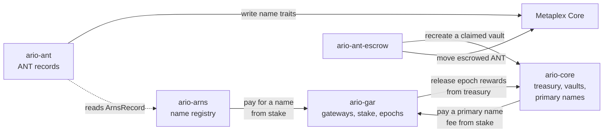
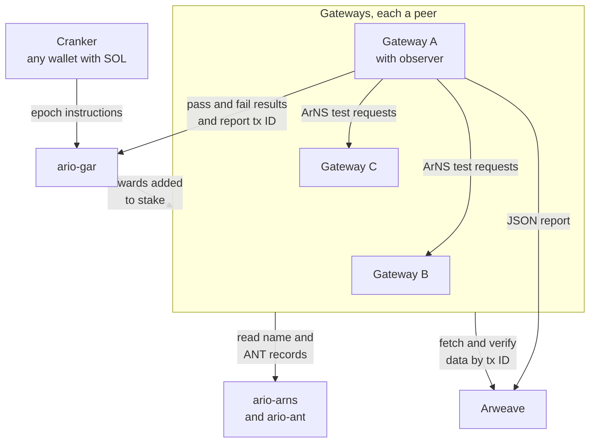

## Overview

The ar.io protocol runs as five Solana programs. Each one owns one part of the protocol. They call each other through [cross-program invocation (CPI)](/glossary#cpi-cross-program-invocation), where one program calls another inside the same transaction.

For the deployed Solana mainnet program IDs and ARIO token mint, see [Mainnet Addresses](/learn/token#mainnet-addresses).

The first diagram shows how the programs call each other on chain. The second shows the off-chain actors that drive them.

### Calls between programs

Solid arrows are CPIs. The dashed arrow is a read of another program's account. The diagram leaves out two things:

- Plain ARIO transfers. ario-core, ario-gar, ario-arns, and ario-ant-escrow each move ARIO by calling the standard SPL Token program directly.
- Other account reads. ario-arns reads a buyer's Gateway account to apply the operator discount, ario-gar reads the NameRegistry to prescribe names, and ario-core reads ArnsRecord accounts to price primary names.

ario-ant-escrow checks Arweave claims against an `Ed25519Program` instruction in the same transaction, and Ethereum claims with the `secp256k1_recover` syscall. Neither is a CPI.

### Who drives the programs

## Programs

### ario-core

The core program manages the ARIO token configuration, the protocol treasury, vaults, and primary names:

- **Token**: ARIO is a standard SPL Token (6 decimals, 1 ARIO = 1,000,000 mARIO). Transfers, balances, and token accounts follow the SPL Token standard.
- **Vaults**: Time-locked ARIO deposits, used for ecosystem programs and other protocol incentives.
- **Primary names**: A mapping from a wallet address to one ArNS name, and back.

### ario-gar (Gateway Address Registry)

Manages the network's gateway infrastructure, staking, delegation, and the epoch reward pipeline:

- **Gateway registry**: An onchain registry of network gateways. Each gateway is a PDA storing operator address, stake, observer address, settings, and performance stats.
- **Staking and delegation**: Operator stakes, delegated stakes (separate PDA per gateway-delegator pair), withdrawals, redelegation, and allowlists.
- **Observer address uniqueness**: An ObserverLookup PDA enforces that no two gateways share the same observer address.
- **Epoch pipeline**: Permissionless instructions submitted by [crankers](/learn/oip/epoch-pipeline), plus one signed by each prescribed observer:
  1. `create_epoch`: create the epoch account and compute its reward allocation
  2. `tally_weights`: compute gateway weights, in batches
  3. `prescribe_epoch`: select observers and prescribed names by weighted roulette
  4. `save_observations`: each prescribed observer submits its pass and fail results
  5. `distribute_epoch`: pay rewards after the epoch ends, in batches
  6. `close_observation`: close each Observation account and refund its rent to the observer
  7. `close_epoch`: close the epoch account at least 7 epochs later and refund its rent to the creator recorded at `create_epoch`, or to the closer if none was recorded
- **Gateway pruning**: A gateway that fails 30 epochs in a row can be pruned by anyone. It loses its minimum operator stake and leaves the network. See [Gateway pruning](/learn/oip/pruning).

### ario-arns (ArNS Registry)

Manages the Ar.io Name System (ArNS): name registration, leasing, pricing, and returned names.

- **Name registry**: An onchain registry of ArNS domains. Each name is an ArnsRecord PDA storing the owner, ANT mint address, lease type, and expiration.
- **Pricing**: Dynamic pricing via a DemandFactor PDA.
- **Returned name auctions**: When a lease ends past its grace period, or a permanent name is released, the name enters a 14-day Dutch auction. See [Returned names](/learn/arns/returned-names).
- **Validation**: Names must meet the [naming rules](/learn/arns/name-registration).
- **Cost simulation**: `get_token_cost` view instruction available via `simulateTransaction` for fee estimation.

### ario-ant (Ar.io Name Tokens)

ANTs are [Metaplex Core](https://developers.metaplex.com/core) NFTs that represent ownership of ArNS names:

- **NFT standard**: Each ANT is a Metaplex Core asset, tradeable on Tensor, Magic Eden, and other NFT marketplaces.
- **DNS-like records**: Each ANT stores routing records (AntRecord PDAs) mapping undernames to Arweave transaction IDs or IPFS CIDs, with configurable TTL values.
- **Controllers**: Controllers can manage records without holding the NFT itself.
- **Lazy reconciliation**: When an ANT changes hands outside the ar.io protocol, for example on a marketplace, its controllers are cleared on the next write, so the new owner has full control.

### ario-ant-escrow

An escrow that holds an ANT, liquid ARIO, or a time-locked vault for a recipient known only by an Arweave or Ethereum address. The recipient claims it once they have a Solana wallet. No off-chain authority or oracle decides a claim.

- **ANT escrow**: Holds a Metaplex Core ANT NFT in a per-mint PDA until the named recipient claims it.
- **Token and vault escrow**: Holds liquid ARIO or a time-locked vault the same way, in a PDA per depositor and asset ID.
- **Claims**: An Arweave claim is attested off-chain, re-signed with Ed25519, then verified onchain. An Ethereum claim is verified onchain with `secp256k1_recover` and an EIP-191 signed message. A vault claim keeps the vault's remaining lock.

See the [Escrow SDK reference](/sdks/ar-io-sdk/escrow).

## State model

All protocol state lives in Solana accounts at [Program Derived Addresses (PDAs)](/glossary#pda-program-derived-address), addresses each program derives from fixed seeds:

| Account Type | Program | Derivation Seeds | Purpose |
|-------------|---------|-----------------|---------|
| ArioConfig | ario-core | `["ario_config"]` | Global token configuration |
| Vault | ario-core | `["vault", owner, vault_id]` | Time-locked token deposit |
| PrimaryName | ario-core | `["primary_name", name_hash]` | Name → address mapping |
| PrimaryNameReverse | ario-core | `["primary_name_reverse", owner]` | Address → name reverse lookup |
| GatewayRegistry | ario-gar | `["gateway_registry"]` | Zero-copy gateway slot array |
| Gateway | ario-gar | `["gateway", operator]` | Individual gateway state |
| Delegation | ario-gar | `["delegation", gateway, delegator]` | Per-pair delegation |
| Withdrawal | ario-gar | `["withdrawal", owner, id]` | Pending withdrawal |
| ObserverLookup | ario-gar | `["observer_lookup", observer]` | Observer uniqueness check |
| Epoch | ario-gar | `["epoch", epoch_index]` | Epoch state and rewards |
| Observation | ario-gar | `["observation", epoch_index, observer]` | One observer's results for one epoch |
| NameRegistry | ario-arns | `["name_registry"]` | Zero-copy name slot array |
| ArnsRecord | ario-arns | `["arns_record", name_hash]` | Individual name record |
| DemandFactor | ario-arns | `["demand_factor"]` | Current pricing multiplier |
| AntConfig | ario-ant | `["ant_config", mint]` | ANT metadata and settings |
| AntControllers | ario-ant | `["ant_controllers", mint]` | Controller list (max 4) |
| AntRecord | ario-ant | `["ant_record", mint, undername_hash]` | DNS-like routing record |
| EscrowAnt | ario-ant-escrow | `["escrow_ant", ant_mint]` | ANT held in escrow for a claimant |
| EscrowToken | ario-ant-escrow | `["escrow_token" or "escrow_vault", depositor, asset_id]` | ARIO or vault held in escrow for a claimant |

## Security model

The protocol relies on Solana's runtime checks, accounts that only the right program can change, and staked ARIO:

- **Signer and account checks**: Solana enforces transaction signatures, account ownership, and program execution rules.
- **PDAs**: Each piece of protocol state lives at an address only its own ar.io program can sign for.
- **Economic accountability**: Gateway operators stake ARIO, and a gateway that keeps failing can be pruned and lose stake.
- **Permissionless verification**: Anyone can crank the epoch pipeline, and every observer report is public on Arweave.
