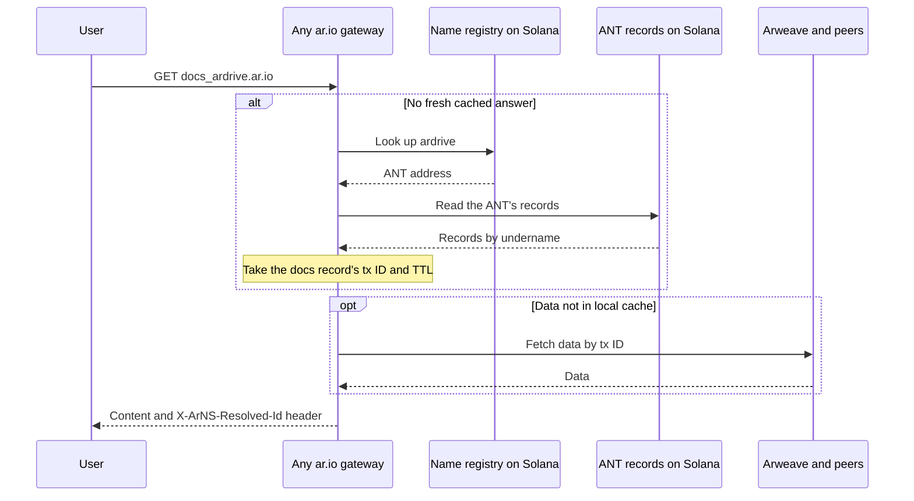

import { Card, Cards } from "fumadocs-ui/components/card";
import { Globe, Key, DollarSign, ShoppingCart } from "lucide-react";

## What ArNS does

An Arweave transaction ID is a 43-character string that is hard to remember and share. The Ar.io Name System (ArNS) gives your data a friendly name, such as `ardrive`, that works as a subdomain on any ar.io gateway that supports ArNS, for example `https://ardrive.ar.io`.

ArNS works like DNS, with three differences:

- No single company runs the registry. It lives on Solana, so anyone can check who owns a name.
- You pay for names in [ARIO](/learn/token). You can lease a name for 1 to 5 years or buy it permanently.
- A name points to data stored on Arweave, not to a server.

## How names resolve

When you register a name, you receive an Ar.io Name Token (ANT), an NFT on Solana that controls the name. Whoever holds the ANT sets its records. Each record points an undername to an Arweave transaction ID, so you can move the name to a new version of your app at any time.

Undernames use an underscore: `docs_ardrive.ar.io` asks for the `docs` record on the ANT behind `ardrive`, and `ardrive.ar.io` asks for its `@` record.

Every [gateway](/learn/gateways) resolves names on its own, by reading the name registry and the ANT's records from Solana:

If a gateway cannot read a name from Solana, it can ask a trusted gateway for the answer instead.

## Explore ArNS

<Cards>
  <Card
    title="Register ArNS Names"
    description="Learn how to register permanent names and understand validation rules"
    href="/learn/arns/name-registration"
    icon={<Globe className="w-8 h-8" />}
  />
  <Card
    title="Ar.io Name Tokens (ANTs)"
    description="Understand ownership, control, and interaction permissions for names"
    href="/learn/arns/ants"
    icon={<Key className="w-8 h-8" />}
  />
  <Card
    title="Pricing Model"
    description="Explore dynamic pricing, demand factors, and gateway discounts"
    href="/learn/arns/pricing-model"
    icon={<DollarSign className="w-8 h-8" />}
  />
  <Card
    title="Buy ArNS Names"
    description="Start registering names for your permanent applications"
    href="https://arns.ar.io"
    icon={<ShoppingCart className="w-8 h-8" />}
  />
</Cards>
