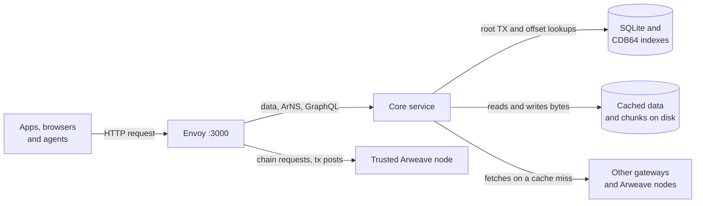
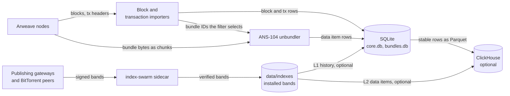

import { Database, Shield, Layers, Server } from 'lucide-react';

ar.io gateways are data access layers built on top of Arweave. They make permanent data easier to retrieve, cache, index, and serve through standard web interfaces.

A gateway does two jobs at once. It answers requests, and in the background it indexes the chain so that it can find data later.

### Serving a request

Envoy also sends `/ar-io/observer` requests to the observer. Each epoch the observer checks other gateways, uploads its report to Arweave and records the result on Solana. See [Observation and Incentives](/learn/oip).

### Indexing in the background

A gateway indexes blocks and transactions itself, and unbundles the bundles its filter selects. It can also install signed index bands that other gateways publish, through [Index Sharing](/learn/gateways/index-sharing).

## Core technology stack

### Runtime and language
- **Node.js** runs every gateway service.
- **TypeScript**: the services are written in it, with interfaces you can swap for your own implementations.

### Data storage
- **SQLite**: five databases, each with one job:
  - `core`: Arweave blocks and transactions
  - `data`: content hashes and cache metadata
  - `bundles`: ANS-104 data items
  - `moderation`: blocked content
  - `chunks`: chunk metadata
- **Redis**: a cache for chain data and ArNS resolutions
- **ClickHouse** (optional): a column store that answers GraphQL queries over long, stable history
- **Files on disk**: cached chunks, transaction headers and whole data
- **CDB64 indexes**: read-only files that map a data item to the root transaction that holds it. [Index Sharing](/learn/gateways/index-sharing), on by default from Release 85, keeps them current with bands other gateways publish. Bands can also hold the Arweave base layer (L1) or selected data items (L2), in Parquet. A gateway that publishes builds its bands from its own records

### Processing model
- **Workers**: separate background workers each handle one task.
- **Events**: components pass work to each other through events rather than direct calls.
- **Streaming**: data streams through the gateway rather than loading into memory, so large files use little memory.

## Key architectural decisions

### Data retrieval strategy
When a gateway does not have the data cached, it tries these sources in order by default, and stops at the first that answers:

1. **Trusted gateways**: the gateways the operator lists, turbo-gateway.com by default
2. **ar.io network**: other gateways in the registry
3. **Chunks**: the data reassembled from Arweave chunks, located by offset
4. **Transaction data**: the whole transaction from Arweave nodes

[Data Retrieval](/learn/gateways/data-retrieval) covers each source.

### Verification and trust model
- **Checks while fetching**: a peer's response must match the hash the gateway already knows, and each chunk is proven against its transaction's data root.
- **Background verification**: the gateway later recomputes the data root of cached data and marks it verified. When the roots differ, it fetches the data again from Arweave chunks.
- **Verification headers**: response headers such as `X-AR-IO-Verified` tell the client whether the data has been verified.

[Data Verification](/learn/gateways/data-verification) covers both.

### Serving capabilities

Beyond serving data, a gateway supports byte-range requests, signed responses that a client can verify, paid access through x402, routing between peers, content moderation, and [Index Sharing](/learn/gateways/index-sharing). The operator chooses which to turn on.

### Worker specialization
- **Block sync workers** keep the gateway in step with Arweave blocks.
- **Bundle workers** unbundle and index ANS-104 data items.
- **Verification workers** check cached data.
- **Maintenance workers** clean up old cache files and database rows.

## Scalability and configuration

A gateway can run on one small server or as a fleet of nodes.

### Modular architecture
An operator can configure or turn off each of these on its own:
- **Data serving**: serve cached data to applications
- **Data indexing**: index new Arweave data
- **Bundle processing**: unbundle and index data items
- **ArNS routing**: resolve ArNS names

## Core philosophy: builder independence

Gateways are built so that you can use Arweave without relying on any one provider.

### Extensibility through modularity
Operators add features through [Extensions](/build/extensions/) and sidecar services that run beside the gateway.

### Data sovereignty
Each operator chooses where its gateway fetches data from ([Data Retrieval](/learn/gateways/data-retrieval)) and checks that data itself ([Data Verification](/learn/gateways/data-verification)), so it does not have to trust a middleman.

### Network resilience
Many independent gateways serve the same data, so no single gateway is a point of failure.

## Explore gateway capabilities

<Cards>
  <Card 
    title="Data Retrieval" 
    description="Learn how gateways fetch data from multiple sources with hierarchical fallback strategies"
    href="/learn/gateways/data-retrieval"
    icon={<Database className="w-8 h-8" />}
  />
  <Card 
    title="Data Verification" 
    description="Understand how gateways ensure data integrity through cryptographic verification"
    href="/learn/gateways/data-verification"
    icon={<Shield className="w-8 h-8" />}
  />
  <Card 
    title="Run Your Own Gateway" 
    description="Set up and operate your own ar.io gateway to join the network"
    href="/build/run-a-gateway/quick-start"
    icon={<Server className="w-8 h-8" />}
  />
  <Card 
    title="Build Extensions" 
    description="Extend gateway functionality with custom plugins and integrations"
    href="/build/extensions"
    icon={<Layers className="w-8 h-8" />}
  />
</Cards>

