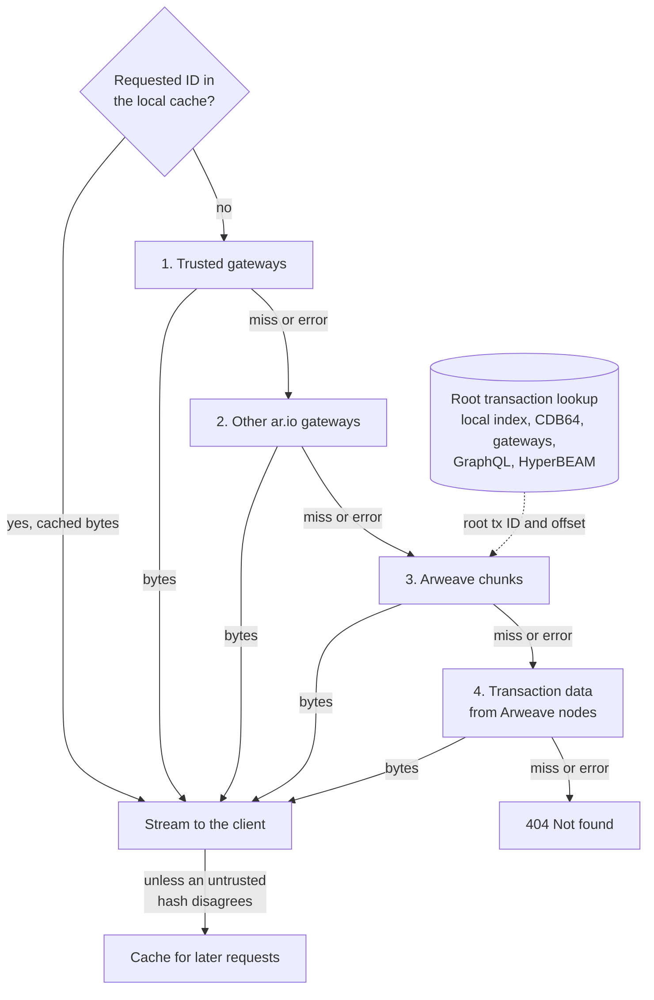

import { Shield, Cpu, Globe, Settings } from 'lucide-react';

ar.io gateways serve Arweave data from their own cache when they can. When they can't, they try other sources in turn and stop at the first one that returns the data.

## How gateways retrieve data

By default a gateway tries trusted gateways first, then other ar.io gateways, then Arweave chunks, then whole transactions from Arweave nodes. Operators can reorder these sources or add others, such as S3, with `ON_DEMAND_RETRIEVAL_ORDER` ([environment variables](/build/run-a-gateway/manage/environment-variables)).

## Data sources

### 1. Trusted gateways
- **What**: gateways the operator chooses to trust, each with a priority. Lower numbers are tried first. By default turbo-gateway.com is first, then arweave.net, which is marked untrusted.
- **Trust**: data from a trusted gateway is cached as trusted. Data from a gateway marked untrusted is handled like data from any untrusted peer.

### 2. ar.io network
- **What**: the other gateways in the [gateway registry](/learn/gateways/gateway-registry). For each ID the gateway asks a few of them, chosen as described in [Peer selection](#peer-selection).
- **Trust**: these peers are not trusted, so their responses are checked (see [Data validation](#data-validation-process)).

### 3. Arweave chunks
- **What**: the gateway rebuilds the data from Arweave chunks, each proven against its transaction's data root, so no middleman has to be trusted.
- **Locating the data**: a data item sits inside a bundle, so the gateway first finds the [root transaction](/glossary#root-transaction) that holds it and the item's offset inside it. Its own database answers for what it has indexed. [CDB64 indexes](/build/run-a-gateway/manage/cdb64), kept current by [Index Sharing](/learn/gateways/index-sharing), answer locally for the rest. Otherwise it asks trusted gateways, GraphQL and HyperBEAM.

### 4. Transaction data
- **What**: the whole transaction, fetched from Arweave nodes. This is the last resort.

## Retrieval strategies

### On-demand retrieval
Used to answer client requests:
1. **One source at a time**: the next source is tried only when the current one fails.
2. **Hedged peer requests**: if an ar.io peer is slow to answer, the gateway also asks the next candidate, after 500 ms by default and up to 3 at once.
3. **Streaming**: bytes stream to the client as they arrive, and are hashed on the way for the cache.

### Background retrieval
Used to fetch bundles for unbundling. By default it uses Arweave chunks only, each proven against its transaction's data root, rather than other gateways.

## Trust and validation

### Peer selection

For each ID, a gateway picks a few candidate ar.io peers (5 by default):

1. **Peer list**: the gateways in the on-chain registry, refreshed periodically. Gateways marked as leaving are skipped.
2. **Home set**: a consistent hash ring maps each ID to the same 3 peers every time, so repeat requests for an ID tend to land where it is already cached.
3. **Weights**: each peer has a weight from 1 to 100, starting at 50. A successful fetch raises it, more so when the peer answered faster or with more throughput than the recent average. A failure lowers it, and a busy answer (429 or 503) lowers it a little. Weights drift back toward 50 over time, so a peer recovers after an outage.
4. **Order**: the home set is tried first, in a random order weighted by each peer's weight, so heavier peers usually go first. The remaining slots are filled by a weighted random draw from the other peers.

### Data validation process
Checks happen at each stage:

1. **Peer responses**: an ar.io peer must say the data is verified or trusted, and its digest must match the hash the gateway already knows, if it knows one.
2. **Chunks**: each chunk is proven against its transaction's data root with its Merkle path.
3. **Caching**: the gateway hashes every response as it streams. Data from a trusted source is cached as trusted. Data from an untrusted source is cached if its hash matches the known one, or, when no hash is known yet, cached as untrusted. A mismatch is not cached.
4. **Background verification**: later, the gateway recomputes the data root of cached data (by default, data requested through ArNS) and marks it verified. See [Data Verification](/learn/gateways/data-verification).

## Why multi-source retrieval matters

- **For operators**: a gateway does not have to store everything. It can fetch from peers, and keep serving when one source is down.
- **For users**: there are several paths to the same data, so a request can succeed when one gateway or node fails.

## Related gateway concepts

<Cards>
  <Card 
    title="Data Verification" 
    description="Learn how gateways ensure data integrity through cryptographic verification"
    href="/learn/gateways/data-verification"
    icon={<Shield className="w-8 h-8" />}
  />
  <Card 
    title="Gateway Architecture" 
    description="Understand the technical architecture and design decisions of ar.io gateways"
    href="/learn/gateways/architecture"
    icon={<Cpu className="w-8 h-8" />}
  />
  <Card 
    title="Access Data" 
    description="Practical guide to retrieving data from Arweave using various methods"
    href="/build/access"
    icon={<Globe className="w-8 h-8" />}
  />
  <Card 
    title="Optimize Your Gateway" 
    description="Configure indexing and filtering to optimize gateway performance"
    href="/build/run-a-gateway/manage/filters"
    icon={<Settings className="w-8 h-8" />}
  />
</Cards>
