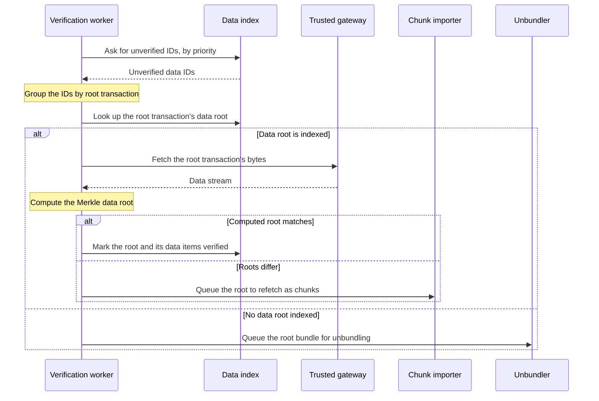

import { Database, Cpu, Server, Cog } from 'lucide-react';

ar.io gateways check that the data they cache matches what was committed to Arweave. This lets you get authentic data without trusting the gateway operator.

Gateway verification is one layer of ar.io's verification. For how it fits with signed responses, checks a client makes itself, and observation, see [Verification and Accountability](/learn/verification).

## How gateways verify data

Arweave commits to each transaction's data through a **data root**: the root of a Merkle tree built over the data's chunks. A gateway recomputes that root from the bytes it holds and compares it with the one in the transaction header.

Verification runs in the background, after the data is cached. A gateway can serve data before it has verified it, and says which state the data is in with the `X-AR-IO-Verified` response header.

What the diagram leaves out:

- **What gets verified**: by default, only data requested through ArNS names. Each scan takes the highest-priority data first.
- **Why whole roots**: data items are grouped by their root transaction, because that is what Arweave commits to. One match verifies every item inside it.
- **Refetching**: after a mismatch, the data is fetched again from Arweave chunks, each proven against the data root.
- **Giving up**: every attempt that does not end verified counts against the data, and the gateway stops trying after 5. Operators can change these defaults with `MIN_DATA_VERIFICATION_PRIORITY` and `MAX_VERIFICATION_RETRIES`.

## Verification types

### Transaction data
For a base-layer Arweave transaction, the gateway recomputes its data root and compares it with the root in the transaction header.

### Bundled data
For [data items](/glossary#ans-104-data-item) inside an ANS-104 bundle, the gateway verifies the root transaction that holds the bundle. A match marks every data item under that root verified.

### Chunks
Each chunk the gateway fetches from Arweave is proven against its transaction's data root with its Merkle path before it is used.

## Why verification matters

- **Proof, not trust**: a data root match proves the bytes are the ones committed to Arweave, whoever served them.
- **Repair**: data whose data root does not match is fetched again from Arweave chunks.
- **Visibility**: the verification state, and when it was reached, is recorded for each ID and reported in the `X-AR-IO-Verified` header.

## Explore gateway systems

<Cards>
  <Card 
    title="Data Retrieval" 
    description="Learn how gateways fetch data from multiple sources with verification"
    href="/learn/gateways/data-retrieval"
    icon={<Database className="w-8 h-8" />}
  />
  <Card 
    title="Gateway Architecture" 
    description="Understand the technical architecture behind verification systems"
    href="/learn/gateways/architecture"
    icon={<Cpu className="w-8 h-8" />}
  />
  <Card 
    title="Run Your Own Gateway" 
    description="Set up a gateway with built-in verification capabilities"
    href="/build/run-a-gateway/quick-start"
    icon={<Server className="w-8 h-8" />}
  />
  <Card 
    title="Gateway Configuration" 
    description="Configure verification settings and optimization options"
    href="/build/run-a-gateway/manage/filters"
    icon={<Cog className="w-8 h-8" />}
  />
</Cards>
