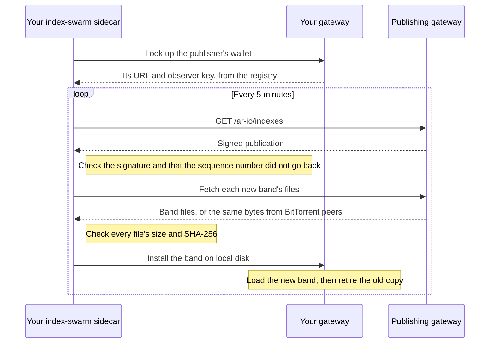
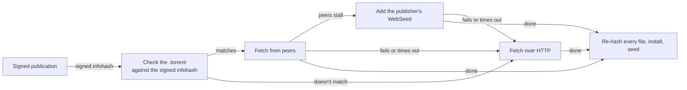

import { Card, Cards } from "fumadocs-ui/components/card";
import { Server, Code, Download, ShieldCheck } from "lucide-react";

Most data on Arweave today is uploaded as **data items**, packed many at a time into bundles. To serve one, a gateway first has to answer a question: *which Arweave transaction holds this item, and where inside it?*

A gateway that can't answer locally has to ask other gateways or search the network, which is slower and can fail.

**Index Sharing** lets gateways share the answer. A gateway that has built a good index publishes it; other gateways download it and answer lookups from local disk. Because every piece is signed and hashed, a gateway can use another gateway's index without trusting that gateway's server.

For an operator, that means no round trip to other gateways or GraphQL to find a data item. The answer can include the item's byte offsets, which lets the gateway fetch and verify just that item. From Release 85 it is on by default: a gateway subscribes to turbo-gateway.com's root transaction index, about 22 GB of disk today, and seeds it to other gateways. An operator can follow other publishers, or opt out with one setting. On Release 84 it is off until a setup script turns it on.

## How it works

### Bands

An index is split into **bands**, each covering a range of block heights: older bands rarely change, while the band at the chain tip is rebuilt as new data arrives. A subscriber downloads only the bands it doesn't have, installs the newest first (most lookups are for recent data), and replaces a band without ever pausing lookups.

There are three kinds of band:

- A **root-TX band** is a [CDB64 index](/build/run-a-gateway/manage/cdb64) that maps a data item to the [root transaction](/glossary#root-transaction) holding it. A gateway loads these and answers lookups from them.
- An **L1 band** holds the Arweave base layer (blocks, transactions, tags and wallets) in Parquet. A gateway can fill its own history from L1 bands instead of indexing the chain block by block. Publishers offer them from Release 85.
- An **L2 band** holds a selection of data items, such as every item an app tags with its name, in Parquet. From Release 88 a gateway can import them, so its GraphQL answers for those items without unbundling them.

A gateway takes L1 and L2 bands only when its operator asks for them. Apps can also query both in place for analytics.

### The publication

A publisher serves one signed **publication** at `/ar-io/indexes`, listing every band and every file in it, with each file's size and SHA-256. It is signed with the gateway's **registered observer key**, the same key it uses for [observation](/learn/oip), so anyone can check who signed it against the [gateway registry](/learn/gateways/gateway-registry).

### What a subscriber checks

Before a single byte is used, a subscriber confirms that:

1. The publication is signed by the key the registry lists for that publisher's wallet
2. It names that same publisher
3. It isn't older than one already seen, so a cache or mirror can't roll it back
4. Every file matches the SHA-256 the signed publication names
5. Every band is a well-formed index

A server in between, whether a mirror, a CDN or a cache, can delay or withhold files, but it can't change them without being caught.

### Files are content-addressed

Each band file can be fetched by its SHA-256 (`/ar-io/indexes/blob/<sha256>`). The address can never change meaning, so those responses are safe for any cache to keep, and the same file can come from any server that has it.

## Bands over BitTorrent

Because every file is checked against the signed publication, it doesn't matter who delivers the bytes. That makes peer-to-peer delivery safe, and gateways that run the torrent engine, which starts by default from Release 85, move bands over **BitTorrent**. Without the engine, everything moves over HTTP as shown above.

### Why BitTorrent

Over HTTP, every subscriber downloads every band from the publisher, so the publisher's upload grows with each gateway that subscribes, and publishers can rate-limit and charge ([x402](/learn/gateways/x402-payments)) for those downloads like any data. Over BitTorrent, subscribers also serve each other. A new band reaches the network once from the publisher and then spreads between peers, so the publisher's cost stays roughly flat as more gateways subscribe, and subscribers download from peers for free. That is what lets a large index be shared across the network without one gateway carrying all of it.

### How a band moves

1. **Peers first.** A publisher offers each band as a torrent and seeds it. A subscriber downloads the band from whichever gateways already hold it. Nobody charges for peer transfers.
2. **The WebSeed, only when peers stall.** If nothing arrives for a while, the subscriber also turns on the publisher's **WebSeed**, an HTTP address that serves the same bytes to a torrent client. It is subject to the publisher's rate limits and payments, so it is used only when peers are not delivering.
3. **HTTP as the fallback.** If the engine is down, errors, or makes no progress for too long, the band is fetched over HTTP instead, in the same poll.
4. **Every subscriber seeds.** Once a band is installed, the subscriber seeds it too, however it arrived. The more gateways subscribe, the less any one publisher has to upload.

Seeding is part of turning the engine on, and it costs the seeder upload bandwidth, so every node bounds it: by default 10 MB/s and 100 GB a day. A gateway that would rather not upload at all subscribes over HTTP only.

### Publishers of the same bytes share one swarm

A band's torrent is built only from its files: their names, sizes and digests. Nothing about the publisher goes in, not even the band's id. So two gateways publishing the same bytes produce the same torrent, with the same **infohash** (the torrent's identifier), and their subscribers all join one swarm.

### What a subscriber trusts

The publication doesn't sign a `.torrent` file (with HTTPSIG, the gateway serving it signs its response), so a subscriber trusts only the infohashes in the signed publication and re-hashes every file against its signed SHA-256, exactly as over HTTP. [Bands as Torrents](/build/advanced/index-publications#bands-as-torrents) shows these checks.

The torrent engine runs isolated from the rest of the gateway: it can't reach the gateway's other services, and it can't change the bands the gateway serves. A publisher also runs a **closed tracker** that helps peers find each other and answers only for the bands it offers. From Release 85, peers reach it through the publisher's own gateway, at `/ar-io/indexes/announce`, so it needs no port of its own. Peers find one another without it too, through the BitTorrent DHT and peer exchange.

## What Index Sharing is not

- **It doesn't replace data verification.** An index says where an item lives; the gateway still [verifies the data itself](/learn/gateways/data-verification) when it serves it.
- **It isn't storage.** Bands are indexes, not the data they point to: about 22 GB for the root-TX index turbo-gateway.com publishes, growing with the chain.
- **It isn't complete.** An index answers only for the bundles its publisher indexed, and the band at the chain tip is rebuilt periodically, so the newest items aren't in it yet. A miss costs nothing: the gateway falls back to its usual lookup.
- **It isn't one provider.** Any registered gateway can publish. The turbo-gateway.com gateway publishes a root transaction index, the L1 base layer and an L2 index of ArDrive's data items today, and subscribers can follow more than one publisher.
- **BitTorrent isn't required.** It is an optional transport. A gateway without the torrent engine publishes and subscribes over HTTP.

## Explore Index Sharing

<Cards>
  <Card
    title="Set Up Index Sharing"
    description="Subscribe your gateway to a publisher, or publish your own indexes, over HTTP or BitTorrent"
    href="/build/run-a-gateway/manage/index-sharing"
    icon={<Server className="w-8 h-8" />}
  />
  <Card
    title="Reading Shared Indexes"
    description="Verify a publication and look up an ID from any client, step by step"
    href="/build/advanced/index-publications"
    icon={<Code className="w-8 h-8" />}
  />
  <Card
    title="Downloading Indexes with BitTorrent"
    description="Take a copy of a band with qBittorrent or aria2 and check it against the signature"
    href="/build/advanced/bittorrent-indexes"
    icon={<Download className="w-8 h-8" />}
  />
  <Card
    title="Data Verification"
    description="How gateways verify the data they serve"
    href="/learn/gateways/data-verification"
    icon={<ShieldCheck className="w-8 h-8" />}
  />
</Cards>
