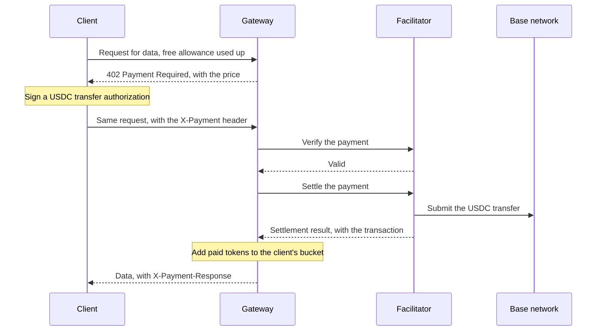

import { CreditCard, Shield, Zap, Globe } from "lucide-react";

ar.io gateways support the x402 payment protocol, so a client can pay for data with a stablecoin when it needs more than the free allowance. Operators recover what serving data costs them, and clients that need more bandwidth can buy it.

## What is x402?

**x402** is an open payment protocol from Coinbase. A server answers a request with HTTP status 402 "Payment Required" and a price; the client pays by repeating the request with a signed payment attached. There are no accounts, API keys or card details.

### Key features

- **No accounts**: a client pays per request, with no sign-up or personal details.
- **Plain HTTP**: payment uses one status code and a few headers.
- **Open**: the protocol works with several blockchains and tokens. ar.io gateways use USDC on Base.

### How x402 works

The client never talks to the facilitator, the service that checks payments and submits them on chain. The gateway settles the payment before it serves the data, and returns the receipt in the `X-Payment-Response` header. If verification or settlement fails, the client gets another 402 instead of the data.

## ar.io gateway integration

ar.io gateways price data per byte served, in **USDC on Base**. Payment is part of the gateway's rate limiter, so a client pays only once it has used its free allowance:

1. **Free tier**: each request spends tokens from the client's rate-limit buckets.
2. **Limit reached**: when the buckets are empty, the gateway answers 402 Payment Required.
3. **Payment**: the client pays in USDC to continue.
4. **Paid tokens**: one payment buys paid tokens worth 10 times the request's cost, by default.
5. **Spending order**: free tokens are spent first, then paid tokens.
6. **Per-resource limits**: paid requests skip per-resource limits. Only the per-IP limit applies.

### Browser paywall and Onramp

On mainnet, a gateway can add Coinbase Onramp to its browser paywall, so a user can buy USDC without leaving the page. Onramp needs Coinbase Developer Platform (CDP) API keys. These are separate from the facilitator's keys and play no part in verifying or settling a payment. On testnet they are optional; on mainnet they are required when you use a Coinbase facilitator.

## Network options

ar.io gateways support two Base networks for x402 payments:

| Feature                 | Base Sepolia (Testnet)            | Base (Mainnet)                    |
| ----------------------- | --------------------------------- | --------------------------------- |
| **USDC**                | Free testnet USDC (faucet)        | Real USDC (costs money)           |
| **CDP API Key**         | Not required                      | Required for official facilitator |
| **Default Facilitator** | https://x402.org/facilitator      | Must configure                    |
| **Use Case**            | Development, testing              | Production monetization           |
| **Configuration**       | `X_402_USDC_NETWORK=base-sepolia` | `X_402_USDC_NETWORK=base`         |

## Rate-limited endpoints

x402 applies to the routes that serve data:

### Data serving endpoints

- **Transactions and data items**: `/:txid` and `/:txid/path`
- **Raw data**: `/raw/:txid`
- **ArNS**: every request resolved through an ArNS name
- **Farcaster frames**: `/local/farcaster/frame/:txid`
- **Chunks**: `GET /chunk/:offset` and `GET /chunk/:offset/data`, at a fixed size price
- **Index Sharing files**: band files by name and by digest, and the WebSeed, under `/ar-io/indexes`. The publication at `/ar-io/indexes` and the `.torrent` files are free
- **GraphQL** (`/graphql`), only when the operator turns on GraphQL metering (Release 88 or later): a flat cost per operation, 10 KiB by default, charged to the client's IP bucket

### Not rate limited

- GraphQL queries (`/graphql`), unless GraphQL metering is on
- Chunk uploads (`POST /chunk`)
- Admin and information endpoints under `/ar-io/*`, except the Index Sharing files above

## Benefits for gateway operators

- **Cost recovery**: charge for data egress, priced per byte, to cover what serving it costs.
- **Paid capacity**: heavy users can pay for more bandwidth instead of being blocked.
- **Abuse control**: the rate limiter still stops abuse, while legitimate heavy users can pay to continue.

## Benefits for users

- **No account**: pay without signing up or logging in.
- **Free tier first**: you pay only after the free allowance runs out.
- **Clear prices**: a per-byte price, with a minimum and maximum per request.
- **Browser or code**: pay through the browser paywall, or from a program.

## Use cases

- **Media and downloads**: charge for large files and high-bandwidth audio and video.
- **Data APIs**: charge for heavy query or archive access.
- **High-volume clients**: let a business pay for capacity beyond the free tier.

## Explore gateway monetization

<Cards>
  <Card
    title="Gateway Architecture"
    description="Understand the technical foundation that enables payment integration"
    href="/learn/gateways/architecture"
    icon={<Shield className="w-8 h-8" />}
  />
  <Card
    title="Data Retrieval"
    description="Learn how gateways serve data that can be monetized"
    href="/learn/gateways/data-retrieval"
    icon={<Globe className="w-8 h-8" />}
  />
  <Card
    title="Run a Gateway"
    description="Deploy your own gateway with payment capabilities"
    href="/build/run-a-gateway"
    icon={<Zap className="w-8 h-8" />}
  />
  <Card
    title="Gateway Registry"
    description="Join the network and participate in the gateway ecosystem"
    href="/learn/gateways/gateway-registry"
    icon={<CreditCard className="w-8 h-8" />}
  />
</Cards>
