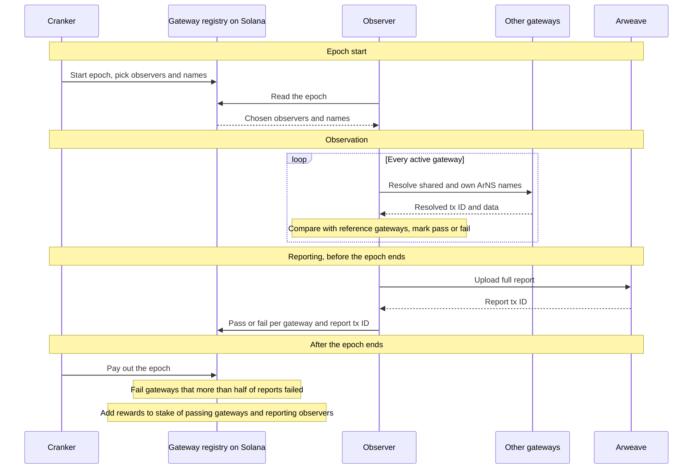

import { Card, Cards } from "fumadocs-ui/components/card";
import { Target, BarChart, FileText, Coins } from "lucide-react";

## Overview

The Observation and Incentive Protocol (OIP) pays gateways for serving data well. Gateways check on each other: each [epoch](/learn/oip/epoch-pipeline) (24 hours on mainnet), up to 50 gateways are chosen as [observers](/glossary#observer) and test every gateway. Gateways that pass earn ARIO. Gateways that fail earn no gateway reward for that epoch, and a gateway that fails 30 epochs in a row can be [pruned](/learn/oip/pruning).

## How an epoch works

No central server runs the protocol or sends notifications. [Crankers](/glossary#cranker), which can be any wallet with SOL, move each epoch forward. Each observer reads the current epoch on Solana to learn whether it was chosen and which names to test.

Observers pay SOL to submit their results, so an observer wallet needs SOL. Every report stays on Arweave, and you can browse current observers and results at [gateways.ar.io](https://gateways.ar.io). ArNS name fees and other protocol fees fund the [protocol balance](/glossary#protocol-balance) that pays the rewards. For the transactions behind each step, see [Epoch pipeline](/learn/oip/epoch-pipeline).

## What observers check

Observers test whether each gateway can:

- Resolve ArNS names to the same transaction ID, cache time (TTL), and content type that reference gateways return
- Return the same data, compared by its hash
- Serve Arweave data by its position on the chain (its offset), with proof that it matches the chain

Observers can change how they test without a change to the protocol.

## Explore the protocol

<Cards>
  <Card
    title="Observer Selection"
    description="Learn how gateways are chosen as observers using weighted criteria"
    href="/learn/oip/observer-selection"
    icon={<Target className="w-8 h-8" />}
  />
  <Card
    title="Performance Evaluation"
    description="Understand how observer results affect gateway standing"
    href="/learn/oip/performance-evaluation"
    icon={<BarChart className="w-8 h-8" />}
  />
  <Card
    title="Reporting System"
    description="Explore observer responsibilities and report submission"
    href="/learn/oip/reporting"
    icon={<FileText className="w-8 h-8" />}
  />
  <Card
    title="Reward Distribution"
    description="Learn how rewards flow to functional gateways and observers"
    href="/learn/oip/reward-distribution"
    icon={<Coins className="w-8 h-8" />}
  />
</Cards>
