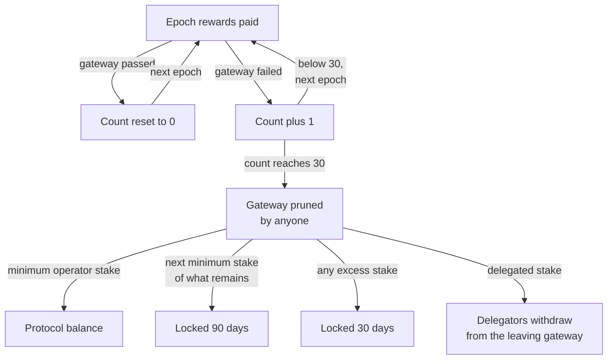

## Overview

Pruning removes a gateway that keeps failing its [observation](/learn/oip) checks. One bad epoch does not get a gateway pruned. Thirty failed epochs in a row do.

## How pruning works

After each epoch, when rewards are paid, the protocol updates every gateway's count of failed epochs in a row. A failed epoch adds one, a passed epoch resets the count to zero, and an epoch with no observations leaves it unchanged. Once a gateway's count reaches the limit (30 on mainnet), anyone can submit a transaction to prune it.

Only a gateway that is still part of the network can be pruned. A pruned gateway is marked as leaving.

## Impact on operators

A pruned operator loses the minimum operator stake, the amount required to join the network, to the [protocol balance](/glossary#protocol-balance). The rest of the operator stake comes back through two locked vaults: up to another minimum stake after the 90-day leave period, and anything above that after the normal 30-day withdrawal period.

## Impact on delegators

Pruning never takes delegated stake. Delegators withdraw from a pruned gateway the same way they would from any gateway that is leaving. A pruned gateway stops earning rewards, so watch the performance of the gateways you delegate to and be ready to withdraw or redelegate.

## Prevention

To lower the risk of pruning, operators can:

- Keep the gateway online and reachable from the internet
- Keep ArNS resolution working
- Watch observation results and gateway health
- Keep SOL in the observer wallet to pay transaction fees
- Check gateway status at [gateways.ar.io](https://gateways.ar.io)

## Related concepts

- [Gateway Registry](/learn/gateways/gateway-registry)
- [Observation and Incentive Protocol](/learn/oip)
- [Staking](/learn/oip/staking)
