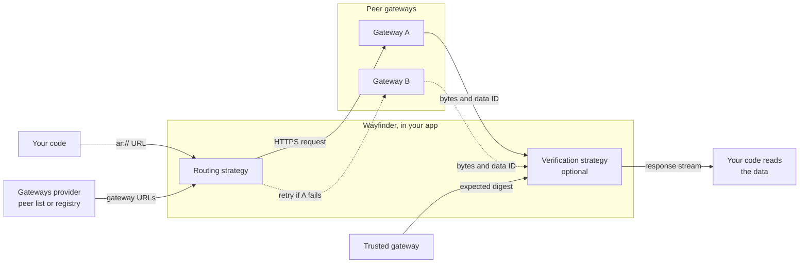

import { Card, Cards } from 'fumadocs-ui/components/card';
import { Code, Lightbulb, Network, Globe } from 'lucide-react';

## The problem with one gateway

An app that writes one gateway host into its URLs depends on that gateway. If it goes down, the app's content is unreachable. It can block or filter content, every request waits on it, and your users have to trust that it serves the right bytes.

## What Wayfinder does

Wayfinder is a client library that lets your app read permanent data through any gateway in the ar.io network. Your app asks for `ar://<transaction-id>` or `ar://<name>` instead of a URL tied to one host, such as `https://<gateway-host>/<transaction-id>`, and Wayfinder decides which gateway serves it:

- **Any gateway:** each request can go to a different ar.io gateway, so no single gateway can take your content offline or block it
- **Retries:** if a gateway returns a server error or does not respond, Wayfinder picks a gateway again and retries, up to three attempts
- **Your choice of routing:** pick a gateway at random, in turn, by the fastest ping, or prefer one and fall back to others
- **Optional verification:** check the data against trusted gateways, whichever gateway served it

## How it works

Wayfinder runs inside your app, not on a server. For each `ar://` request it does three things:

1. A **gateways provider** supplies the list of candidate gateways. By default it asks a trusted gateway (`turbo-gateway.com`) for its peer list at `/ar-io/peers`, falling back to that gateway alone if the list is empty or cannot be fetched. It can instead read the ar.io gateway registry on Solana through the ar.io SDK.
2. A **routing strategy** picks one gateway from that list for this request.
3. An optional **verification strategy** checks the bytes as they stream, for example by comparing their SHA-256 hash with the digest a trusted gateway reports.



### Transaction IDs

To access content by its Arweave transaction ID, append the ID to `ar://`:

```
ar://qI19W6spw-kzOGl4qUMNp2gwFH2EBfDXOFsjkcNyK9A
```

Wayfinder picks a gateway with its routing strategy and requests the transaction ID from that gateway, on a sandbox subdomain derived from the ID.

### ArNS names

To fetch content by an ar.io Name System (ArNS) name, attach the name to `ar://`:

```
ar://good-morning
```

Wayfinder tells transaction IDs and ArNS names apart by their format: a transaction ID is exactly 43 characters. For a name, it requests `https://good-morning.<gateway-host>/` from the chosen gateway, and that gateway resolves the name to a transaction ID.

## Verification

Verification is off unless you turn it on. When it is on, Wayfinder checks the response stream as your app reads it, using one of these strategies:

1. **Hash verification:** Hashes the bytes with SHA-256 and compares the result with the digest that trusted gateways report for the same data
2. **Data root verification:** Rebuilds the transaction's data root from the bytes and compares it with the data root that trusted gateways report
3. **Signature verification:** Checks the signature of the transaction or ANS-104 data item, using metadata from trusted gateways
4. **Remote verification:** Accepts the serving gateway's own claim that it verified the data. It needs no client-side work but trusts that gateway, so it suits testing more than production

For an ArNS request, Wayfinder verifies against the transaction ID the gateway reports in its response headers. In strict mode a failed check errors the stream. Otherwise the data is delivered and a verification failure is reported as an event.

For the trust model behind these strategies, including the difference between gateway claims, signed claims, and cryptographic proofs, see [Verification and Accountability](/learn/verification).

## Explore Wayfinder

<Cards>
  <Card 
    title="Integration Methods" 
    description="Learn how to integrate Wayfinder in browsers and applications"
    href="/learn/wayfinder/integration"
    icon={<Code className="w-8 h-8" />}
  />
  <Card 
    title="Use Cases" 
    description="Discover practical applications and implementation examples"
    href="/learn/wayfinder/use-cases"
    icon={<Lightbulb className="w-8 h-8" />}
  />
  <Card 
    title="Gateway Registry" 
    description="Understand how gateways participate in the decentralized network"
    href="/learn/gateways/gateway-registry"
    icon={<Network className="w-8 h-8" />}
  />
  <Card 
    title="Access Data" 
    description="Start accessing Arweave content through multiple gateways"
    href="/build/access"
    icon={<Globe className="w-8 h-8" />}
  />
</Cards>
