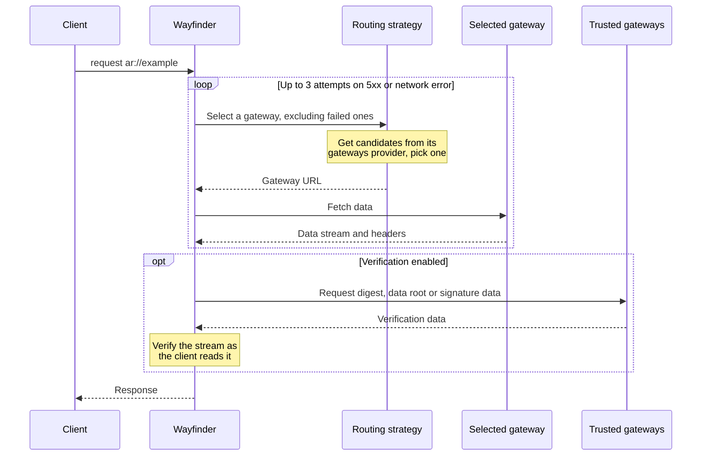

Retries cover only failures before the response is returned. A 4xx response is returned without a retry, except with `ChunkDataRetrievalStrategy`, whose metadata HEAD request throws on any error status, so a 404 there is retried and then thrown. An error while the response stream is being read, such as a failed chunk fetch, is not retried: it errors the stream. With `strict: true` in `verificationSettings`, a failed verification errors the response stream; otherwise the data is delivered and a `verification-failed` event is emitted.